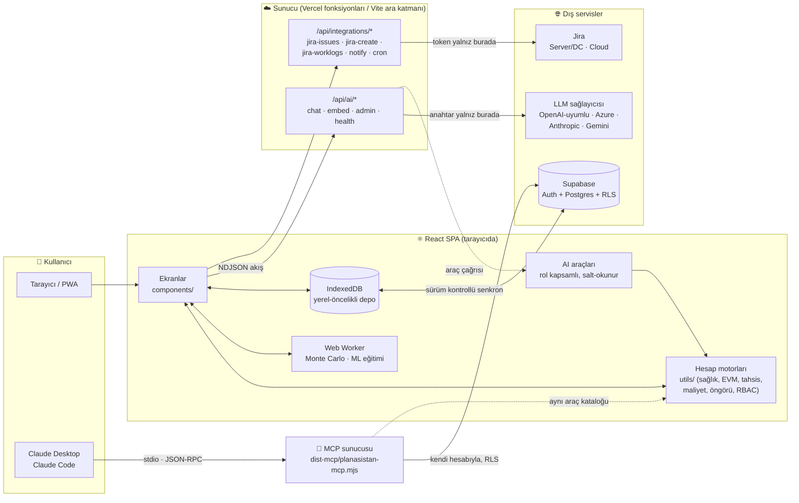
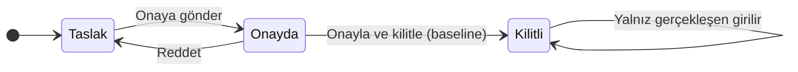
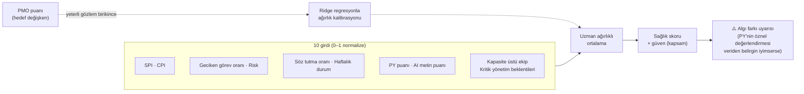
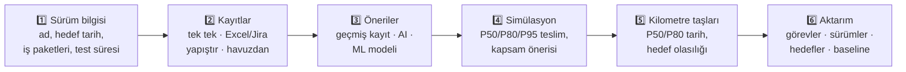
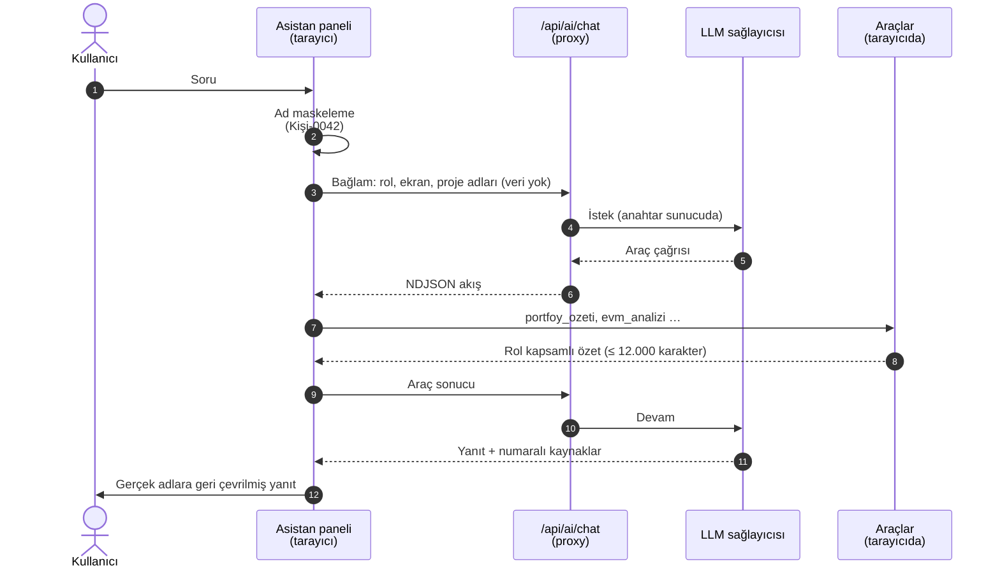
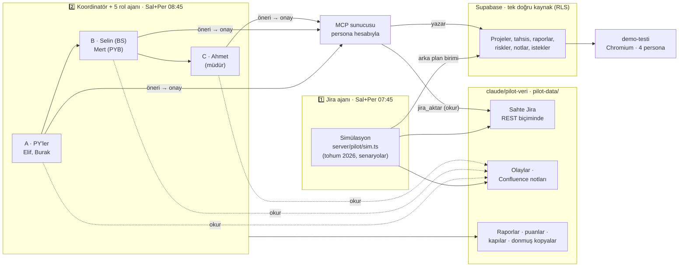
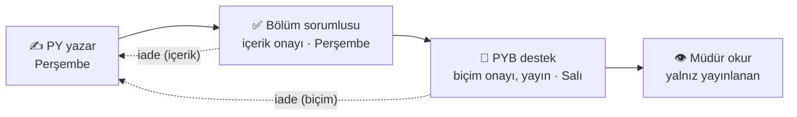
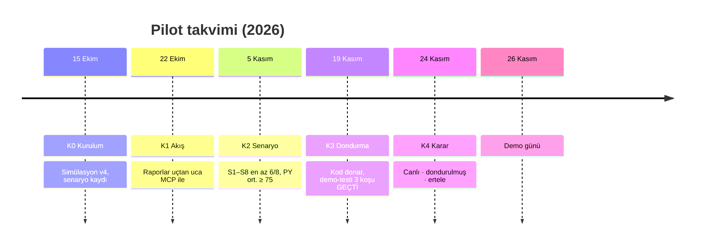

<div align="center">

# 🧭 PlanAsistan

**Akıllı proje, program ve portföy yönetim aracı**

PERT ve Bulanık PERT ile görev planlama · çoklu proje portföyü · adam/ay işgücü tahsisi · Monte Carlo teslim tahmini · rol bazlı yönetim ekranı · kurumsal AI asistanı · Claude (MCP) bağlantısı


</div>

---

## 📑 İçindekiler

1. [Bir bakışta](#-bir-bakışta)
2. [Sistem topolojisi](#️-sistem-topolojisi)
3. [Teknik özellikler](#️-teknik-özellikler)
4. [Özellikler](#-özellikler)
5. [Roller ve yetki](#-roller-ve-yetki)
6. [Test ve pilot: yapay zekâ ajan sistemi](#-test-ve-pilot-yapay-zekâ-ajan-sistemi)
7. [Yerel geliştirme](#️-yerel-geliştirme)
8. [Yayınlama](#-yayınlama)
9. [Belgeler](#-belgeler)
10. [Yol haritası](#️-yol-haritası)

---

## 🔭 Bir bakışta

| Katman | Ne sağlar |
|---|---|
| 📋 **Proje** | Otomatik sprint planlama (topolojik çizelgeleme + kritik zincir), Kanban, Gantt, OKR, haftalık notlar, müşteri istekleri, risk kaydı |
| 🗂️ **Portföy / Program** | Çoklu proje çalışma alanı, veri havuzu (personel, bölüm, rol, ünvan), adam/ay tahsis, onaylı plan kilidi, kapasite-talep, senaryo, öngörü, maliyet |
| 📊 **Üst yönetim** | Yönetim ekranı, 10 girdili proje sağlık modeli, baseline ve plan kayması, EVM, Excel/PowerPoint yönetici paketi |
| 🎯 **Planlama ve tahmin** | Planlama asistanı (yeni kayıt · sürüm sihirbazı · Monte Carlo), tarayıcıda eğitilen ML modeli, geriye dönük testler, altın set ve kalite kapısı |
| 🤖 **Yapay zekâ** | Rol kapsamlı araç kullanan asistan, RAG bilgi tabanı, ad maskeleme, onaylı değişiklik, haftalık rapor asistanı, sağlayıcıdan bağımsız proxy |
| 🔌 **Entegrasyon** | Jira (geçmiş aktarımı, gönderim, worklog, Billed Hours), Excel, Supabase bulut senkronizasyonu, Claude Desktop / Claude Code (MCP) |

---

## 🗺️ Sistem topolojisi



**Temel ilkeler**

- 🧮 **Sayıları model değil uygulama hesaplar.** AI asistanı ve MCP sunucusu, uygulamanın test edilmiş hesap motorlarını araç olarak çağırır.
- 🔐 **Gizli bilgiler yalnız sunucuda.** AI anahtarı ve Jira jetonu tarayıcı paketine girmez; yayında erişim koruması, hız sınırı ve köken denetimi uygulanır.
- 📴 **Yerel-öncelikli.** Veri tarayıcıda (IndexedDB) durur, çevrimdışı çalışır; Supabase isteğe bağlıdır ve sürüm kontrolüyle kimsenin verisini sessizce ezmez.
- 👁️ **Kullanıcı arayüzde göremediğini AI'da da göremez.** Kapsam `utils/ai/scope.ts` ve RLS ile iki katmanda uygulanır; yönetici rollerine notlar hiç gitmez, sicil hiçbir çıktıya girmez.

---

## ⚙️ Teknik özellikler

| Alan | Teknoloji / yaklaşım |
|---|---|
| **Ön yüz** | React 19, TypeScript 5.8, Vite 6, Tailwind CSS 3 (derleme anında), Font Awesome — stil ve kitaplıklar pakete gömülü, CDN'e bağımlı değil |
| **Yerel depo** | IndexedDB (`utils/workspaceStore.ts`), JSON yedeği, PWA + service worker |
| **Bulut** | Supabase: e-posta girişi, çalışma alanı üyeliği, satır düzeyi güvenlik (RLS), sürüm kontrollü senkronizasyon — şema `supabase/schema.sql` |
| **Sunucu** | Çatıdan bağımsız çekirdek (`server/ai`, `server/integrations`); Vercel sunucusuz fonksiyonları (`api/`, 60 sn) ve haftalık cron; yerelde Vite ara katmanı |
| **AI proxy** | OpenAI-uyumlu / Azure OpenAI / Anthropic / Gemini adaptörleri, SSE → NDJSON akış, kurumsal CA zinciri, şifreli ayar deposu, hız sınırı |
| **RAG** | BM25 (Türkçe ek/aksan duyarsız) + isteğe bağlı embedding hibrit arama; PDF, Word, Markdown, metin okuyucular (`utils/rag/`) |
| **Planlama motoru** | Topolojik liste çizelgeleme, kritik zincir, EDD; beta-PERT Monte Carlo (1.000–10.000 koşu, Web Worker, tohumlu ve belirlenimci); Türkiye iş günü ve tatil takvimi |
| **Makine öğrenmesi** | Tarayıcıda: gradyan artırmalı karar ağaçları (efor, kapanma süresi) + çok sınıflı lojistik regresyon (önem, tür); katlamalı sınama ile P10/P50/P90 |
| **Dışa aktarma** | Excel (`xlsx`), PowerPoint (`pptxgenjs`), CSV (`papaparse`), JSONL (ince ayar / altın set) |
| **MCP** | JSON-RPC, taşımadan bağımsız protokol + stdio giriş; tek dosyalık paket (`npm run build:mcp`) |
| **Test** | Vitest — 106 dosyada 886 test (birim, protokol, simülasyon, akış); pilotta Chromium ile uçtan uca demo yolu testi (`playwright-core`) |
| **Derleme çıktıları** | `dist/` (uygulama) · `dist-mcp/` (Claude bağlantısı) · `dist-pilot/` (pilot simülasyonu ve ajan aracı) |

<details>
<summary><b>📁 Dizin yapısı</b></summary>

```
├── App.tsx, index.tsx        # Uygulama kabuğu
├── components/               # Ekranlar (Portföy, Tahsis, Yönetim, Kanban, Gantt, Risk …)
│   └── assistant/            # AI paneli ve sohbet
├── utils/                    # Hesap motorları (sağlık, EVM, maliyet, öngörü, RBAC …)
│   ├── ai/                   # Ajan döngüsü, araçlar, kapsam, maskeleme, rapor AI
│   ├── planning/             # Monte Carlo, sürüm planı, Jira aktarımı, ML modeli
│   └── rag/                  # Bilgi tabanı: BM25, hibrit arama, doküman okuyucular
├── server/
│   ├── ai/                   # AI proxy çekirdeği, sağlayıcılar, yetki, hız sınırı
│   ├── integrations/         # Jira, bildirim
│   ├── mcp/                  # MCP sunucusu (protokol, araç uyarlayıcı, veri kaynakları)
│   └── pilot/                # Pilot simülasyonu, sahte Jira, kontroller, CLI
├── api/                      # Vercel sunucusuz fonksiyonları
├── supabase/                 # Şema, kurulum ve doğrulama
├── pilot/                    # Ajan rutinlerinin talimatları
└── docs/                     # Kurulum ve tasarım belgeleri
```

</details>

---

## ✨ Özellikler

### 📋 Proje yönetimi

| Özellik | Açıklama |
|---|---|
| **Otomatik planlama** | Topolojik liste çizelgeleme + kritik zincir önceliklendirmesi ile görevleri sürüm (sprint) takvimine yerleştirir; termin (EDD) ve kapasite farkındalıklı |
| **Kanban panosu** | Sürüm bazlı, sürükle-bırak; plan uyarıları (aşırı büyük görev, öncül döngüsü) banner ile |
| **Analiz ve zaman çizelgesi** | Proje bitiş tarihi ve kritik yolu hesaplayan Gantt şeması |
| **Diğer** | OKR / Hedefler, Haftalık Notlar, Müşteri İstekleri, Risk kaydı (5×5 matris) |
| **Kayıt yaşam döngüsü** | Açılış, ilk başlama, kapanış ve durum geçişleri otomatik kaydedilir; kapanma süresi Türkiye iş günü takvimiyle ölçülür; kayıt türü (hata / özellik / iyileştirme / görev) |

### 🗂️ Program ve portföy yönetimi

| Özellik | Açıklama |
|---|---|
| **Çoklu proje çalışma alanı** | Proje kartları; durum (Devam Eden / Teklif / Beklemede / Tamamlandı), haftalık RAG (Yolunda / Riskli / Kritik) ve durum notu |
| **Veri havuzu** | Personel (sicil, bölüm, ünvan, kullanılabilir AA, roller), bölümler, rol kataloğu, ünvan sözlüğü |
| **İşgücü tahsisi (adam/ay)** | Kişi × proje × iş paketi × rol × yıl bazında aylık Plan ve Gerçekleşen; Plan / Gerçekleşen / Karşılaştırma modları; kişi-ay bazlı aşırı tahsis uyarıları |
| **Onaylı plan kilidi** | Taslak → Onaya Gönder → Onayla & Kilitle / Reddet; kilitli planda yalnız gerçekleşen girilir |
| **Excel entegrasyonu** | "İşgücü Tahsisi" formatı (Personel, Bölümler, Roller, Ünvanlar, Projeler, İş Paketleri, Plan + Gerçekleşen) tek tıkla; mükerrer kayıt oluşturmaz, günceller |



### 📊 Üst yönetim

- **Yönetim ekranı:** Portföy KPI'ları, RAG dağılımı, aylık Plan vs Gerçekleşen (kapasite çizgisiyle), bölüm bazlı AA, aşırı tahsis listesi, proje durum tablosu.
- **Baseline ve plan kayması:** Plan onaylandığında portföyün anlık görüntüsü otomatik alınır; ayın ilk açılışında aylık baseline kendiliğinden oluşur; yönetim ekranı Δ'yı proje bazında gösterir.
- **Yönetici paketi:** Tek tıkla çok sayfalı Excel (Özet, Projeler, Aylık Plan-Gerçekleşen, Bölüm/Kişi AA, Aşırı Tahsis) ve PowerPoint.

#### 🩺 Proje sağlık modeli



<details>
<summary>Ayrıntılar</summary>

- **Söz tutma oranı:** PY'nin geçen haftanın planını raporda değerlendirmesinden gelir.
- **AI metin puanı:** PYB destek haftayı yayınlarken onaylı rapor metinleri AI ile puanlanır; rapordan birebir alıntıyla gerekçelendirilir, uydurma alıntılar atılır.
- Verisi olmayan girdi skora girmez; kapsam "güven" olarak gösterilir.
- PY haftalık rapora 1–10 puan verir; PMO (PYB sorumlusu / PYB destek) birleşik raporda her projeye kendi puanını verir (PY'lere gösterilmez).
- Her ISO haftası girdiler ve skor kaydedilir; ağırlıklar uzman ağırlıklarına doğru büzülen ridge regresyonla kalibre edilecek.
- Yönetim ve proje genel bakış ekranlarındaki (i) kartı hesaplamayı, girdi dökümünü, toplanan veriyi ve sıradaki adımları gösterir.

</details>

### 🎯 Planlama asistanı ve tahmin

Proje → **Planlama** üç kip sunar:



| Kip | Ne yapar |
|---|---|
| **Sürüm planı (sihirbaz)** | Yukarıdaki 6 adım. Hedef %80 tutmuyorsa "şu kayıtlar çıkarılırsa %X tutuyor" kapsam önerisi. Plan taban çizgisi olarak donar, sonradan "güncel tahmin"le karşılaştırılır. Taslak otomatik kaydedilir. |
| **Yeni kayıt** | Yazdıkça en benzer kapanmış kayıtlar (Türkçe metin benzerliği + tür, birim, öncelik, proje, iş paketi) bulunur; onların **gerçek** kapanma sürelerinden P50–P80 aralığı, efor (iyimser · olası · kötümser), önem ve tür önerisi, güven derecesi. "Hangi sürüme sığar?" her sürüm için olasılık verir. |
| **Plan simülasyonu** | Açık kayıtlar ekip kapasitesiyle 1.000–10.000 kez Monte Carlo ile çizelgelenir (beta-PERT, geçmiş sapma kalibrasyonu, öncüller, kişi katılımı, izinler, tatil takvimi, test süresi). Senaryolar: kapsam, kayıt çıkarma, hedef tarih, test süresi, birim içi serbest dağıtım, ek kişi. Geçmiş kapanış hızıyla ikinci bir yöntem bağımsız sınar. |

<details>
<summary><b>AI önerisi, kör tahmin ve öneri günlüğü</b></summary>

- **AI önerisi:** Benzer kapanmış kayıtlar gerçek efor ve kapanma süreleriyle (kişi adı olmadan, yalnız görülebilen projelerden) AI'ya verilir; tür, önem, efor aralığı, gerekçe ve eksik bilgi soruları döner. Dayanak kayıtlar bağlamla doğrulanır; efor geçmiş aralığın çok dışındaysa ya da önem güçlü çoğunluktan ayrılıyorsa güven düşer.
- **Kör tahmin** (admin ayarı, varsayılan açık): öneriler kullanıcı kendi tahminini girdikten sonra görünür.
- **Öneri günlüğü:** gösterilen öneriler, kör tahmin ve nihai karar saklanır; kayıt kapanınca gerçekleşenle eşlenir. Yönetici konsolu › Tahmin kalitesi › "Kayıt tahmini önerileri" kartında kaynak bazında isabet, AI kabul oranı ve AI–kör tahmin karşılaştırması; CSV indirilebilir.
- Kendi tahmininiz girilirse, birim ve türde geçmişte gerçekleşen ÷ tahmin oranıyla düzeltilmiş hâli de gösterilir. "Kayıtlara gönder" açılıştaki tahmini saklar; kapanınca görev ayrıntısında isabet görünür.

</details>

<details>
<summary><b>Makine öğrenmesi modeli</b> (Yönetici konsolu › Tahmin kalitesi)</summary>

- Eğitime uygun kapanmış kayıtlardan **tarayıcıda** eğitilir; kayıtlar dışarı gönderilmez, kişi adı kullanılmaz.
- Efor ve kapanma süresi: logaritmik ölçekte gradyan artırmalı karar ağaçları; aralık katlamalı sınama kalıntılarından (P10 · P50 · P90). Önem ve tür: çok sınıflı lojistik regresyon.
- Özellikler: tür, birim, proje, önem, iş paketi, ekibin ilk tahmini, etiket sayısı, metin uzunluğu, sık sözcükler. Ekip tahmini olan ve olmayan taslak için iki ayrı model.
- **Eğit ve sına:** son kapanan kayıtlar (en çok 150) sınama kümesi; model yalnız onlardan önce kapanmış kayıtlarla eğitilir.
- **Geçme ölçütü:** geçmiş kayıt tahmininden en az %3 daha isabetli ve aralığı gerçeğin en az %65'ini kapsıyor.
- Planlamada model önerisi: otomatik (yalnız geçtiğinde) / her zaman / kapalı. Efora etki eden etkenler gösterilir (ör. "Tür: Yeni özellik +%40").
- En az 60 eğitime uygun kapanmış kayıt gerekir (sınama için 80).

</details>

<details>
<summary><b>Tahmin kalitesi ve ince ayar kararı</b></summary>

- **Benzer kayıt tahmini — geriye dönük test:** son 100/200/500 kapanmış kayıt yalnız kendisinden önce kapanmış kayıtlarla tahmin edilir (zaman ayrımlı, sızıntı yok); P50/P80/P90 kalibrasyonu, efor hatası, aralık kapsaması, birim × tür kırılımı.
- **Sürüm simülasyonu — geriye dönük test:** tamamlanmış her sürüm, başladığı gün bilinenlerle yeniden simüle edilir; gerçek bitişin P50/P80'e yetişme oranı.
- **Kalibrasyon:** birim × tür bazında gerçekleşen ÷ tahmin oranı ve son 90 gündeki kayma.
- **Altın set ve kalite kapısı:** PY/PMO onaylı kayıtlarda AI önerisi önemi ve türü söylenmeden çalıştırılır. Eşikler: efor hatası geçmiş tahmine göre en çok ×1,1 · önem isabeti ≥ %60 · aralık kapsaması ≥ %60 (en az 10 yanıt). İstem ya da model değişince sonuç "eski" sayılır. Kapı zorunluysa ve geçilmediyse AI tahmin önerisi kapanır.
- **İnce ayar kararı:** veri yetersiz / gerekmiyor / düşünülebilir / önerilir. "Veri kümesini hazırla" sohbet biçiminde JSONL eğitim ve doğrulama dosyaları ve veri kartı üretir (zaman ayrımlı bağlam, altın set dışarıda, son %15 doğrulama, kişi adları maskeli). Ayrıntı: [docs/INCE_AYAR_KARARI.md](docs/INCE_AYAR_KARARI.md).
- **Kayıt verisi paneli:** kapanmış kayıtları tutarlılık testlerinden geçirir (eksik/tutarsız tarih, toplu kapatma, aykırı süre) ve temiz veri kümesini kişi adları olmadan CSV verir.

</details>

### 🤖 Kurumsal AI asistanı



| Yetenek | Açıklama |
|---|---|
| **Her ekrandan erişim** | Sağ alt düğme, ⌘K › "AI'ya sor", Zekâ sekmesinde tam ekran |
| **Araçlar** | Portföy sağlığı, proje detayı, görev/risk arama, kişi profili, uygun kişi, doluluk, departman karnesi, kapasite-talep, tahsis, öngörü, EVM, maliyet, veri sağlığı, son değişiklikler, notlar, durum raporu |
| **Bilgi tabanı (RAG)** | Notlar, görev/risk açıklamaları, istekler, PESTEL/SWOT, kullanım kılavuzu ve Bilgi Bankası dokümanları; artımlı dizinleme, numaralı kaynak, doğruluk değerlendirme seti |
| **Onaylı değişiklik** | "Şu riski ekle", "görevi tamamlandı yap" → öneri kartı → onay → yetki ve plan kilidi yeniden doğrulanır → denetim günlüğü → geri alınabilir |
| **Ekran içi AI** | Durum raporundan e-posta, yönetici brifingi, risk önerisi, PESTEL/SWOT taslağı, PERT süre tahmini |
| **Haftalık rapor asistanı** | Notlar, worklog, görüşmeler ve kapanan işlerden kılavuza uygun taslak; dayanak denetimi (girdide olmayan rakam/tarih/ad vurgulanır); kurum, bölüm, proje ve kişi bazında ölçülebilir öğrenme — [docs/RAPOR_AI.md](docs/RAPOR_AI.md) |
| **Güvenlik** | Anahtar yalnız sunucuda; erişim kodu ya da Supabase üyeliği; hız sınırı; köken denetimi; yanıtlar HTML yorumlanmadan gösterilir |

> **⚡ En kısa kurulum (test):** Google AI Studio'dan alınan bir Gemini API anahtarı yeterlidir. Yönetici konsolundaki "Bu tarayıcıda AI bağlantısı" kutusuyla yalnız kendi tarayıcınızda (24 saat), "Hızlı kurulum: Google Gemini API" ile herkes için ya da sunucuya yalnız `GEMINI_API_KEY` tanımlayarak. Ayrıntı: [docs/AI_KURULUM.md](docs/AI_KURULUM.md).

### 🔌 Entegrasyonlar

| Entegrasyon | Açıklama |
|---|---|
| **Jira'dan geçmiş** | Kapanmış (istenirse açık) kayıtlar sayfa sayfa: başlık, açıklama, tür, önem, bileşen, etiket, sürüm, tahmin, harcanan süre, story point, sorumlu, engelleyen kayıt ve **durum geçmişi**. Önizleme, Jira anahtarıyla birleştirme, uygulamadaki planlama verisi korunur. Jira Server/DC ve Cloud. |
| **Jira'ya gönder** | Anahtarı olmayan açık kayıtlar Jira'da açılır; tür/önem/bileşen eşlenir, anahtar göreve yazılır. Yalnız `JIRA_ALLOW_CREATE=1` ile. |
| **Jira Billed Hours** | "Toplam Billed Hours" pivotu → Saat → Gün → Adam-Ay (TR çalışma günü takvimi) → gerçekleşen tahsis; eşleşmeyen proje ve kişiler tek tıkla havuza eklenir. |
| **Claude (MCP)** | Claude Desktop / Claude Code'dan doğal dille sorgu; uygulamadaki araçların ve kapsam kurallarının aynısı; isteğe bağlı onaylı yazma (`PLANASISTAN_MCP_WRITE=1`). [docs/MCP_KURULUM.md](docs/MCP_KURULUM.md) |
| **Supabase** | E-posta girişli çok kullanıcılı çalışma; notlar ve müşteri istekleri ayrı tabloda, yönetici rolleri RLS gereği okuyamaz. Kurulum ~10 dk: [supabase/KURULUM.md](supabase/KURULUM.md) |

Jira adresi ve jetonu yalnız sunucu ortam değişkenlerindedir; tüm aktarımlar denetim günlüğüne yazılır.

### 🧰 Yönetici konsolu ve genel

<details>
<summary><b>Yönetici konsolu (Admin) bölümleri</b></summary>

Admin yalnız konsolu kullanır (proje yönetimi ekranları açılmaz). Her değişiklik denetim günlüğüne yazılır ve bulutla paylaşılır.

| Bölüm | İçerik |
|---|---|
| **Yetkiler** | Rol × özellik matrisi: yönetim ekranı, tüm portföy, proje oluşturma, veri havuzu, plan onayı, beklenti yanıtı, görüşme onayı, rapor denetimi/yayını, PMO puanı, uygulama araçları |
| **Görünüm ve filtreler** | Rol bazında proje sekmeleri, yönetim kartları, süzgeçler; "Tam görünüm", "Yönetici özeti", "Yalnız kritikler" hazır ayarları |
| **Haftalık rapor akışı** | Bölüm onayı ve format denetimi adımları, PY puanı zorunluluğu, AI metin puanı, son gün |
| **Sağlık puanı** | Girdi ağırlıkları (0 = kapalı), bant eşikleri, portföye etkisi önizlemeli |
| **Yapay zekâ** | Kurum geneli aç/kapa; sohbet, ekran içi AI, değişiklik önerileri ayrı ayrı; halüsinasyon güvenceleri (birebir alıntı doğrulama, 1/3/5 bağımsız değerlendirmenin medyanı, kural tabanlı çapraz kontrol, sinyal–puan çelişkisi); kör tahmin |
| **Tahmin kalitesi** | Geriye dönük testler, kalibrasyon, altın set, kalite kapısı, ML modeli, ince ayar kararı |
| **Profiller · Denetim günlüğü · Uygulama** | Yedek, veri sağlığı, bulut |

Süzgeçler yalnız gösterimi daraltır; skorlar tüm veriden hesaplanır. Not gizliliği kilitlidir.

</details>

- **Sayfa rehberleri:** Planlama, Tahmin kalitesi ve Haftalık rapor ilk açılışta adım adım, kaydırmalı rehber açar (← → tuşları, dokunmatik); başlıktaki "?" yeniden açar.
- **Profil değiştir:** Kenar çubuğundaki profil düğmesi; role göre gruplu, aranabilir liste.
- **Yapılacaklar paneli:** Role göre onay bekleyen plan, girilmemiş gerçekleşen, geciken görev, kritik RAG, aşırı tahsis.
- **PWA:** Uygulama olarak yüklenir, çevrimdışı çalışır; JSON yedeği alınır (eski tek proje yedekleri de içe aktarılır).

---

## 👥 Roller ve yetki

| Rol | Odak | Girdi yapar mı? | Notları görür mü? |
|---|---|:---:|:---:|
| **Proje Yöneticisi (PY)** | Proje, görev, risk, RAG, haftalık rapor | ✅ | ✅ |
| **Bölüm Sorumlusu** | Doluluk, aşırı tahsis, rapor içerik onayı | ✅ | ✅ |
| **PYB Destek** | Veri havuzu, rapor biçim onayı ve yayını, PMO puanı | ✅ (havuz) | ✅ |
| **PYB Sorumlusu** | Portföy, PMO puanı | ❌ | ❌ |
| **Müdür** | Portföy, EVM, kapasite-talep, yayınlanmış raporlar | ❌ | ❌ |
| **Admin** | Yalnız yönetici konsolu | — | — |

Yönetici rolleri PM'e özel ekranları (Günlük, İstekler) göremez. Matris yönetici konsolundan değiştirilebilir; not gizliliği ve sahiplik kuralları yetkiyle değişmez.

---

## 🧪 Test ve pilot: yapay zekâ ajan sistemi

Uygulamayı gerçek veri olmadan, **"kullanılıyormuş gibi"** sınamak için iki rutinden oluşan bir ajan sistemi kurduk. Pilot **15 Ekim – 26 Kasım 2026** arasında Salı ve Perşembe sabahları koşar ve **yönetim demosu bu ortamın kendisidir**: sunumda gösterilen çalışma alanı, beş ajanın altı hafta boyunca üzerinde çalıştığı alandır.



### İki rutin

| Rutin | Ne yapar |
|---|---|
| **1. Jira ajanı** | Son koşudan bu yana geçen günleri üretir: yeni kayıt, işe başlama, worklog, kapanış, yeniden açılma — gerçek Jira REST API'siyle aynı biçimde. Confluence tarzı toplantı/karar notları, arka plandaki birim (KALKAN'ın PY'si, ay başı gerçekleşen), müşteri istekleri ve yönetim beklentileri. Talimat: [pilot/RUTIN_1_VERI.md](pilot/RUTIN_1_VERI.md) |
| **2. Rol ajanları** | Otomatik kontroller; ardından 5 rol ajanı uygulamayı MCP üzerinden kendi rolleriyle **üç aşamada** kullanır. Koordinatör her ajana ön puan önerir; kullanıcının onayladığı puan sonraki koşuda ajanlara döner. Talimat: [pilot/RUTIN_2_KULLANICILAR.md](pilot/RUTIN_2_KULLANICILAR.md) |

### Ajanlar ve kurgusal birim

5 bölüm (U300 PYB, U310 Yazılım, U320 Test, U330 Sistem, U340 Veri ve YZ), 24 kişi, 5 proje. Gerçek kişi, kurum ya da proje adı kullanılmaz.

| Ajan | Rol | Uygulamada ne yapar |
|---|---|---|
| 👩‍💼 **Elif Yılmaz** | Proje Yöneticisi (ATLAS) | Jira aktarımı, görev, risk, RAG, istek, not, haftalık rapor; kilitli plan |
| 👨‍💼 **Burak Demir** | Proje Yöneticisi (PUSULA, NEHİR) | İki projenin aynı işleri, hata yükü, kaynak talebi |
| 👩‍🔧 **Selin Kaya** | Bölüm Sorumlusu (U310) | Doluluk, aşırı tahsis, kaynak talebi yanıtı, rapor onayı / iadesi |
| 🧑‍💻 **Mert Aydın** | PYB Destek | Veri tutarlılığı, maliyet ↔ tahsis, rapor biçim onayı ve yayın |
| 🧑‍⚖️ **Ahmet Şahin** | Müdür | Portföy, EVM, kapasite-talep kararı; notları ve istekleri **göremez** |

| Proje | Jira | Durum | Bilerek konmuş zorluk |
|---|---|---|---|
| ATLAS Karar Destek Sistemi | ATL | Devam, plan kilitli | Kapasite üstü iki kişi (KALKAN ile paylaşılan) |
| PUSULA Saha Mobil Uygulaması | PSL | Devam, plan onayda | Sınırda; PY raporu bazen geç gönderir |
| NEHİR Veri Platformu | NHR | Devam | Kapasitenin %30 üstünde iş gelişi, hata yükü, bütçe aşımı eğilimi |
| KALKAN Siber İzleme | KLK | Devam | Küçük ekip (arka plan) |
| YILDIZ Test Otomasyonu | — | Teklif | Jira akışı yok; Kasım'dan plan (arka plan) |

Veri kalitesi denetimi için bilerek bırakılmış kusurlar da vardır (ünvansız kişi, fazla tahsisli yarı zamanlı çalışan, havuz dışı danışman, tahminsiz kayıtlar); hangisini hangi ajanın bulduğu izlenir.

### Haftalık rapor akışı



### Güvenceler

- 🔐 **Gerçek yetki:** Her ajan MCP sunucusuna kendi Supabase hesabıyla bağlanır; rolü üyelikten gelir, RLS gerçekte olduğu gibi uygulanır. `pilot kontrol` müdürün notları okuyamadığını, PY'nin okuyabildiğini sınar.
- ✋ **Öneri → onay:** Ajanlar uygulamaya yalnız MCP araçlarıyla, gerçek kullanıcının onay adımından geçerek yazar. Tetikleyicisi olmayan değişiklik yapılmaz; "bugün değişiklik gerekmedi" geçerli bir sonuçtur.
- 🖥️ **Demo yolu testi:** `pilot demo-testi` ekranları Chromium'da müdür, PY, bölüm sorumlusu ve PYB destek gözüyle klasik ve modern arayüzde gezer (28 adım); ekrandaki sağlık puanını MCP'deki değerle karşılaştırır.
- 💾 **Geri dönülebilirlik:** `pilot dondur` her kapı gününde çalışma alanı, simülasyon durumu ve sahte Jira'nın kopyasını alır; `pilot geri-yukle` aynı çalışma alanını yerinde eski hâline getirir.

### Takvim ve kapılar



**Demo kararı** DH1–DH7 ölçütleriyle verilir: kontroller, açık bulgular, veri tutarlılığı, PY puan ortalaması (son 4 koşuda ≥ 80), senaryolar, müdürün demo yoklaması ve demo yolu testi.

| Belge | İçerik |
|---|---|
| [pilot/README.md](pilot/README.md) | Kurulum, bulut modu, sahte Jira, komutlar, `pilot-data/` yapısı |
| [pilot/SENARYOLAR.md](pilot/SENARYOLAR.md) | Senaryo takvimi, kapılar (K0–K4), demo günü protokolü |
| [docs/pilot/PILOT_NOTU.md](docs/pilot/PILOT_NOTU.md) | Rutinlerden beklentiler, iş döngüleri, puanlama |
| [docs/pilot/SISTEM_TASARIMI.md](docs/pilot/SISTEM_TASARIMI.md) | Mimari, veri ve yetki, tasarım kararları |
| [docs/pilot/DANISMAN_RAPORU.md](docs/pilot/DANISMAN_RAPORU.md) | Danışman değerlendirmesi ve güncellemeleri |
| [docs/pilot/BACKLOG.md](docs/pilot/BACKLOG.md) | Açık ve yapılmış geliştirmeler (BL-xx) |

---

## 🛠️ Yerel geliştirme

Node.js 20 ya da üstü gerekir.

```bash
npm install
npm run dev          # http://localhost:3000
npm run test         # birim testleri (vitest)
npm run build        # üretim derlemesi → dist/
npm run build:mcp    # Claude için MCP sunucusu → dist-mcp/planasistan-mcp.mjs
npm run build:pilot && npm run -s pilot -- baslat   # pilot verisi ve ajan aracı
```

AI asistanını yerelde denemek için `.env.example` dosyasını `.env.local` olarak kopyalayın:

| Değişken | Amaç |
|---|---|
| `GEMINI_API_KEY` | En kısa yol: tek başına yeterli, modeller otomatik seçilir |
| `AI_PROVIDER`, `AI_API_KEY`, `AI_MODEL`, `AI_BASE_URL` | `openai` · `azure` · `anthropic` · `gemini` |
| `AI_ACCESS_TOKEN` ya da `SUPABASE_URL` + `SUPABASE_ANON_KEY` | Yayında erişim koruması (biri zorunlu) |
| `AI_EMBEDDING_*` | İsteğe bağlı anlamsal arama |
| `JIRA_BASE_URL` + `JIRA_TOKEN` (ya da `JIRA_EMAIL` + `JIRA_API_TOKEN`) | Jira entegrasyonu; `JIRA_ALLOWED_PROJECTS`, `JIRA_STORY_POINTS_FIELD`, `JIRA_ALLOW_CREATE` isteğe bağlı |

Tam liste: [`.env.example`](.env.example) · [docs/AI_KURULUM.md](docs/AI_KURULUM.md)

---

## 🚀 Yayınlama

| Hedef | Nasıl |
|---|---|
| **Vercel** (önerilen) | Depoyu bağlamak yeterli; `vite build` otomatik çalışır, `api/ai/*` ve `api/integrations/*` sunucusuz fonksiyon olarak yayınlanır. Ortam değişkenleri Vercel proje ayarlarından girilir. |
| **GitHub Pages** | `npm run build` sonrası `dist/` yayınlanır. AI proxy'si statik barındırmada çalışmaz; ayrı bir proxy + `VITE_AI_PROXY_URL` gerekir. |

---

## 📚 Belgeler

| Belge | Konu |
|---|---|
| [docs/AI_KURULUM.md](docs/AI_KURULUM.md) | Kurumsal AI asistanı kurulumu, araçlar, kapsam kuralları |
| [docs/MCP_KURULUM.md](docs/MCP_KURULUM.md) | Claude Desktop / Claude Code bağlantısı |
| [docs/RAPOR_AI.md](docs/RAPOR_AI.md) | Haftalık rapor AI asistanı |
| [docs/RAPOR_AI_PLANI.md](docs/RAPOR_AI_PLANI.md) | Rapor AI geliştirme planı |
| [docs/INCE_AYAR_KARARI.md](docs/INCE_AYAR_KARARI.md) | İnce ayar karar kaydı ve uygulama adımları |
| [docs/AJAN_GOREVI_HAFTALIK_RAPOR_AI.md](docs/AJAN_GOREVI_HAFTALIK_RAPOR_AI.md) | Haftalık rapor AI ajan görevi |
| [supabase/KURULUM.md](supabase/KURULUM.md) | Bulut senkronizasyonu kurulumu |
| [docs/pilot/](docs/pilot/README.md) | Pilot belgeleri (ana kopya) |

---

## 🗺️ Yol haritası

<details>
<summary><b>✅ Tamamlananlar</b></summary>

- Sprint planlayıcı yeniden yazımı (topolojik çizelgeleme, döngü güvenliği, termin/kritik zincir farkındalığı)
- Çoklu proje çalışma alanı + portföy ekranı · İki katmanlı navigasyon
- Veri havuzu + U310 Excel içe aktarma
- İşgücü tahsisi (Plan / Gerçekleşen / Karşılaştırma, aşırı tahsis uyarıları) · Onaylı plan kilidi
- Üst yönetim ekranı + rol bazlı yetkilendirme · Yönetici paketi (Excel + PowerPoint)
- Baseline & plan kayması · Aylık otomatik baseline
- Supabase bulut senkronizasyonu (RLS ile not gizliliği)
- **Rol bazlı kapasite-talep analizi:** bölüm × rol bazında Planlı-Proje / Kaynak-İşgücü / İhtiyaç-Teklif / Personel Açığı; işe alım ihtiyacı göstergesi
- **Maliyet katmanı:** tahsis × ünvan aylık maliyeti → proje/bölüm ₺ plan-gerçekleşen
- **Görev → Tahsis köprüsü:** sprint planındaki görev eforlarını aylık AA önerisine çevirir
- **Yapılacaklar paneli** · **Kişi sayfası** (tüm projelerdeki aylık doluluk, kapasite aşımı, çapraz görevler)
- **Risk kaydı:** 5×5 olasılık × etki matrisi; portföy geneli en kritik riskler
- **Haftalık durum raporu üretici:** AI'sız taslak, isteğe bağlı Zekâ ile parlatma
- **Senaryo / what-if planlama:** teklifleri "kazanılmış" say + varsayımsal işe alım; hiçbir şey kaydedilmez
- **Jira Billed Hours → Gerçekleşen:** eşleşmeyen proje ve kişiler havuza otomatik eklenir
- **İş yükü öngörüsü:** Hareketli Ortalama / Doğrusal Trend / Son Ay / Plana Göre → yıl sonu EAC ve tahmini maliyet
- Planlama asistanı, Monte Carlo simülasyonu, ML modeli, tahmin kalitesi ve ince ayar kararı
- Kurumsal AI asistanı, RAG, haftalık rapor AI'sı ve Claude (MCP) bağlantısı
- Pilot ajan sistemi (sahte Jira, 5 rol ajanı, demo yolu testi, dondur / geri yükle)

</details>

**Backlog (Supabase kurulumu tamamlanınca):**

1. **Supabase Realtime:** Ekip üyelerinin değişikliklerini sayfa yenilemeden anlık görme; hücre bazlı canlı eşzamanlılık.
2. **Normalize veritabanı şeması:** Tahsis/görev verilerinin ayrı tablolara açılması → alan bazlı yazma RBAC'ının sunucuda zorlanması ve çakışmasız eşzamanlı düzenleme.
3. Supabase kurulum doğrulaması (`supabase/dogrula.mjs`).

Pilot sürecindeki geliştirmeler: [docs/pilot/BACKLOG.md](docs/pilot/BACKLOG.md)

---

<div align="center">
<sub>Sürüm 2.x · React 19 + Vite + TypeScript</sub>
</div>
