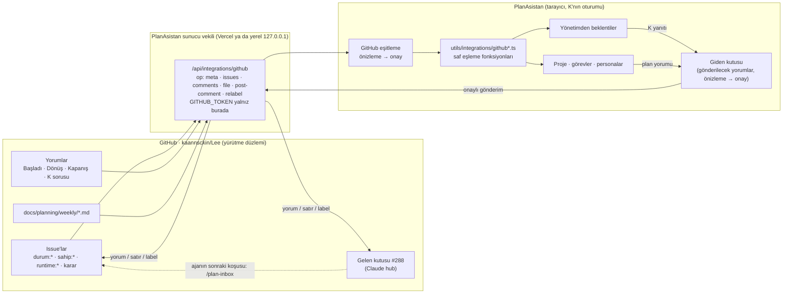

# Ajan görevi: AI ajan projelerini PlanAsistan'dan yönetmek

> **Kullanım:** Bu dosyanın tamamını Codex'e ilk mesaj olarak verin ya da "`docs/AJAN_GOREVI_AI_PROJE_YONETIMI.md` dosyasındaki görevi planla ve uygula" deyin.
> Hazırlayan: Claude (sistem mühendisi rolü), 26 Kasım 2026. Kod gerçekleri bu tarihteki `main` (v3.7.0) ve `kaannsckin/Lee@a17869e` üzerinden doğrulandı; kod değişmiş olabilir, sembol adıyla arayın.
> **Uygulayıcı:** Codex. **Son kontrol ve kabul:** Claude (§14). **Karar sahibi:** K (Murat Bey, ürün sahibi ve "yönetim").

---

## 0. Rolün ve çalışma biçimin

Sen bu depoda çalışan kıdemli bir full-stack (TypeScript / React / Node) mühendisisin. Görevin, K'nın AI ajanlarla yürüttüğü yazılım projelerini (ilk örnek: `kaannsckin/Lee`) PlanAsistan'da **bir yönetici gibi izleyip yönetebileceği** bir köprü kurmak:

- Ajanların GitHub'da yürüttüğü iş, PlanAsistan'da proje, görev, ajan personası ve haftalık plan olarak görünür.
- K'nın PlanAsistan'da verdiği kararlar ve yorumlar GitHub'a, ajanların zaten okuduğu yerlere düşer.
- Bunların hiçbiri LLM çağırmaz. Köprü sıfır token harcar.

Çalışma sırası:

1. **Aşama 0: Keşif ve plan** (§9 F0). Kodu oku, `docs/AJAN_YONETIMI_PLANI.md` plan ve durum dosyasını yaz, commit'le.
2. **Fazlar F1–F9** (§9). Sırayla uygula. Her faz ayrı commit; her commit'ten önce `npx vitest run` ve `npx tsc --noEmit` yeşil olmalı.
3. Her fazın sonunda plan dosyasındaki durum tablosunu güncelle.
4. Bitince PR aç (§13). Claude son kontrolü yapar (§14), K merge eder.

Belirsizlikte makul varsayılanı seç; varsayımı plan dosyasına ve commit mesajına yaz, ilerle. **Yalnız şu durumlarda dur ve sor:**

- Yeni bir npm bağımlılığı şartsa. Varsayılan: GitHub REST çağrıları `fetch` ile yapılır, Octokit eklenmez.
- Bir GitHub deposuna **gerçek** yazma (yorum, label) denemesi gerekiyorsa. Testler sahte `fetch` ile yapılır; canlı yazma yalnız K'nın verdiği test deposunda ve K'nın onayıyla denenir.
- Mevcut bir davranışın (özellikle Jira eşitlemesi) kullanıcıya görünür biçimde değişmesi gerekiyorsa.
- Supabase şemasında (`supabase/schema.sql`) değişiklik gerekiyorsa. Bu görev şema değişikliği **gerektirmeyecek** biçimde tasarlandı (§7).

---

## 1. Yönetici özeti

**İstek (K):** "Codex, Claude ve Copilot ile oluşturduğum ajanların yürüttüğü AI projelerimi, iş hayatımda projeleri yönettiğim gibi PlanAsistan'dan yönetmek istiyorum. Ajanlar uygulamayı, pilottaki personalar gibi kendi profilleriyle kullanan çalışanlar gibi olsun. Ben yönetim olarak raporları okuyayım, beklentilerini yanıtlayayım, planlama ajanının planına yorum yapayım. Bunu yaparken token maliyetini ve benim insan kontrolümü (human in the loop) koruyalım. Ajan yönetim verisi, uygulamayı paylaştığım başka kişilere görünmesin."

**Karar (bu konuşmada varılan):**

- **GitHub, ajanların çalıştığı yer (yürütme düzlemi) olarak kalır.** Lee'deki issue-first düzen, 20 `/plan-*` skill'i, CI kapıları ve Copilot ataması GitHub'a bağlıdır. Lee daha önce Linear'dan GitHub'a bilerek geçti (K-2026-09-24-01). Canlı işi PlanAsistan'a taşımak bu göçü tekrarlatır; yapılmaz.
- **PlanAsistan, K'nın yönetim düzlemi olur.** Proje, görev, persona, beklenti, plan yorumu, haftalık plan ve ajan koşu özeti burada görünür.
- **İkisi arasında deterministik bir köprü (gateway) kurulur.**
  - İçe alım: GitHub → PlanAsistan, Jira eşitleme hattının yeniden kullanımıyla.
  - Geri kanal: PlanAsistan → GitHub. Yalnız issue yorumu, Lee'nin gelen kutusu biçiminde bir satır ve tek bir dar label geçişi.
- **Lee'de değişiklik neredeyse yok.** Yalnız `plan-inbox` skill'ine "K kararı / yorumu" madde türü eklenir. Bu, Claude'un Lee'de ayrı bir PR'ıdır; **bu görevin kapsamı dışındadır.**
- **Gizlilik:** Ajan yönetim verisi kurumun paylaşılan Supabase projesine **konmaz**. Önce yerel kip, gerekince K'ya ait ayrı bir Supabase projesi kullanılır. Tüm çalışma alanını şifrelemek önerilmez; gerekçe §6'da.

**Bu görevde yapılmayanlar (sonraki işler):** uzak MCP (HTTP + OAuth, pilot BL-16), ajanların PlanAsistan'a MCP ile yazması, GitHub webhook'ları, uçtan uca şifreleme, PR merge'ünün PlanAsistan'dan yapılması.

---

## 2. Bağlam

### 2.1 PlanAsistan

- **Teknoloji:**
  - React 19, Vite 6, TypeScript 5.8.
  - Sunucusuz uçlar `api/` altında (Vercel); aynı uçlar yerel sürümde `server/local/main.ts` ile 127.0.0.1'de çalışır.
  - Veri tarayıcıda (IndexedDB). İsteğe bağlı Supabase bulut eşitlemesi var.
- **Dil:** Arayüz, kod yorumları, belgeler ve commit mesajları Türkçe; kısa, net cümleler.
- **Mimari ilkeler** (`docs/AJAN_GOREVI_HAFTALIK_RAPOR_AI.md` §1 ile aynı):
  - İş mantığı `utils/` altında saf fonksiyon; yanında `*.test.ts`.
  - Arayüz `components/modern/` altında. Klasik arayüze yeni özellik eklenmez.
  - Dışarı yazan her işlem önce **öneri** olarak gösterilir; kullanıcı onaylarsa uygulanır.
  - Sırlar (token, anahtar) yalnız sunucu ortam değişkeninde durur; tarayıcıya ve çalışma alanı verisine girmez. Jira'da da böyle: `JIRA_TOKEN` sunucu env'inde, tarayıcı `/api/integrations/*` vekiline gider.
- **Görev kodu kuralı (`AGENTS.md`):**
  - Görev listelenen her ekranda görev kodu `components/modern/TaskKeyButton.tsx` ile düğme olarak gösterilir.
  - Projede karşılığı olmayan anahtar düz etiket olarak gösterilir.
  - Bu görevde eklenen her yeni liste bu kurala uyar.
- **Taban çizgisi (26 Kasım 2026):** `npx vitest run` → 169 test dosyası (1 atlanan), 1373 test geçiyor, 4 atlanan. `npx tsc --noEmit` temiz.

### 2.2 Yeniden kullanılacak mevcut parçalar

| Parça | Yer | Bu görevde ne için |
|---|---|---|
| Jira kayıt biçimi | `utils/integrations.ts` › `JiraIssueRecord` (sunucudaki eşi `server/integrations/handler.ts`) | GitHub issue'su bu biçime çevrilir |
| Jira birleştirme | `utils/planning/jiraImport.ts` › `mergeJiraIssues`, `previewJiraImport` | Anahtarla birleştirme, planlama alanlarını koruma, önizleme |
| Jira eşitleme arayüzü | `components/modern/planning/JiraSync.tsx`, `useJiraAutoSync.ts` | GitHub eşitleme arayüzünün şablonu |
| Entegrasyon vekili | `server/integrations/handler.ts` › `handleIntegrationRequest`, `api/integrations/*.ts`, `server/local/main.ts` | Yeni `github` rotası |
| Kimlik doğrulama | `server/ai/auth.ts` › `authorize` (`none` / `token` / `supabase` kipleri) | Yazma rotalarının korunması (§8.2) |
| İş akışı şemaları | `docs/PROJE_YAPILANDIRMA.md`, `Task.jiraStatus`, `BoardStatusKey = jira:<ad>` | Lee `durum:*` durumlarının panoda görünmesi |
| Yönetimden beklentiler | `types.ts` › `ManagementExpectation`, `utils/expectations.ts`, `components/modern/ModernExpectations.tsx` | `karar` issue'ları ve "K'dan bu hafta istenen" maddeleri |
| Görev yorumları | `Task.comments` | Plan yorumları |
| Haftalık notlar | `types.ts` › `Note` (`weekNumber`, `year`, `content`, `tags`) | Lee haftalık plan md'leri |
| Bulut ayrımı | `utils/cloudSync.ts` › `splitWorkspaceDoc` | Yeni alanların bulutta kaybolmaması (§7.4) |
| Kural setleri ve rapor otomasyonu | `docs/OTOMASYON.md` | Karar süresi bildirimi (F8) |
| Denetim günlüğü | `utils/audit.ts` › `appendAudit` | Dışarı yazılan her işlemin kaydı |

### 2.3 Lee'nin işletim modeli (köprünün uyacağı sözleşme)

Kaynak: `kaannsckin/Lee` → `AGENTS.md`, `docs/agents/ISSUE_WORKFLOW.md`, `docs/agents/PLAN_LOOP.md`, `docs/agents/runtime.json`, `.claude/scripts/plan_loop.py`.

| Kavram | Lee'de | Not |
|---|---|---|
| Canlı iş | GitHub issue'su; başlık `[LEE-LOCAL-NNN] kısa başlık` | Katalogda 242 görev: 144 bitti, 71 bloklu, 26 hazır, 1 iptal |
| Durum | Tek `durum:*` label'ı: `draft`, `ready`, `blocked`, `in-progress`, `in-review`, `rework`; kapanış `completed` / `not_planned` / `duplicate` | Geçişler `PLAN_LOOP.md` "Durum makinesi" |
| Sahip | `sahip:<rol>` (orchestrator, planning-advisor, backend, ios, engine, qa, security, design) + `runtime:claude` / `codex` / `copilot` | Atama claim değildir |
| Öncelik, kilometre taşı | `P0`…`P3`, `MS0`…`MS11` | |
| K kararı | `karar` label'ı; `/plan-write` K'ya soruyu **seçenekleriyle tek yorumda** yazar ve K'yı assignee yapar | **48 saat karar süresi**; sessizlik onay değildir |
| Karar kaydı | `docs/ROADMAP.md` "Karar kaydı" (K-YYYY-AA-GG-NN) | **Tek yazar: orchestrator.** Köprü buraya yazmaz |
| Gelen kutuları | Sabit issue'lar: Claude #288, Codex #289, koordinatör notları #287 (`docs/agents/runtime.json` › `plan_loop`) | Mesaj biçimi aşağıda |
| Yorum şablonu | `**Plan \| Başladı \| Devir \| Dönüş \| Review \| Kapanış** · … actual executor/model/reasoning + agent/run · … Sonuç: passed/failed/skipped/not-run` | Ajan koşu özeti bu satırlardan çıkarılır (F7) |
| Haftalık plan | `docs/planning/weekly/YYYY-Www.md`; "K'dan bu hafta istenen" bölümü var | Bu bir **sprint planıdır**, PlanAsistan'ın durum raporu (`WeeklyReport`) değil |
| Katalog | `docs/tasks/registry.json` (~217 KB; efor, bağımlılık) | İsteğe bağlı okunur (F2b), yazılmaz |

Lee gelen kutusu mesaj biçimi (`plan_loop.py` › `inbox_format` / `inbox_parse`). İlk dört satır başlıktır; maddeler `- [ ]` ile yazılır; `inbox_unread` göndereni kısıtlamaz, yalnız `To:` alanına bakar:

```
From: <gönderen>
To: claude
Date: YYYY-AA-GG
Why: <neden>
- [ ] <madde>
```

### 2.4 Mevcut MCP sunucusunun durumu (konuşmadaki denetimin özeti)

- `server/mcp/` çalışıyor: `server/mcp` + `server/pilot` testlerinde 91 test geçiyor; `npm run build:mcp` tek dosya üretiyor (`dist-mcp/planasistan-mcp.mjs`, ~2,4 MB).
- Yaklaşık 30 araç var; rol kapsamı uygulamayla aynı, RLS geçerli. Yazma iki adımlı: `oner_*` aracı öneri hazırlar, kullanıcı onayından sonra `oneriyi_uygula` yazar. Pilotta 5 ajan bu yolla kendi Supabase hesaplarıyla çalıştı.
- **Sınırlar:**
  - Yalnız yerel bağlantı (stdio); uzak HTTP + OAuth yok (BL-16).
  - Ajan kimliği e-posta ve parolayla; parola istemci yapılandırmasında düz metin.
  - MCP değişiklikleri uygulama denetim günlüğüne düşmez.
  - Token ölçümü yok.
  - Araç kataloğu 17.673 / 18.000 karakter; yeni araç sığmaz.
  - Pilot kuralı: pilot süresince araç sözleşmesi değişmez (demo 3 Aralık).
- **Bu görev MCP'ye dokunmaz.**

---

## 3. Gereksinimler

| ID | Gereksinim | Kabul ölçütü (özet) |
|---|---|---|
| G-01 | Lee issue'ları PlanAsistan'da görev olarak görünür; kaynak GitHub'dır | Anahtar `LEE-LOCAL-NNN`, durum `durum:*`'dan, kapalılar Done; aynı eşitleme iki kez koşunca değişiklik 0 |
| G-02 | Ajanlar persona olarak görünür (ör. "Claude · Orchestrator", "Claude · iOS", "Codex · Backend", "Copilot") | `runtime:*` + `sahip:*` → `resourceName`; personalar veri havuzunda "AI Ajan" ünvanıyla |
| G-03 | `karar` issue'ları "Yönetimden beklentiler"de görünür | Ajanın soru yorumu, seçenekleri, P0–P3 aciliyeti, 48 saat son tarihi ve issue bağlantısı kayıtta |
| G-04 | K'nın beklenti yanıtı GitHub'a düşer | Önizleme ve onaydan sonra issue'ya bir "K kararı" yorumu ve #288'e bir gelen kutusu satırı; tekrar gönderimde kopya oluşmaz |
| G-05 | K, plana (göreve) yorum yazabilir; tür seçer: Not / Değişiklik iste / Onayla | §8.4'teki biçim ve kurallar; yalnız `durum:ready` iken "Değişiklik iste" label'ı `durum:draft`'a çevirir |
| G-06 | Haftalık plan md'leri haftalık not olarak görünür; "K'dan bu hafta istenen" maddeleri beklenti olur | Hafta ve yıl doğru; madde başına bir beklenti; tekrar içe alımda kopya yok |
| G-07 | Ajan koşuları görünür: kim, hangi model, sonuç | Başladı / Dönüş / Kapanış yorumlarından; bilinmeyen alan "bilinmiyor"; token yoksa boş |
| G-08 | Karar süresi yaklaşınca ya da aşılınca K'ya bildirim gider | Mevcut kanallar (Teams / Slack / e-posta) ve kural seti; günlük tek özet |
| G-09 | Köprü LLM kullanmaz; ajan tarafındaki ek okuma en az düzeyde kalır | Kodda AI çağrısı yok; GitHub'a yazılan her mesaj ≤ 1500 karakter |
| G-10 | Lee'nin tek-yazar kuralı bozulmaz | Köprü `docs/ROADMAP.md`, `registry.json`, `INDEX`, `NOW`, `memory` dosyalarına ve kod dosyalarına **yazmaz**; `karar` label'ını kaldırmaz |
| G-11 | Gizlilik: ajan yönetim verisi paylaşılan kullanıcılara görünmez | §6'daki dağıtım seçenekleri belgelenir; yazma rotaları yalnız K'nın kimliğiyle çalışır |
| G-12 | Güvenlik: issue içeriği veri sayılır; arayüzde düz metin işlenir | XSS testi; içerikten komut, talimat ya da URL yürütülmez |

---

## 4. Kararlar

| ID | Karar | Gerekçe |
|---|---|---|
| D-01 | GitHub yürütme düzlemi, PlanAsistan yönetim düzlemidir | §1; Linear ve GitHub da aynı deseni kullanır: kod GitHub'da, yönetim aracı otomatik senkron ve insana soru kanalı sağlar |
| D-02 | İçe alım, Jira gibi **kullanıcının oturumundan** tetiklenir: "GitHub'dan eşitle" düğmesi + açıkken otomatik eşitleme. Sunucu yalnız vekildir, veriyi saklamaz | Veri yalnız K'nın çalışma alanına, K'nın kimliğiyle yazılır; service role yazımı yok; webhook gerekmez |
| D-03 | Geri kanal yalnız üç işlem yapar: issue yorumu ekle, gelen kutusu issue'suna yorum ekle, `durum:ready → durum:draft` label geçişi | En küçük yetki; Lee'nin kendi kanallarını kullanır |
| D-04 | Köprü ROADMAP'e, registry'ye yazmaz ve `karar` label'ını kaldırmaz; kararı kayda orchestrator geçirir | Lee'nin tek-yazar kuralı (G-10) |
| D-05 | Lee durumları Task'a şöyle eşlenir: `jiraStatus` = label adı, `status` = kategori (§7.1). Yeni `TaskStatus` değeri eklenmez | `TaskStatus` 4 değerli; iş akışı şemaları Jira adlarıyla zaten çalışıyor |
| D-06 | Şema değişikliği yok. Yeni alanlar mevcut tiplerde **isteğe bağlı** alanlardır (§7.2) | Bulut eşitlemesi ve RLS dokunulmadan çalışır |
| D-07 | GitHub kimliği: kapsamı Lee ile sınırlı, süreli bir **fine-grained PAT**. İzinler: Issues okuma-yazma, Contents salt-okunur, Metadata salt-okunur; sunucu env'inde `GITHUB_TOKEN`. GitHub App sonraki iş | Tek kullanıcı için en basit yol; yorum K'nın hesabından düşer, Lee'de "K" zaten bu hesap |
| D-08 | Yazma varsayılanda **kapalı** (`GITHUB_ALLOW_WRITE` yoksa kuru çalıştırma: gönderilecek metin döner, GitHub'a gitmez) | Güvenli varsayılan; canlı deneme bilinçli açılır |
| D-09 | K'nın bulut rolü kendi ayrı alanında `all_roles = true` (demo bayrağı) ya da `pyb_destek` + `access_admin`; beklenti yanıtlama izni rol yetkilerinden verilir | `expectation.respond` varsayılan olarak `mudur` / `pyb_sorumlu`'da; Müdür `workspace_private`'ı (notlar) okuyamaz, oysa haftalık plan notu orada |
| D-10 | Ajanların PlanAsistan'a MCP ile yazması bu görevde yok | Pilot sözleşmesi ve kapsam; köprü tek başına değer üretir |

---

## 5. Mimari



**Akışlar:**

1. **İçe alım.** K "GitHub'dan eşitle" der ya da otomatik eşitleme zamanı gelir. Tarayıcı vekilden açık issue'ları ve son eşitlemeden beri güncellenen kapalı issue'ları sayfa sayfa ister (`since` parametresi). Saf fonksiyon her issue'yu `JiraIssueRecord`'a çevirir. `previewJiraImport` / `mergeJiraIssues` ile önizleme gösterilir. Onayla birleştirilir. İlk kurulumdan sonra küçük değişiklikler sessiz uygulanabilir; Jira otomatik eşitlemesiyle aynı kural.
2. **Beklentiler.** `karar` label'lı açık issue'lar ve haftalık md'deki "K'dan bu hafta istenen" maddeleri `ManagementExpectation` olur (anahtar: kaynak; tekrar içe alımda güncellenir, kopyalanmaz).
3. **Geri kanal.** K yanıt ya da yorum yazar. Metin "Giden kutusu"na **önizleme** olarak düşer. K "GitHub'a gönder" der. Vekil önce idempotentlik işaretini arar, sonra yazar. Sonuç (yorum URL'si) kayda ve denetim günlüğüne yazılır.
4. **Ajan tarafı.** Lee orchestrator'ı bir sonraki koşusunda (Claude günlük 09.00, haftalık pazartesi 00.00) `/plan-inbox read` ile #288'deki satırı okunmamış madde olarak görür, kararı karar kaydına geçirir ve `karar` label'ını kaldırır. Bu adım Lee'dedir.

---

## 6. Gizlilik ve veri güvenliği (sistem mühendisi değerlendirmesi)

### 6.1 Soru: "Ajan proje yönetim hafızası Supabase'de mi tutulacak? Başkalarıyla paylaştığımda görünmesini istemiyorum. Özel alan açıp şifrelemek mantıklı mı?"

Üç ayrı "hafıza" var; her biri farklı yerde:

| Veri | Nerede durur | Kim görür |
|---|---|---|
| Ajanların kendi hafızası (`docs/memory.md`, issue'lar, karar kaydı) | **GitHub, Lee reposu**. PlanAsistan yalnız aynasını tutar | Repoya erişimi olanlar |
| PlanAsistan'daki ayna ve K'nın kararları, yorumları | Yerel kipte **yalnız K'nın tarayıcısında** (IndexedDB); bulut açıksa Supabase'de | Aşağıdaki tablo |
| Uygulama içi AI asistanının kişisel hafızası (`hafiza.md`) | Supabase `assistant_memory` tablosu | **Yalnız sahibi** (RLS: `memory_select_own`); aynı çalışma alanındaki başka üyeler de göremez |

Aynı Supabase projesinde kim neyi görebilir (`supabase/schema.sql` ile doğrulandı):

| Kim | Görür mü | Dayanak |
|---|---|---|
| Uygulamanın başka kullanıcıları (çalışma alanına üye değil) | **Hayır** | `has_full_workspace_access` / `can_access_workspace_project` yalnız üyelikle açılır; `list_planasistan_workspaces` yalnız üye olunanları döner |
| Çalışma alanına eklediğiniz üyeler | Rolüne göre evet | `workspaces.core` (beklentiler, raporlar burada) tüm üyelere açık; `workspace_private` (notlar) Müdür ve PYB Sorumlusu'na kapalı |
| Supabase projesinin sahibi / ortak yöneticileri (Dashboard, SQL editörü) | **Evet, düz metin** | RLS panel ve service role için geçerli değildir |
| Vercel ortam değişkenlerine erişimi olanlar | **Evet** (`SUPABASE_SERVICE_ROLE_KEY` ile) | Rapor cron'u bulut verisini service role ile okur (`docs/OTOMASYON.md`) |
| AI sağlayıcısı | Asistan kullanılırsa, AI politikasına göre | Bu görevin köprüsü AI kullanmaz |

**Sonuç:** RLS, uygulamanın diğer kullanıcılarına karşı yeterli. Ama uygulamayı paylaştığınız kişiler aynı Supabase projesinin ya da Vercel dağıtımının **yöneticisi** de olabiliyorsa, ya da proje kurum projesiyse, RLS sizi onlara karşı korumaz. Kişisel AI projelerinizin kurum veritabanında durması ayrıca veri yönetişimi açısından da doğru değil.

### 6.2 Öneri: kademeli yalıtım

| Seviye | Kurulum | Kime karşı korur | Ne zaman |
|---|---|---|---|
| **0 · Yerel kip (başlangıç önerisi)** | PlanAsistan yerel sürümü (`npm run build:local && npm run local` ya da exe) 127.0.0.1'de; `GITHUB_TOKEN` yerel `planasistan.env`'de; bulut kapalı | Herkese: veri yalnız bilgisayarınızda | F1–F9 için yeterli; ajanlar PlanAsistan'a yazmıyor, siz GitHub'dan çekiyorsunuz |
| **1 · Ayrı çalışma alanı, aynı Supabase** | Kurumun dağıtımında yalnız sizin üye olduğunuz alan | Uygulamanın diğer kullanıcılarına | **Önerilmez**: proje ve Vercel yöneticileri görür, kişisel veri kurum DB'sine girer |
| **2 · Ayrı Supabase projesi + ayrı dağıtım** | Sizin hesabınızda yeni Supabase projesi (`schema.sql` aynen) ve ayrı bir Vercel projesi ya da yerel sürüm; tek üye sizsiniz | Kurumun yöneticilerine ve diğer kullanıcılara | Birden çok cihaz gerekince ya da ajanlar MCP ile yazacaksa (sonraki iş) |

### 6.3 Şifreleme değerlendirmesi

- **Zaten var:** Supabase veriyi diskte şifreli tutar; aktarım TLS'tir. Bu, fiziksel erişime karşı korur; proje yöneticisine karşı korumaz.
- **Tüm çalışma alanını uygulama düzeyinde (uçtan uca) şifrelemek önerilmez:**
  1. RLS politikaları veri içini okur (`can_edit_workspace_project(..., data->>'pmPersonId')`, `project_shared_data` kısıtı). Şifreli veride kurallar çalışmaz.
  2. Sunucu tarafı özellikler (rapor cron'u, MCP, ileride webhook) veriyi okuyamaz; anahtarı sunucuya koymak da şifrelemenin anlamını kaldırır.
  3. Anahtar yönetimi (kayıp = veri kaybı, cihazlar arası paylaşım) yeni bir risk getirir.
  4. Aynanın kaynağı GitHub'da zaten düz metin. Aynayı kaynaktan daha sıkı korumak gerçek bir kazanç sağlamaz. Asıl koruma yalıtımdır (Seviye 0 / 2).
- **Şifrelenecek olan sırlardır:**
  - `GITHUB_TOKEN` yalnız sunucu env'inde durur. Veritabanına konacaksa mevcut `AI_CONFIG_SECRET` desenindeki gibi (`server/ai/settingsStore.ts`, AES ile `app_settings`, politikasız tablo) şifreli saklanır.
  - Tarayıcıya, çalışma alanı JSON'una, yedeğe, loga girmez.
- **Sonraki iş, istenirse:** yalnız K'ya özel serbest metin alanları için (ör. kararın iç gerekçesi) parola türevli anahtarla istemci tarafı alan şifrelemesi. Bu görevde yok.

**Codex için gereklilik:** Kod üç kipte de (yerel, ayrı Supabase, paylaşılan Supabase) çalışmalı; dağıtım seçimi K'nındır. Belgede (F9) Seviye 0 ve 2'nin kurulumu adım adım yazılır.

---

## 7. Veri modeli ve eşleme

### 7.1 Issue → görev

| GitHub | Task alanı | Kural |
|---|---|---|
| Başlıktaki `[LEE-LOCAL-NNN]` | `jiraId` | Yoksa `GH-<numara>`. Anahtar `TaskKeyButton` ile gösterilir |
| Başlık (önek atılmış) | `name` | |
| Gövde | `JiraIssueRecord.description` → `mergeJiraIssues` bunu `Task.notes`'a yazar | **Düz metin**; HTML'e çevrilmez (G-12). En çok 20.000 karakter, fazlası kesilir ve "devamı GitHub'da" bağlantısı |
| `durum:draft` | `status = Backlog`, `jiraStatus = "durum:draft"` | |
| `durum:ready` | `ToDo`, `jiraStatus = "durum:ready"` | |
| `durum:blocked` | `ToDo`, `jiraStatus = "durum:blocked"`, `labels` + `engel` | Bloklu iş sürüyor sayılmaz |
| `durum:in-progress` / `in-review` / `rework` | `InProgress`, `jiraStatus` = label adı | |
| Açık, `durum:*` yok | `Backlog` | |
| Kapalı `completed` | `Done`, `resolution = "Tamamlandı"` | |
| Kapalı `not_planned` / `duplicate` | `Done`, `resolution = "Yapılmayacak"` / `"Tekrar"` | |
| `P0` / `P1` / `P2` / `P3` | `priority = Blocker` / `High` / `Medium` / `Low` | Yoksa `Medium` |
| `MS0`…`MS11` | `fixVersions` + `labels` | |
| `runtime:*` + `sahip:*` | `resourceName` = persona adı (§7.3) | `runtime:*` yoksa "Atanmamış" |
| Diğer label'lar (`karar`, `parent` …) | `labels` | |
| `created_at`, `closed_at`, `updated_at` | `JiraIssueRecord.created` / `resolved` (merge bunları `createdAt` ve kapanış bilgisine çevirir), `Task.updatedAt` | |
| `html_url`, numara | `github` (yeni, §7.2) | |
| PR'lar | İçe alınmaz | Issue'ya bağlı PR bağlantısı `github.prUrls` olarak tutulabilir (gövde ya da timeline'daki `Closes #N` / `Refs #N`; zorunlu değil) |

Çeviri saf bir fonksiyondur: `githubIssueToRecord(issue, opts): JiraIssueRecord`. `statusCategory` `new` / `indeterminate` / `done`'dan seçilir. Böylece `mergeJiraIssues` **değiştirilmeden** kullanılır. Değiştirmek gerekirse Jira testlerinin hepsi yeşil kalmalı.

### 7.2 Yeni isteğe bağlı alanlar (şema değişikliği yok)

```ts
// types.ts — hepsi isteğe bağlı; eski veriler etkilenmez
interface GithubRef { repo: string; number: number; url: string }

// Project
github?: {
  repo: string;                 // "kaannsckin/Lee"
  inboxIssue?: number;          // 288; boşsa repo'daki docs/agents/runtime.json › plan_loop.inbox.claude okunur
  weeklyPath?: string;          // "docs/planning/weekly"
  lastSyncAt?: string;          // ISO; artımlı eşitleme için
  personaMap?: Record<string, string>; // "codex/backend" → "Codex · Backend"
};

// Task
github?: GithubRef & { prUrls?: string[] };
agentRuns?: AgentRun[];         // en çok 20, en yeni sonda (F7)

interface AgentRun {
  at: string; kind: 'Başladı' | 'Devir' | 'Dönüş' | 'Review' | 'Kapanış';
  executor?: string; model?: string; result?: 'passed' | 'failed' | 'skipped' | 'not-run' | 'mixed';
  url: string;                  // yorumun bağlantısı
}

// ManagementExpectation
source?: GithubRef & { kind: 'karar' | 'weekly'; week?: string; questionCommentUrl?: string };
options?: string[];             // ajanın sunduğu seçenekler (A/B/C …), varsa
thread?: { author: string; text: string; date: string; githubCommentUrl?: string }[];
outbound?: OutboundState;       // giden kutusu durumu

// Task.comments öğesine
// { author, text, date, kind?: 'not' | 'degisiklik' | 'onay', outbound?: OutboundState }

interface OutboundState {
  status: 'taslak' | 'gonderildi' | 'hata';
  marker: string;               // idempotentlik işareti (§8.3)
  sentAt?: string; commentUrl?: string; inboxCommentUrl?: string; error?: string;
}
```

### 7.3 Personalar

- İlk eşitlemede görülen her `runtime:<r>` + `sahip:<s>` ikilisi için veri havuzunda bir kişi oluşturulur. Varsayılan adlar: `Claude · Orchestrator`, `Claude · iOS`, `Codex · Backend`, `Copilot · Uygulayıcı`; biçim `<Runtime> · <Rol>`, rol adı Türkçe karşılığıyla.
  - Ünvan: "AI Ajan", maliyetsiz. Bölüm: "AI".
  - **Sicil alanı boş kalır.**
- `personaMap` ile adlar değiştirilebilir. Kişi oluşturma bir öneri olarak gösterilir; K onaylar.
- K'nın kendisi: "Yönetim" kişisi (K).

### 7.4 Bulut eşitlemesi tuzağı

`utils/cloudSync.ts` › `splitWorkspaceDoc` çekirdek belgeyi **beyaz listeyle** kurar.

- Yeni alanlar mevcut nesnelerin içinde olduğu için (Project, Task, ManagementExpectation) otomatik taşınır.
- **Yeni bir üst düzey `WorkspaceData` alanı eklenirse** beyaz listeye ve okuma yoluna da eklenmelidir; yoksa bulutta sessizce kaybolur. Bu görev üst düzey alan **eklememeyi** hedefler. Eklemek zorunda kalırsan F0 planına yaz ve test et.
- `Project.notes` buluta `workspace_private` ile gider. Haftalık plan notlarını Müdür rolü okuyamaz; D-09 bu yüzden var.

---

## 8. Sunucu vekili ve geri kanal

### 8.1 Rota

- `api/integrations/github.ts` (Vercel) ve yerel sunucuda aynı rota: `POST /api/integrations/github`, gövde `{ op, ... }`.
- İş mantığı `server/integrations/github.ts` içinde, `handleIntegrationRequest` desenine uygun.

| op | Ne yapar | Yazma mı |
|---|---|---|
| `meta` | Yapılandırma durumu: token var mı, izinli repolar, yazma açık mı, kimlik kipi | Hayır |
| `issues` | `GET /repos/{repo}/issues?state=all&since=&per_page=100&page=` (PR'ları ayıklar) | Hayır |
| `comments` | Tek issue'nun yorumları (son sayfadan, `per_page` ≤ 50) ya da `since` ile repo geneli | Hayır |
| `file` | `GET /repos/{repo}/contents/{path}`; yalnız izinli yollar: `docs/planning/weekly/*.md`, `docs/agents/runtime.json`, isteğe bağlı `docs/tasks/registry.json` | Hayır |
| `post-comment` | Issue'ya yorum ekler (§8.3 kurallarıyla) | **Evet** |
| `relabel` | Yalnız `durum:ready` → `durum:draft`; önce güncel label'ları okur, `durum:ready` değilse hiçbir şey yapmaz ve nedenini döner | **Evet** |

Ortam değişkenleri:

| Değişken | Anlamı |
|---|---|
| `GITHUB_TOKEN` | Fine-grained PAT (D-07) |
| `GITHUB_ALLOWED_REPOS` | Virgüllü liste, ör. `kaannsckin/Lee`. Listede olmayan repoya hiçbir istek gitmez |
| `GITHUB_ALLOW_WRITE` | `1` değilse yazma op'ları kuru çalışır: gönderilecek gövdeyi `{ dryRun: true }` ile döner |
| `GITHUB_WRITERS` | Yazabilecek doğrulanmış e-postalar (Supabase kipi), virgüllü |
| `GITHUB_API_URL` | İsteğe bağlı; varsayılan `https://api.github.com`. Testte sahte sunucu |
| `AI_CA_CERTS` | Kurum ağında mevcut sertifika deseni geçerli |

### 8.2 Erişim kuralları

- **Okuma op'ları:** entegrasyon rotalarının mevcut kimlik kipiyle aynı koruma.
- **Yazma op'ları:**
  - Yalnız `supabase` kimlik kipinde ve doğrulanmış e-posta `GITHUB_WRITERS` içindeyse çalışır, ya da yerel sürümde 127.0.0.1'den gelen istekte.
  - `none` ve `token` kiplerinde yazma **403** döner. Ortak erişim kodunu bilen biri K adına yorum yazamamalı.
- Hız sınırı: kişi başına dakikada en çok 10 yazma (`server/ai/rateLimit.ts`).
- Her yazma sunucu loguna yazılır: kim, repo, issue, op, işaret. Metnin kendisi loglanmaz.

### 8.3 Yazılan metinlerin biçimi (saf fonksiyonlar, testli)

Ortak kurallar:

- Her mesajın son satırı gizli bir idempotentlik işaretidir: `<!-- planasistan:v1 kind=<tür> ref=<kayıt-id> -->`.
- Gönderimden önce vekil o issue'nun son 50 yorumunda aynı işareti arar. Varsa yeniden yazmaz, mevcut yorumun bağlantısını döner.
- Metin en çok 1500 karakter (G-09). Uzunsa kısaltılır ve "ayrıntı PlanAsistan'da" denir.
- Sicil, parola, token, e-posta ve sağlık verisi yazılmaz. Metin içinde `@kullanıcı` varsa ters tırnağa alınır; istenmeyen bildirim gitmesin.
- Ham kullanıcı metni Markdown olarak gider. Başındaki ``` / `~~~` dengesizliği kapatılır.

**a) Karar yanıtı → ilgili issue'ya yorum**

```
**K kararı** · PlanAsistan · 2026-11-27
Soru: <beklenti başlığı>
Yanıt: <seçilen seçenek ya da metin>
Gerekçe: <isteğe bağlı>
Kayda geçirme: orchestrator (ROADMAP karar kaydı); `karar` label'ını kaydı yazan kaldırır.
<!-- planasistan:v1 kind=karar ref=<expectationId> -->
```

**b) Gelen kutusu satırı → #288** (`inbox_parse` ile birebir uyumlu; ilk dört satır başlık)

```
From: K (PlanAsistan)
To: claude
Date: 2026-11-27
Why: #NNN K kararı
- [ ] #NNN: <≤200 karakter özet> → <a'daki yorumun bağlantısı>
<!-- planasistan:v1 kind=inbox ref=<expectationId> -->
```

**c) Plan yorumu → ilgili issue**

```
**K yorumu** · PlanAsistan · <Not | Değişiklik isteği | Onay>
<metin>
<!-- planasistan:v1 kind=plan-yorum ref=<taskId>:<yorumId> -->
```

### 8.4 Plan yorumu türlerinin kuralı

| Tür | Issue yorumu | Gelen kutusu satırı | Label |
|---|---|---|---|
| Not | Evet | Hayır | Yok |
| Değişiklik iste | Evet | Evet (`Why: #NNN plan değişikliği`) | Yalnız güncel label `durum:ready` ise `durum:draft`. `in-progress` / `in-review` / `rework`'te label değişmez; arayüz "iş sürüyor, karar ajanda" uyarısını gösterir |
| Onayla | Evet | Evet (`Why: #NNN K onayı`) | Yok |

Bu kural Lee'nin "yeni açık soru çıkan ready → draft" geçişine dayanır (`PLAN_LOOP.md`). Süren bir işin planı geri çekilmez.

### 8.5 Haftalık plan md'si

- `docs/planning/weekly/YYYY-Www.md` dosyaları `file` op'uyla okunur.
- Her dosya bir `Note` olur: `weekNumber` ve `year` dosya adından; `content` md metni (düz metin gösterilir); `tags` `["ajan-plan"]`. Kayıt kimliği dosya yolundan türer; tekrar içe alımda güncellenir.
- "K'dan bu hafta istenen" başlığının altındaki numaralı her madde bir beklenti olur:
  - kategori `approval`; aciliyet `important`; son tarih haftanın pazartesisi + 2 gün;
  - `source.kind = 'weekly'`;
  - maddedeki `#N` / `PR #N` bağlantıları `links`'e eklenir.
  - Başlık bulunamazsa beklenti üretilmez; not yine içe alınır.
- Bu beklentilere verilen yanıt hangi issue'ya yazılır? Maddede tek bir `#N` varsa o issue'ya yorum + #288 satırı. Birden çoksa ya da hiç yoksa yalnız #288 satırı (`Why: Hafta Www beklentisi`).

---

## 9. Fazlar

Her faz: kod, test, plan dosyasında durum. Fazlar **sırayla**; F4 F3'e, F5 F4'e bağlıdır.

### F0 — Keşif ve plan (≈0,5 gün)

- §2.2'deki dosyaları oku. `mergeJiraIssues`'ın `statusCategory` / `jiraStatus` / `resolution` eşlemesini ve `JiraSync.tsx` akışını çıkar.
- `docs/AJAN_YONETIMI_PLANI.md` dosyasını oluştur:
  - fazlar ve durum tablosu;
  - aldığın varsayımlar;
  - üst düzey alan gerekip gerekmediği (§7.4);
  - D-05 eşlemesinin `mergeJiraIssues` ile sağlanıp sağlanmadığı.
- **Kabul:** plan dosyası commit'lendi; taban test sayısı plana yazıldı.

### F1 — Tipler ve saf eşleme (≈1 gün)

- §7.2 tipleri.
- `utils/integrations/github.ts` (saf fonksiyonlar):
  - `parseLeeKey`, `labelsToStatus`, `priorityOf`, `personaOf`, `githubIssueToRecord`;
  - `parseAgentComment` (F7 için de);
  - `buildKararComment`, `buildInboxMessage`, `buildPlanComment`, `outboundMarker`, `findMarker`;
  - `parseWeeklyPlan` (hafta, yıl, "K'dan bu hafta istenen" maddeleri).
- Testler §11.1.
- **Kabul:** `buildInboxMessage` çıktısı Lee'deki `inbox_parse` mantığıyla aynı başlıkları ve maddeleri verir. Lee'nin `plan_loop.py` testine benzer bir test yaz; Python'u çağırma, beklenen çözümlemeyi TypeScript'te yeniden kur.

### F2 — Sunucu vekili, okuma (≈1,5 gün)

- `server/integrations/github.ts`, `api/integrations/github.ts`, yerel sunucuda rota.
- Okuma op'ları: `meta`, `issues`, `comments`, `file`.
- Repo izin listesi, sayfalama (en çok 20 sayfa), 403/404/429 hataları Türkçe mesajla. 429'da `retry-after`.
- **Kabul:** sahte `fetch` ile testler §11.2; `GITHUB_ALLOWED_REPOS` dışı repo 403; token hiçbir yanıtta ve logda görünmez.

### F2b — İsteğe bağlı: registry'den efor ve bağımlılık (≈0,5 gün)

- `docs/tasks/registry.json` yalnız eşitlemede bir kez okunur. Görev başına `effort` (S/M/L/XL → `time` tahmini için PERT varsayılanı) ve `dependencies` (→ `predecessor`) alınır.
- Dosya okunamazsa eşitleme yine tamamlanır.
- **Kabul:** registry yokken ve varken iki test.

### F3 — Eşitleme arayüzü ve personalar (≈1,5 gün)

- Proje ayarlarında "GitHub deposu" (repo, gelen kutusu issue'su, haftalık klasör).
- `components/modern/planning/GithubSync.tsx`: `JiraSync.tsx` deseni. Önizleme (yeni / güncellenecek / değişmeyen / kapanan), onay, son eşitleme zamanı. Proje açıkken otomatik eşitleme varsayılanda 15 dk; Jira otomatik eşitlemesi gibi kapatılabilir.
- Persona öneri kartı (§7.3).
- Proje için "Lee ajan iş akışı" yapılandırma önerisi: `durum:*` adlarıyla durumlar ve kategoriler. Yönetici konsolundaki iş akışı şemalarıyla; mevcut şema motoru kullanılır, yenisi yazılmaz.
- Görev listelerinde anahtar `TaskKeyButton`.
- **Kabul:** sahte veriyle Lee benzeri 30 issue eşitlenir. İkinci eşitlemede değişiklik 0. PY'nin elle girdiği planlama alanları (tahmin, öncül, iş paketi) korunur. Kapanan issue Done olur.

### F4 — Beklentiler: içe alım ve yanıt (≈1,5 gün)

- `karar` label'lı açık issue'lar → beklenti.
  - Soru metni: issue'nun son yorumlarında `karar` etiketinin eklendiği andan sonraki ilk ajan yorumu. Bulunamazsa issue başlığı.
  - Seçenekler: soru metnindeki `A)`, `B)` / `- A:` gibi satırlardan.
  - Aciliyet: P0 → `critical`, P1 → `important`, diğer → `normal`.
  - Son tarih: etiketin eklendiği an + 48 saat. Bilinemezse issue'nun `updated_at`'i + 48 saat; varsayım kayda düşer.
  - Açan: persona.
- Label kalkınca ya da issue kapanınca beklenti `resolved` olur; K'nın yanıtı korunur.
- Yanıt arayüzü:
  - `ModernExpectations.tsx` içinde seçenek düğmeleri ve serbest metin;
  - yanıt **giden kutusuna** taslak olarak düşer.
- **Kabul:** §11.1 ve §11.3 senaryoları; Müdür rolüyle yanıtlanabilir; D-09 rol notu belgede.

### F5 — Geri kanal: giden kutusu ve yazma (≈2 gün)

- Yazma op'ları (`post-comment`, `relabel`), §8.2 erişim kuralları, §8.3 idempotentlik.
- "Giden kutusu" paneli: gönderilecek her mesajın **tam metni**, hedef issue ve tür. Tek tek ya da toplu "GitHub'a gönder". Kuru çalıştırma kipinde düğme "Önizlemeyi doğrula" der.
- Gönderim sonucu kayda (`outbound`) ve `appendAudit`'e yazılır.
- Hata (403, 404, 422, ağ) kayıtta `hata` durumuyla kalır; yeniden denenebilir.
- **Kabul:**
  - Aynı yanıt iki kez gönderilince GitHub'a tek yorum düşer.
  - Kuru çalıştırma hiçbir yazma isteği yapmaz.
  - `token` kipinde yazma 403.
  - `relabel` güncel label `durum:in-progress` iken hiçbir şey yapmaz.

### F6 — Plan yorumları ve haftalık plan (≈1,5 gün)

- Görev ayrıntısında "Ajana yorum" alanı: tür seçimi (Not / Değişiklik iste / Onayla), §8.4 kuralları. Giden kutusu üzerinden gönderilir.
- Haftalık plan md içe alımı (§8.5): projenin "Notlar" bölümünde haftalık not, "K'dan bu hafta istenen" maddeleri beklenti olur.
- **Kabul:** W45 benzeri örnek md'den 5 beklenti ve 1 not; tekrar içe alımda kopya yok.

### F7 — Ajan koşuları ve "AI Ajanlar" görünümü (≈1,5 gün)

- `parseAgentComment` ile Başladı / Devir / Dönüş / Review / Kapanış yorumları çözülür:
  - alanlar: actual executor, model, sonuç;
  - kaynak: eşitleme sırasında yalnız `updated_at`'i son eşitlemeden yeni olan issue'ların yorumları (API bütçesi).
- `Task.agentRuns`, en çok 20 kayıt.
- Projede "AI Ajanlar" sekmesi ya da kartı. Persona başına:
  - açık işler (durum dağılımı), son koşu, son 30 günde passed / failed oranı;
  - bekleyen `karar` sayısı ve en yakın son tarih;
  - model dağılımı.
- **Token / maliyet:** Lee yorumlarında token alanı bugün yok. Alan boş kalır, "bilinmiyor" yazılır. Sayı uydurulmaz, tahmin gösterilmez.
- **Kabul:** gerçek Lee yorum örneklerinden kurulmuş fixture'larla ayrıştırma testleri; bilinmeyen biçim hata vermez, atlanır.

### F8 — Karar süresi bildirimi (≈1 gün)

- Mevcut kural setlerine tetikleyici: "Beklentinin son tarihine N saat kaldı / son tarih geçti" (N varsayılan 12). Zaten varsa yeniden kullan.
- Eylem: mevcut bildirim kanalları. Günde en çok bir özet; anlık bildirim yalnız `critical` için.
- Vercel Hobby'de cron günde bir kez çalışır (`docs/OTOMASYON.md`). Bu sınırlama belgeye yazılır.
- **Kabul:** kural motoru testleri; çift bildirim yok.

### F9 — Belgeler (≈1 gün)

- `docs/GITHUB_AJAN_KOPRUSU.md`:
  - kurulum: PAT oluşturma ve izinleri, env değişkenleri;
  - §6 kademeleri (Seviye 0 ve 2 adım adım);
  - Lee eşlemesi; giden kutusu kullanımı; sorun giderme.
- `README.md` belgeler tablosu ve yetenek haritası; `.env.example`'a yeni değişkenler (değersiz); `CHANGELOG.md`.
- Lee tarafı için tek paragraflık "Lee'de yapılacak" notu: `plan-inbox` skill'ine "K kararı / yorumu" madde türü. Bu Claude'un Lee PR'ıdır; burada yalnız belgelenir.
- **Kabul:** belgedeki her komut ve değişken adı kodla eşleşir.

**Toplam efor:** ≈12–13 iş günü (F2b ile).

---

## 10. Token ve maliyet modeli

| Kalem | Token | Not |
|---|---|---|
| İçe alım, eşleme, geri kanal (F1–F8) | **0** | LLM çağrısı yok (G-09). GitHub API: PAT ile saatte 5000 istek; artımlı eşitleme tipik olarak 3–10 istek |
| Ajan tarafındaki ek okuma | Mesaj başına birkaç yüz token | Ajan yorumu zaten okuduğu yerden (kendi issue'su, #288) okur; 1500 karakter sınırı |
| Lee'deki mevcut maliyet (bilgi) | Orchestrator oturum başına ~43 KB giriş metni (~12–15 bin token) | Sonraki iş fırsatı: PlanAsistan'ın kısa bir "yönetim brifi" üretmesi. Bu görevde yok |
| Sonraki iş: ajanların MCP ile rapor / risk yazması | Ajan başına günde 1–3 çağrı; Sonnet 5.5 ile ayda ~$1–3 | Araç kataloğunun sabit yükü (~5–6 bin token) önbellekle 1/10 fiyatına okunur |
| Sonraki iş: haftalık özet | Haiku 5.5 + Batch API ile ayda < $1 | İsteğe bağlı |

Referans fiyatlar ($ / 1M token, giriş / çıkış): Opus 5.5 4 / 20; Sonnet 5.5 2 / 10; Haiku 5.5 0,10 / 0,50. Önbellekten okuma Opus 5.5'te 0,20, Sonnet 5.5'te 0,10. Batch API %50 indirimli. Codex/GPT tarafı OpenAI fiyatlarına tabidir. Abonelikle çalışılıyorsa ölçü dolar değil kotadır.

---

## 11. Test planı

### 11.1 Birim (saf fonksiyonlar, `utils/integrations/github.test.ts`)

- Anahtar: `[LEE-LOCAL-086] …` → `LEE-LOCAL-086`; önekin yoksa `GH-412`; başlıkta iki anahtar varsa ilki.
- Durum tablosunun (§7.1) her satırı; birden çok `durum:*` label'ı (bozuk veri) varsa en ileri durum seçilir ve uyarı üretilir.
- Öncelik, MS, persona; `runtime` yokken "Atanmamış".
- `buildInboxMessage`: başlık sırası, `To: claude`, madde `- [ ] `, işaret satırı madde sayılmaz, 200 karakter sınırı.
- `buildKararComment` / `buildPlanComment`: 1500 karakter, `@` kaçışı, kod çiti dengeleme, işaret.
- `findMarker`: aynı işaret varken `true`, başka `ref` için `false`.
- `parseWeeklyPlan`: W45 benzeri örnek → hafta 45, yıl 2026, 5 madde, maddelerdeki `#N` / `PR #N` bağlantıları; başlık yokken 0 madde.
- `parseAgentComment`: Başladı / Dönüş örnekleri, `actual executor/model` yokken `unknown`, `Sonuç: passed/failed` karışık → `mixed`.
- **XSS:** `` içeren başlık ve gövde düz metin kalır (bileşen testi ya da `renderToString` ile).

### 11.2 Sunucu (`server/integrations/github.test.ts`, sahte `fetch`)

- İzin listesi dışı repo → 403, GitHub'a istek gitmez.
- Token yanıtta, hata mesajında ve logda yok.
- Sayfalama, PR ayıklama, `since`.
- Yazma: `GITHUB_ALLOW_WRITE` yokken kuru çalıştırma; `token` kipinde 403; `GITHUB_WRITERS` dışı e-posta 403; işaret varken ikinci yazma yok; `relabel` yalnız `durum:ready`'de.
- 429 ve `retry-after`; 404 issue.

### 11.3 Uçtan uca senaryo (sahte GitHub ile)

1. 30 issue'luk Lee fixture'ı eşitlenir. Görev, persona ve 2 `karar` beklentisi oluşur.
2. K, bir beklentiye "B" yanıtı verir. Giden kutusunda tam metin görünür. Gönderilir: issue'ya 1 yorum, #288'e 1 satır.
3. Aynı yanıt tekrar gönderilir: yeni yorum yok.
4. `durum:ready` bir plana "Değişiklik iste": yorum + satır + label `durum:draft`. `durum:in-progress` bir plana aynı tür: label değişmez.
5. Sahte GitHub'da `karar` label'ı kaldırılır, eşitlenir: beklenti `resolved`, K'nın yanıtı korunur.

### 11.4 Canlı doğrulama (yalnız K'nın onayıyla)

- Önce kuru çalıştırma kipinde gerçek `kaannsckin/Lee` üzerinde **salt okuma** eşitlemesi. Sayılar `registry.json` ile kabaca tutarlı olmalı.
- Yazma, K'nın göstereceği ayrı bir test deposunda ya da Lee'de K'nın açacağı tek bir test issue'sunda denenir. **Lee'nin gerçek issue'larına ve #288'e test yazması yapılmaz.**

---

## 12. Riskler

| Risk | Etki | Önlem |
|---|---|---|
| K adına istenmeyen yorum (yanlış kimlik kipi, açık uç) | Ajanlar sahte kararla iş yapar | §8.2: yazma yalnız Supabase kipinde ve izinli e-postayla ya da yerelde; kuru çalıştırma varsayılan; önizleme ve onay; işaretli denetim |
| Lee'nin tek-yazar düzenini bozmak | Ajanlar arası çakışma | D-03, D-04: yalnız yorum, gelen kutusu satırı ve tek label geçişi |
| Issue içeriğinden XSS ya da talimat enjeksiyonu | Tarayıcıda kod çalışması | Düz metin işleme; bu akışta LLM yok; G-12 testi |
| Lee biçimi değişir (label, yorum şablonu, gelen kutusu) | Eşleme bozulur | Biçimler tek dosyada sabit; bilinmeyen biçim atlanır ve uyarı verir; F9'da "Lee sözleşmesi" bölümü |
| Kişisel verinin kurum veritabanına girmesi | Yönetişim ihlali | §6.2: Seviye 0 ya da 2 |
| Bulut beyaz listesi yüzünden alan kaybı | Veri sessizce kaybolur | §7.4; üst düzey alan yok |
| GitHub hız sınırı | Eşitleme yarıda kalır | Artımlı `since`, sayfa sınırı, `retry-after` |
| Jira eşitlemesinin gerilemesi | Mevcut kullanıcılar etkilenir | `mergeJiraIssues` değişmez; değişirse Jira testlerinin hepsi yeşil |

---

## 13. Teslim

- **Dal:** `codex/ajan-yonetimi-github-koprusu`; tabanı bu belgenin bulunduğu dal (`claude/friendly-bohr-5d5dwh`) ya da bu belge merge edildiyse `main`.
- **Commit:** faz başına en az bir commit; mesajlar Türkçe ve fazı adlandırır (ör. `F5: Giden kutusu ve idempotent GitHub yorumu`).
- **PR gövdesi:**
  - faz tablosu;
  - `npx vitest run` ve `npx tsc --noEmit` çıktısının özeti (dosya / test sayısı, taban çizgisine göre fark);
  - koşmayan kontroller ve nedeni;
  - alınan varsayımlar;
  - canlı doğrulama yapıldıysa hangi repo / issue, kuru mu gerçek mi.
- PR'ı merge etme; son kontrol Claude'da, merge K'da.

---

## 14. Son kontrol (Claude'un kabul kapısı)

Claude PR'ı şu sırayla denetler. Biri bile kırmızıysa PR "rework" ile döner.

1. **Testler:** `npx vitest run` taban çizgisinin (1373 geçen) altına düşmez ve yeni testler eklenmiştir. `npx tsc --noEmit` temiz. Jira testleri dokunulmadan yeşil.
2. **Kapsam:** Şema değişikliği yok; MCP araç kataloğu değişmemiş; yeni npm bağımlılığı yok (ya da K onayı var); klasik arayüze ekleme yok.
3. **Güvenlik:**
   - token hiçbir yanıtta, logda ve tarayıcıda yok;
   - izin listesi dışı repoya istek yok;
   - yazma `none` / `token` kipinde 403;
   - kuru çalıştırma varsayılan;
   - XSS testi var ve geçiyor;
   - issue metni hiçbir yerde HTML olarak işlenmiyor (`dangerouslySetInnerHTML` ya da Markdown → HTML yok).
4. **Lee sözleşmesi:**
   - `buildInboxMessage` çıktısı `plan_loop.py` › `inbox_parse` ile çözülebilir. Claude bunu Lee'nin betiğiyle ayrıca dener. §8.3 (b) biçimi 26 Kasım'da `Lee@a17869e`'deki `inbox_parse` ve `inbox_unread` ile denendi: başlıklar ve tek madde doğru çözüldü, işaret satırı madde sayılmadı.
   - Köprü ROADMAP / registry / kod dosyalarına yazmıyor ve `karar` label'ını kaldırmıyor.
   - `relabel` yalnız `durum:ready → durum:draft`.
5. **İdempotentlik:** aynı gönderim iki kez → tek yorum (test ve kod incelemesi).
6. **Gizlilik:** §6 belgede doğru ve kodla tutarlı. Yerel kipte (Seviye 0) uçtan uca çalıştığı gösterilmiş (yerel sürüm derlemesi ve rota testi).
7. **Arayüz kuralı:** yeni görev listelerinde anahtar `TaskKeyButton` ile; karşılığı olmayan anahtar düz etiket. Metinler Türkçe ve kısa.
8. **Belgeler:** `docs/GITHUB_AJAN_KOPRUSU.md` komutları ve env adları kodla birebir; `.env.example` güncel; CHANGELOG girdisi var.
9. **Canlı doğrulama:** salt okuma Lee eşitlemesi K'nın onayıyla yapılmışsa sonuçlar PR'da; yazma yalnız test deposunda.

---

## 15. Açık kararlar (K) ve seçilen varsayılanlar

| Soru | Varsayılan (Codex bununla ilerler) |
|---|---|
| Yanıt `karar` label'ını otomatik mi kaldırsın? | **Hayır.** Orchestrator kayda geçirince kaldırır (D-04) |
| Kritik yanıtta ajan beklemeden uyandırılsın mı? | **Hayır.** Bir sonraki koşu yeterli. Uyandırma sonraki iş |
| Dağıtım seviyesi | **Seviye 0 (yerel kip)** ile başla; Seviye 2 belgelenir |
| GitHub kimliği | Fine-grained PAT (Lee ile sınırlı, 90 gün). GitHub App sonraki iş |
| Kapsam | Yalnız `kaannsckin/Lee`; birden çok repo yapı olarak desteklenir (`GITHUB_ALLOWED_REPOS`), arayüz proje başına tek repo |
| Lee yorum şablonuna token alanı eklensin mi? | Bu görevde yok; Lee'de ayrı öneri (Claude) |

---

## Ek A — Konuşmadaki seçeneklerin özeti

| Seçenek | Özet | Sonuç |
|---|---|---|
| A · Linear benzeri uygulama erişimi (uzak MCP + ajan anahtarları) | Ajan işi PlanAsistan'dan alır, MCP ile yazar | En pahalı geliştirme; her çağrı token harcar. **Sonraki iş**; önce köprü |
| B · Git md hafıza dosyalarının aktarımı | Push'ta md ayrıştırılır | Lee'de canlı durum md'de değil issue'da. Md yalnız haftalık plan için kullanılır (F6) |
| C · Olay ve telemetri katmanı (hook'lar, OTel, webhook) | Sıfır token takip ve gerçek maliyet ölçümü | Bu görevde yorum ayrıştırmasıyla başlanır (F7); hook ve OTel sonraki iş |
| D · İnsan kontrolü katmanı (otonomi seviyeleri, onay kutusu) | Kritik olan anlık, kalanı özet | Beklentiler, giden kutusu, önizleme ve onay, F8 bildirimi ile karşılanır |
| **Seçilen: hibrit köprü** | GitHub yürütme, PlanAsistan yönetim; deterministik iki yönlü köprü | Bu belge |

Linear karşılaştırması:

- **Linear:** Ajanlar uygulama kullanıcısıdır; issue'lar ajana devredilir, ajan @ ile anılabilir; ajan oturumu issue zaman çizelgesine adım adım yazar (düşünce / eylem / insana soru / yanıt). Kod GitHub'da yazılır; PR bağlanınca issue durumu otomatik değişir.
- **PlanAsistan karşılığı:**

  | Linear | PlanAsistan |
  |---|---|
  | Persona | §7.3 |
  | Insana soru | `karar` → beklenti |
  | Yanıt | Giden kutusu → GitHub yorumu |
  | Ajan adımları | F7 koşu özeti |
  | Otomatik durum | Eşitleme |

## Ek B — Sonraki işler (bu görev dışında)

1. Lee: `plan-inbox` skill'ine "K kararı / yorumu" madde türü (Claude, Lee PR'ı).
2. Lee: Dönüş şablonuna `Token: giriş/çıkış` alanı → F7 maliyet panosu gerçek veriyle dolar.
3. Ajanların persona hesabıyla MCP'den rapor, risk ve beklenti yazması; beklenti aracı (pilot BL-12).
4. Uzak MCP (HTTP + ajan anahtarı / OAuth), Codex ve ChatGPT bulut oturumları için (BL-16).
5. GitHub webhook'ları ve GitHub App (bot kimliği), anlık eşitleme.
6. "Yönetim brifi": orchestrator'ın oturum başı okumasını küçülten kısa özet.
7. K'ya özel alanlar için istemci tarafı alan şifrelemesi (gerekirse).
