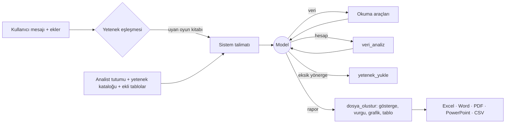

# Asistan yetenekleri: analiz ve rapor

Asistan artık "veriyi düz yazıya döken" bir yardımcı değil, analist gibi çalışır:
veriyi **hesaplar**, **yorumlar** (neye göre iyi/kötü, ne kadar, neden önemli),
**örüntü arar** ve rapor istendiğinde **yönetici özeti, göstergeler, bulgular,
grafikler ve öneriler** içeren bir dosya üretir.

## Sorun

Önceki sürümde "bana rapor ver" ya da "şu Excel'i incele" denince:

- Dosya yalnız başlık, paragraf ve tablodan oluşuyordu; çoğu zaman ham tablonun kopyasıydı.
- Ekli Excel modele metin olarak gidiyordu; büyük dosyalar kısaltılıyor, model sayıları kafadan topluyordu.
- Kıyas, eğilim, yoğunlaşma, aykırı değer, kök neden gibi analiz adımları için yönerge yoktu.

## Araştırma: neye dayandık

| Kaynak | Aldığımız |
|---|---|
| [anthropics/skills](https://github.com/anthropics/skills) (Agent Skills, `xlsx`, `docx`, `pptx`) | **Kademeli açılım** (progressive disclosure): yeteneğin adı ve "ne zaman" cümlesi hep görünür, tam yönerge yalnız gerektiğinde yüklenir. Belgelerde varsayım ve kaynakların görünür yazılması. |
| [anthropics/knowledge-work-plugins → data/analyze](https://github.com/anthropics/knowledge-work-plugins) | Üç düzey (hızlı yanıt / tam analiz / resmî rapor); anla → topla → analiz et → **doğrula** → sun → görselleştir akışı; doğrulama listesi (satır sayısı, boşluklar, büyüklük, zaman serisi boşlukları, ara toplam = genel toplam). |
| product-management eklentisi: `metrics-review` | Gösterge skor kartı (güncel, önceki, değişim, hedef, durum); parlak noktalar / endişe alanları; önerilen aksiyonlar; bağlam ve uyarılar. |
| product-management eklentisi: `stakeholder-update` | Kitleye göre yazım; G/S/K durumu "dürüst değerlendirme"; süreç değil sonuç; somut talepler ve tarihli kararlar. |
| Yönetim danışmanlığı pratiği | Piramit ilkesi (önce sonuç), SCQA hikâye kurgusu, mesaj başlıkları ("Maliyet" değil "Maliyet planın %14 üstünde"), Pareto, 5 Neden. |

Python çalıştıran Claude / ChatGPT'nin yaptığı "kodla hesapla" adımının tarayıcıdaki
karşılığı olarak bir **hesap motoru** yazdık; böylece model sayı uydurmaz.

## Mimari

| Parça | Dosya | Görev |
|---|---|---|
| Analist tutumu | `utils/ai/skills.ts` → `ANALYST_CORE` | Her yanıtta: önce sonuç, kıyas olmadan yargı yok, sayıyı araçla hesapla, örüntü ara, belirsizliği söyle, sunmadan doğrula, sahipli ve tarihli öneri. |
| Yetenek kataloğu | `utils/ai/skills.ts` → `SKILLS` | 9 oyun kitabı (aşağıda). Kullanıcı mesajı tetikleyicilere uyarsa en çok 2'sinin tam yönergesi o tura eklenir; kaçarsa model `yetenek_yukle` ile açar. Ek içeriğindeki sözcükler yetenek tetiklemez. |
| Hesap motoru | `utils/ai/dataAnalysis.ts` + `veri_analiz` aracı | profil, ozet (grupla + ölç + pay %), pivot, trend (dönem, değişim, eğilim, zirve), dağılım (yüzdelik, çarpıklık, histogram), aykırı (IQR), korelasyon, satırlar (süz-sırala-ilk N). Kaynak: ekli tablo (tüm satırlar) ya da herhangi bir okuma aracının sonucu. |
| Ek tabloları | `utils/ai/attachments.ts` | Excel/CSV/TSV ekleri sayfa başına tabloya çevrilir (en çok 50 000 satır). Başlık satırı bulunur, rapor başlıkları atlanır, Türkçe ondalık virgül doğru okunur. Tablolar sohbet boyunca tutulur. |
| Analitik belge | `utils/export/aiDocument.ts`, `renderAiDocument.ts`, `chartSvg.ts` | Yeni bloklar: **gösterge** (KPI kartı: değer, kıyas, iyi/dikkat/kritik), **vurgu** (bulgu, dikkat, öneri, karar, özet kutusu), **grafik** (çubuk, çizgi, pasta). PowerPoint yerel grafik, PDF SVG grafik, Word değer + çubuk tablosu, Excel grafik verisi ayrı sayfada ve özet sayfasında göstergeler. |

Analiz araçları yalnız tarayıcı sohbetinde sunulur (dosya çalışma zamanı); MCP
(Claude Desktop) isteği büyümez, orada Claude kendi analizini yapar.

## Yetenekler

| Kimlik | Ne zaman | `/` komutu |
|---|---|---|
| `veri-analizi` | Ekli Excel/CSV ya da uzun araç sonucu: analiz et, incele, kırılım, dağılım | `/analiz` |
| `analitik-rapor` | Rapor, sunum, yönetim raporu, Word/PDF/Excel raporu | `/analizrapor` |
| `yonetici-ozeti` | Üst yönetime / paydaşa durum notu, brifing, e-posta | `/yonetici` |
| `kok-neden` | Neden gecikti, neden arttı, sapmanın sebebi | `/kokneden` |
| `risk-degerlendirme` | Risk analizi, erken uyarı, kayıt dışı riskler | `/riskler` (mevcut) |
| `kapasite-kaynak` | Doluluk, adam-ay, kapasite aşımı, iş gücü maliyeti | `/kapasite` (mevcut) |
| `tahmin` | Ne zaman biter, yetişir mi, senaryo | `/tahmin` |
| `karar-destek` | X mi Y mi, önceliklendir, seçenek karşılaştır | `/karar` |
| `toplanti-hazirlik` | Gündem, konuşma notları, açık aksiyonlar | `/toplanti` |

Her oyun kitabı aynı iskeleti izler: **adımlar** (hangi araçla hangi veri,
hangi hesap) → **yanıt şablonu** → **kalite kontrolü**.

### Örnek: veri analizi oyun kitabının özü

1. `veri_analiz islem=profil`: yapı, türler, boşluklar, toplam satırı ve tekrar uyarıları.
2. Soruyu 2-4 alt soruya böl (ne kadar? nerede yoğun? zamanla nasıl? hangi segment farklı?).
3. Her alt soru için hesapla (ozet, pivot, trend, dagilim, aykiri, korelasyon).
4. Bulgu = gözlem + sayı + kıyas + anlam. Sıradan olanı bulgu diye yazma.
5. Doğrula: ara toplamlar genel toplamı tutuyor mu, birimler doğru mu.

Yanıt: **Kısaca** → **Öne çıkanlar** (3-5) → özet tablo → **Ne yapmalı** → **Veri notu**.

### Rapor dosyası iskeleti (analitik-rapor)

1. Yönetici özeti (vurgu, ton=bilgi): durum, en önemli iki bulgu, istenen karar.
2. Göstergeler: 3-6 KPI, her biri kıyaslı.
3. Bulgular: her biri mesaj başlıklı vurgu + destekleyen grafik ya da kısa tablo.
4. Riskler (vurgu, ton=uyari).
5. Öneriler (vurgu, ton=oneri: ne, kim, ne zamana); karar gerekiyorsa ton=karar.
6. Yöntem ve veri notları.
7. Ek: Veri (ayrıntılı tablolar).

Dosya yalnız tablodan oluşuyorsa araç bir **kalite notu** döner: kullanıcı veri
dökümü istediyse sorun yok, rapor istediyse model göstergeler ve bulgularla
yeniden hazırlar.

## Örnek istekler

- *(Excel ekleyerek)* "Bu bütçe dosyasını analiz et; nerede aşım var, neden?"
- "/analizrapor ATLAS Kasım maliyet durumu" → Word raporu: özet, KPI kartları, grafikli bulgular, öneriler.
- "/kokneden ATLAS teslim tarihi neden 3 hafta kaydı?"
- "/yonetici" (proje açıkken) → 🟢🟡🔴 durum notu.
- "Kasım worklog'larını kişi × proje pivotla ve sunum yap."
- "/tahmin" → iyimser / beklenen / kötümser tarih ve varsayımlar.

## Yeni yetenek eklemek

1. `utils/ai/skills.ts` içinde `SKILLS` dizisine bir kayıt ekleyin: `id` (kebab-case),
   `name`, `when` (tek cümle; katalogda modele görünür), `triggers` (kullanıcı
   ifadeleri için düzenli ifadeler), `playbook` ("Oyun kitabı — …" ile başlar).
2. Oyun kitabında **hangi araçla** veri alınacağını, **hangi hesabın** `veri_analiz`
   ile yapılacağını, **yanıt şablonunu** ve **kalite kontrolünü** yazın. Sayı
   uydurmaya kapı açan "tahmin et" gibi ifadelerden kaçının.
3. İsterseniz `utils/ai/slashCommands.ts` içine `skill: '<id>'` taşıyan bir `/` komutu ekleyin.
4. `utils/ai/skills.test.ts` içine eşleşme örneği ekleyin. Sistem talimatı sınırı
   (`AI_LIMITS.maxSystemChars`) testle korunur.
