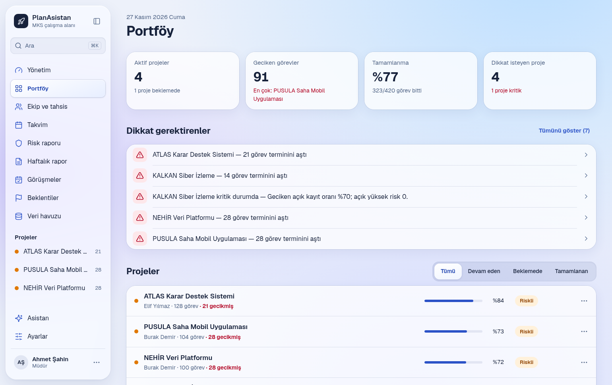

# PlanAsistan Kullanım Kılavuzu

**Proje, ekip kapasitesi ve haftalık karar takibi**

PlanAsistan, Jira görevlerini, ekiplerin aylık iş gücü planını ve haftalık yönetim raporlarını aynı çalışma alanında bir araya getirir. Proje yöneticisi teslim planını oluşturur, bölüm sorumlusu ekibindeki kapasiteyi kontrol eder, yönetim ise riskleri ve karar bekleyen konuları portföy genelinde izler.

*Portföy ekranı. Proje adını açarak işin ayrıntısına inebilir, durum ve sağlık göstergeleriyle inceleyeceğiniz projeyi seçebilirsiniz.*

## Hangi ihtiyaçları karşılar?

| İhtiyaç | PlanAsistan’da karşılığı |
| --- | --- |
| Görevlerin, bağımlılıkların ve teslim tarihlerinin farklı dosyalarda kalması | Proje listesi, Pano, Zaman çizelgesi ve sprint planlama |
| Aynı çalışanın birden fazla projeye kapasitesinin üzerinde atanması | Ekip ve tahsis → Doluluk, rol bazlı Kapasite–talep ve Uygun kişi bul |
| Gecikmenin ne zaman ortaya çıkabileceğini ve hangi işe müdahale edileceğini görmek | PERT, Monte Carlo, proje risk kaydı ve yönetim sağlığı |
| Onaylı plan ile son durum arasındaki farkın kaybolması | Plan kilidi, taban çizgisi ve Plan / Gerçekleşen / Karşılaştır |
| Haftalık durumun e-posta zincirlerinde dağılması | Proje raporu, içerik ve biçim onayı, hafta yayını ve yönetim okuması |
| Toplantı kararlarının uygulanabilir işlere dönüşmemesi | Whiteboard, görev bağlantıları, müşteri görüşmeleri ve yönetim beklentileri |

## Kılavuz bölümleri

| Bölüm | Burada yapabilecekleriniz |
| --- | --- |
| [İlk oturum ve roller](baslangic.md) | Çalışma alanını açın, doğru profili ve projeyi bulun. |
| [Görevden teslim planına](proje-planlama.md) | Görev oluşturun, Jira kayıtlarını inceleyin, sprint ve sürüm planlayın. |
| [Kapasite, tahsis ve maliyet](kapasite.md) | Talebi iş gücüyle karşılaştırın, aylık tahsisi onaya hazırlayın. |
| [Risk, rapor ve yönetim](raporlama.md) | Riskleri işleyin, haftayı yayınlayın, karar bekleyen işleri takip edin. |
| [Whiteboard, asistan ve entegrasyonlar](isbirligi.md) | Atölye yürütün, notları göreve bağlayın, dış sistemlerle çalışın. |

> Görseller, PlanAsistan 3.7.0’ın modern arayüzünden kurgusal pilot verileriyle alınmıştır. Hesabınızın rolüne, proje kapsamına ve çalışma alanı ayarlarına göre görünen seçenekler değişebilir. Yeni özellikler için uygulamadaki **Sürüm notları** bölümünü inceleyin.

## Baştan sona örnek

1. **Proje yöneticisi** Portföy’den projeyi açar. Jira’dan gelen görevleri **Liste**’de gözden geçirir, öncülleri ve eforu doğrular, işleri **Planlama**’da sprint ya da sürüme alır.
2. **Bölüm sorumlusu** **Ekip ve tahsis**’te çalışanların aylık doluluğunu inceler. Kapasite aşılıyorsa uygun kişiyi, başka bir ayı veya teslim kapsamındaki değişikliği proje yöneticisiyle değerlendirir.
3. **Proje yöneticisi** açık riski, etkisini ve ihtiyaç duyduğu kararı kaydeder. Haftalık raporu incelemeye gönderir.
4. **Bölüm sorumlusu** içeriği, **PYB Destek** biçimi inceler. PYB Destek haftayı yayımladığında **Müdür** sonucu **Haftalık rapor** ve **Yönetim** ekranlarında takip eder.

[Depo README’si ve teknik belgeler](../../README.md)
