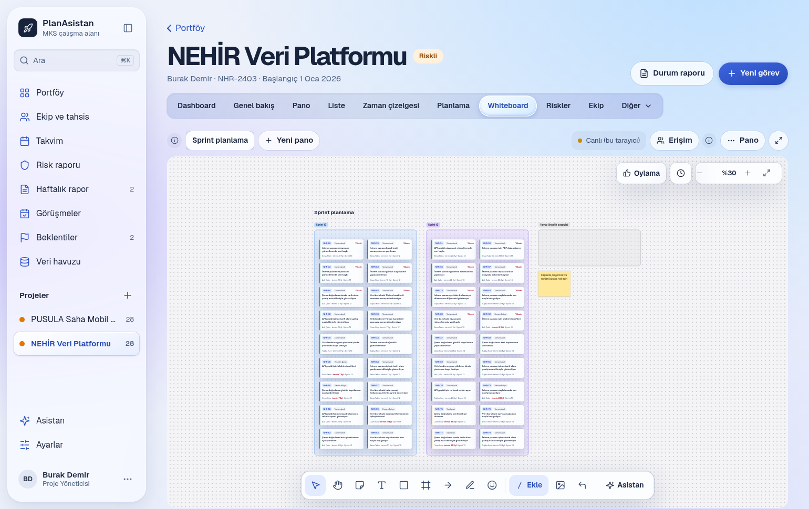
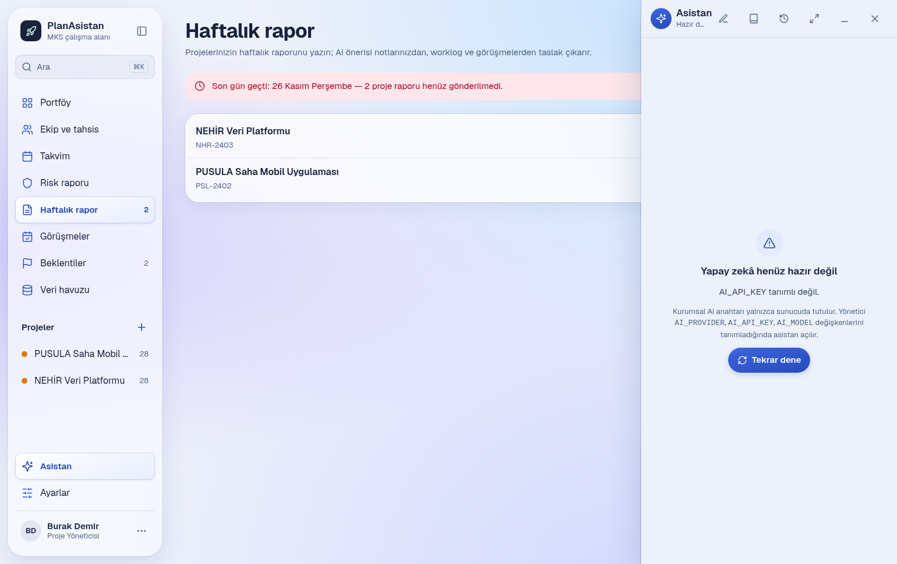
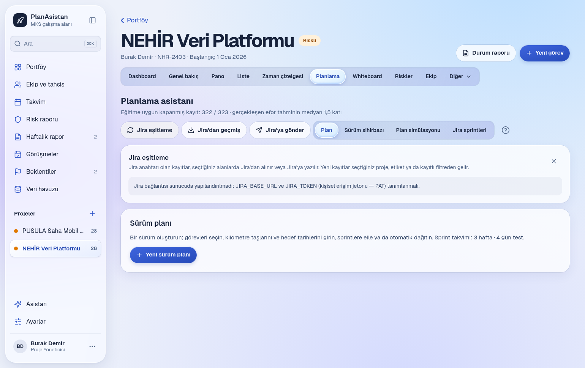

# Whiteboard, asistan ve entegrasyonlar

[← Risk, rapor ve yönetim](raporlama.md) · [Kılavuz ana sayfası](README.md)

## Toplantıyı iş listesine dönüştürün

1. Projede **Whiteboard** sekmesini açın. İlk pano için şablonu doğrudan seçin. Mevcut panoların yanına bir tane eklemek için **Yeni pano**’yu kullanın. Sprint retrospektifi, sprint planlama, önceliklendirme, UI/UX inceleme ve risk değerlendirme şablonları arasından seçim yapabilirsiniz.
2. **Erişim**’den panoyu kimlerin görüntüleyip düzenleyebileceğini belirleyin. Erişimi pano sahibi ve proje yöneticisi yönetir.
3. Bir yapışkan not eklemek için boş alana çift tıklayın. **Ekle** veya `/` ile görev, sprint, risk, iş paketi ya da sürüm arayıp tuvale bağlı kart olarak ekleyin. Not içinde `//` ile görev koduna referans verin.
4. **Oylama**’da kapsamı, kişi başına oy hakkını ve süreyi seçin. Görüntüleme yetkisi olan katılımcılar da açık oylamada oy verebilir.
5. Sonuçtan aksiyonları belirleyin. Proje yöneticisi ilgili notu seçip **Göreve dönüştür** ile iş listesine alabilir. Yeni görevin sahibini ve tarihini **Liste**’de tamamlayın.
6. Toplantı çıktısı için pano menüsünden Markdown özetini kopyalayın ya da indirin. Bulut eşzamanlı çalışması için Supabase Whiteboard kurulumu gerekir. Yerelde aynı tarayıcının sekmeleri arasında birlikte çalışılır.

[Whiteboard kısayolları, paylaşım ve eşzamanlı çalışma](../WHITEBOARD.md)

## Yapay zekâ asistanıyla analiz yapın

1. **Asistan**’ı açın. İstekte proje, dönem ve istenen çıktıyı belirtin. Örnek: “NEHİR’in bu haftaki açık risklerini etki sırasına göre listele ve her biri için ilk aksiyonu öner.”
2. Yanıttaki görev kodlarını ve sayıları ilgili ekranlardan kontrol edin. Asistan analizini hesabınızın erişebildiği veri üzerinden yapar.
3. Asistan bir görev ya da alan değişikliği önerdiğinde önizlemeyi inceleyip uygunsa **Uygula**’yı seçin. Whiteboard açıkken asistan çizim yapabilir. Çizim Ctrl+Z ile geri alınabilir.
4. Bir görsel üzerinden çizim istiyorsanız **Görseli asistana göster** seçeneğini kontrol edin. Açıkken görsel AI sağlayıcısına gönderilir. Kapalıyken asistan yazılı açıklama üzerinden çalışır.

*“Yapay zekâ henüz hazır değil” mesajı görünüyorsa yönetici sağlayıcı kurulumunu tamamlamalıdır.*

Ekibin kılavuz ve karar belgeleri bilgi tabanına eklenebiliyorsa asistan yanıt üretirken ilgili parçaları arayabilir. Sağlayıcı, belge arama ve ad maskeleme seçenekleri yönetici yapılandırmasına bağlıdır.

[Asistan yetenekleri](../ASISTAN_YETENEKLERI.md) · [AI kurulumu ve politikası](../AI_KURULUM.md)

## Jira’dan veri alın ve gerçekleşeni kontrol edin

*Planlama → Jira eşitleme. Bağlantı kurulduktan sonra hedef proje ve eşitleme seçeneklerini buradan gözden geçirin.*

1. Yetkili kullanıcı Jira bağlantısını kurduktan sonra doğru PlanAsistan projesini ve Jira proje anahtarını eşleştirin.
2. Kayıtları eşitlemeden önce proje, dönem ve filtreyi kontrol edin. Aktarım sonrası birkaç örnek görevde Jira anahtarını, durumu, atananı, termini ve çalışma kayıtlarını karşılaştırın.
3. Ayrıntıdan durum geçmişini ve eforu, **Ekip ve tahsis → İş güçleri** veya **Zaman çizelgesi** üzerinden kişi ve hafta toplamlarını inceleyin.
4. Billed Hours aktarırken kişi ve proje eşleşmelerine bakın. Sonuçları **Gerçekleşen** görünümünde doğru ay için doğrulayın.
5. Kurumunuzda Jira’ya gönderim açıksa değişecek kayıtları ve hedef projeyi işlemden önce doğrulayın.

[Jira zaman takibi ve worklog eşleştirme](../JIRA_ZAMAN_TAKIBI.md)

## Diğer bağlantılar

| Araç | Kullanım |
| --- | --- |
| Excel | Veri havuzu, tahsis ve Billed Hours aktarımı. Aktarımdan önce şablonu, kodları ve dönemleri kontrol edin. |
| Supabase | Hesapla giriş, çalışma alanı üyeliği, bulut senkronizasyonu ve Whiteboard’un canlı çalışması. |
| Claude / MCP | Desteklenen araçları Claude Desktop veya Claude Code üzerinden, hesabınızın yetki kapsamıyla kullanın. |
| Rapor otomasyonu | Kurulu bağlantılar ve yetkiler üzerinden planlı rapor teslimi. Gönderim öncesi gönderim hedefini ve alıcıları yapılandırma ekranında doğrulayın. |

[Supabase kurulumu](../../supabase/KURULUM.md) · [MCP kurulumu](../MCP_KURULUM.md) · [Otomasyon](../OTOMASYON.md)
