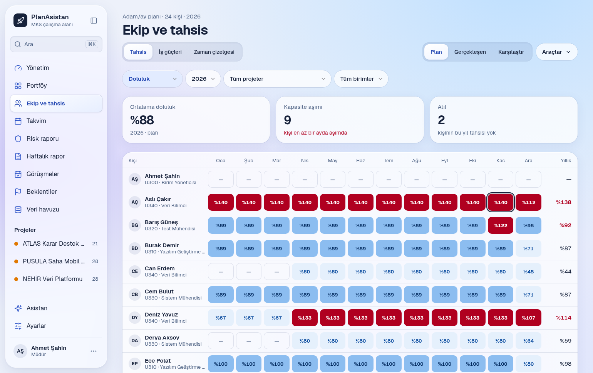
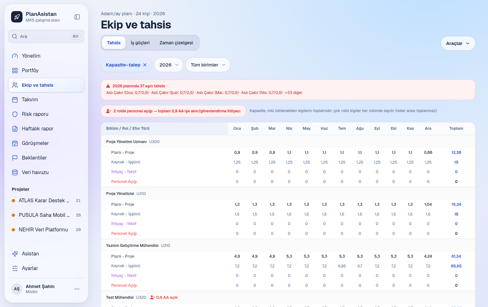

# Kapasite, tahsis ve maliyet

[← Görevden teslim planına](proje-planlama.md) · [Risk, rapor ve yönetim →](raporlama.md)

## Aylık doluluğu okuyun

*Doluluk. Bir kişinin farklı projelerdeki tahsislerini ay bazında inceleyin. Renklerin anlamını ekranın lejantından okuyun.*

**AA (adam/ay)** bir tam zamanlı kişinin bir aylık iş gücünü temsil eder. 0,50 AA yaklaşık yarım aylık kapasitedir. Örneğin izinlerden sonra kapasitesi 0,80 AA olan bir kişinin aynı aya iki projede 0,50 ve 0,45 AA planı varsa, toplam 0,95 AA olur ve kapasite 0,15 AA aşılır.

1. **Veri havuzu**’nda kişinin bölümü, rolü, ünvanı ve kapasitesini doğrulayın. İzin ya da yarı zaman etkisini hesaba katın.
2. **Ekip ve tahsis → Doluluk**’ta yılı ve ilgili kapsamı seçin. Aşım olan kişi-ay kesişimini bulun.
3. **Kişi özeti** ile yükün hangi projelerden geldiğini, **Bölüm özeti** ile yükün ekipteki dağılımını inceleyin.
4. **Tahsis tablosu**’nda kişi, proje, iş paketi, rol ve dönem bilgisiyle kayıt açın veya yetkili olduğunuz satırı güncelleyin.

## Plan, onay ve gerçekleşen

| Görünüm | Kullanım |
| --- | --- |
| **Plan** | Ay bazında taahhüt edilecek iş gücünü girin. Aynı kişinin diğer proje tahsislerini kontrol edin. |
| **Gerçekleşen** | Kullanılan iş gücünü kaydedin. Kurulum izin veriyorsa Jira worklog veya Billed Hours verisini aktarın. |
| **Karşılaştır** | Aynı yıl ve kapsamda plan ile gerçekleşeni yan yana değerlendirin. Sapmanın ay, proje veya iş paketinden kaynaklanıp kaynaklanmadığına bakın. |

Plan kilidi proje ve yıl düzeyinde ilerler. Proje yöneticisi taslağı onaya gönderir. Yetkili yönetim rolü planı inceler ve onayla kilitler. Gerçekleşen kayıtları kendi yetki akışında tutulur. Onaylı planla daha sonraki görünümü karşılaştırmak için taban çizgisi (baseline) kullanın.

## Rol açığını ve maliyeti değerlendirin

*Kapasite–talep. Bir roldeki toplam talebi ve kullanılabilir kapasiteyi aynı dönem için karşılaştırın.*

- **Araçlar → Kapasite–talep** ile açığın hangi rol ve dönemden geldiğini inceleyin. Teklif projelerinin yarattığı ek ihtiyacı ayrıca gözden geçirin.
- **Uygun kişi bul** aracında rolü ve gereken ay aralığını seçin. Eşleşen kişinin diğer proje taahhütlerini de kontrol edin.
- **Senaryo** ile bir teklifin devreye alınması, bir talebin kaydırılması veya varsayımsal kapasite artışı gibi seçeneklerin etkisini karşılaştırın. Üzerinde uzlaşılan kararı ana tahsis planına yetkili kullanıcı işler.
- **Öngörü** ile yakın dönemin gerçekleşenleri veya mevcut plan üzerinden yıl sonu yükünü ve maliyetini değerlendirin. Maliyet tahmini, tahsis ve ünvanın aylık maliyetine dayanır. Sonuç eksik görünüyorsa ünvan, maliyet ve gerçekleşen verilerini kontrol edin.

**Örnek karar.** Aralık ayında test rolünde 0,40 AA açık varsa önce ilgili projelerin tahsis satırlarını bulun. Uygun kişi bul ile aynı ayı inceleyin. Açık kapanmıyorsa bir işi sonraki aya kaydırmanın termin ve risk etkisini proje yöneticisiyle değerlendirin.
