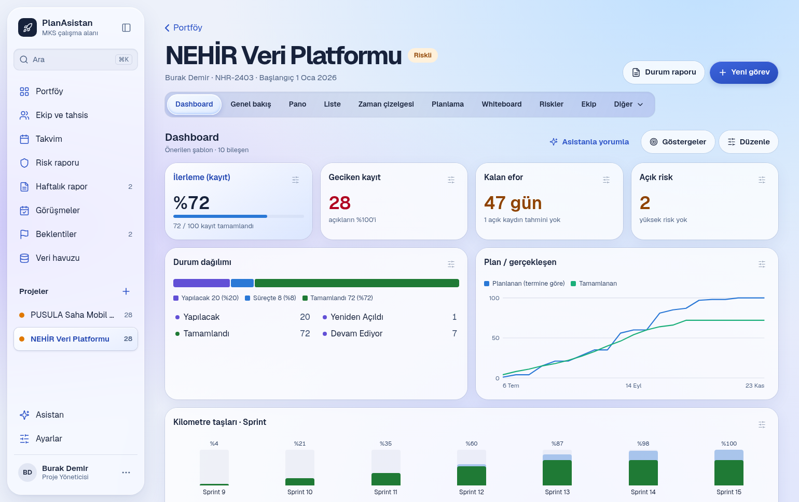
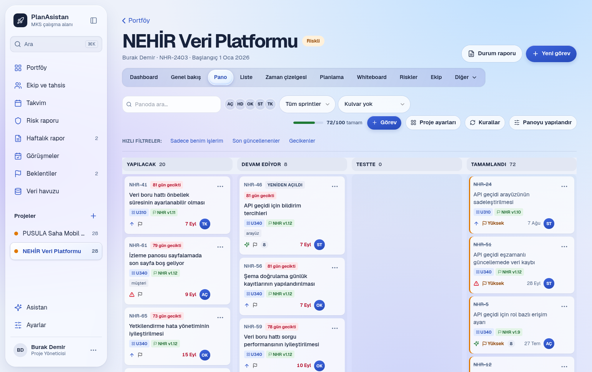
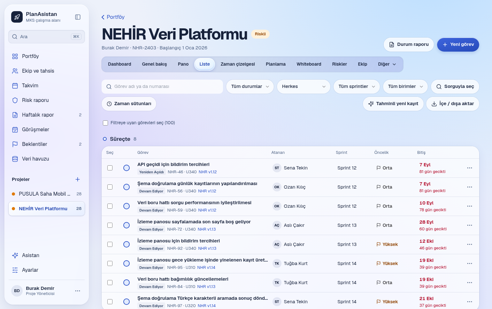
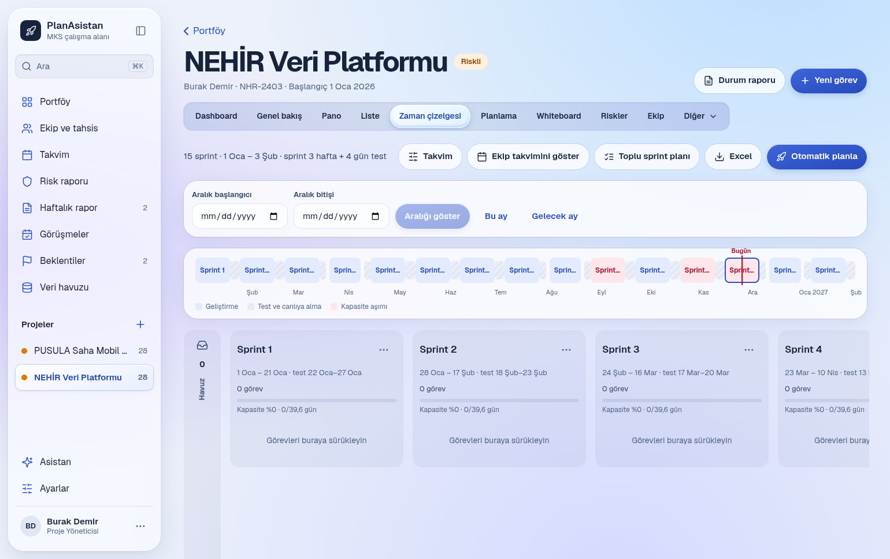
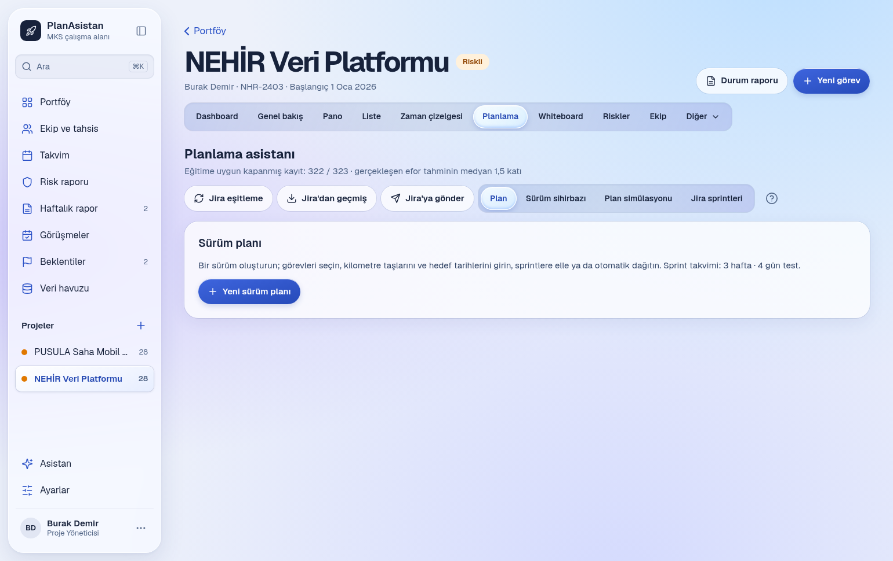

# Görevden teslim planına

[← İlk oturum ve roller](baslangic.md) · [Kapasite, tahsis ve maliyet →](kapasite.md)

## Projenin durumunu okuyun

*Dashboard, seçili projenin özet metriklerini gösterir. Üstteki sekmeler aynı projeyi farklı açılardan incelemek içindir.*

1. **Portföy**’den projeyi açın. Yeni bir proje için yetkiniz varsa sol menüde **Projeler** yanındaki **+** düğmesini kullanın.
2. **Dashboard**’da tarih aralığını ve göstergeleri kontrol edin. **Genel bakış**’ta projenin haftalık durumunu ve özetini gözden geçirin.
3. **Yeni görev**’i açın. Görev adı, durum, öncelik, atanan kişi ve termini girin. Bir teslim paketinin parçasıysa iş paketini, önce başka bir işin tamamlanması gerekiyorsa öncülü belirleyin.
4. Kaydedilen görevi **Liste**’de bulun. Kodundan ayrıntıyı açıp bilgileri kontrol edin.

## Pano, liste ve zaman çizelgesi

| Ekran | Kullanım |
| --- | --- |
| **Pano** | İşin hangi aşamada biriktiğini görün. Sahibi olduğunuz projede pano ayarlarından durumları kolonlarla eşleyin, gerekirse iş limiti (WIP), kulvar ve filtre tanımlayın. |
| **Liste** | Görevleri sorgulayın ve ayrıntılarını inceleyin. Toplu düzenlemeden önce seçilen kayıtları ve önizlemeyi kontrol edin. |
| **Zaman çizelgesi** | Teslim tarihleri ile sprint ve görevlerin zamana dağılımını inceleyin. Geciken bir öncülün sonraki işleri etkileyip etkilemediğini kontrol edin. |

*Pano. Açık işleri kolonlar arasında karşılaştırarak darboğazı bulun, görev kodundan ayrıntıyı açın.*

*Liste. Bir toplu işlemden önce sorgunun döndürdüğü görevleri ve seçimi doğrulayın.*

*Zaman çizelgesi. Darboğazı tarihler üzerinden incelemek için zaman görünümüne geçin.*

## Sprinti ve sürümü planlayın

*Planlama ekranı, sprint çizelgelemesi, sürüm hazırlığı ve teslim tahminine giriş noktasıdır.*

1. **Planlama**’da önce proje takvimini, sprint süresini ve ekibin kapasitesini gözden geçirin.
2. Belirsiz işler için iyimser, en olası ve kötümser eforu girin. PERT bu üç tahminle beklenen süreyi hesaplar. Benzer geçmiş işlerle tahminleri karşılaştırın.
3. Otomatik planı çalıştırın. Öncül ilişkilerini, kapasiteyi ve son tarihleri dikkate alan öneride termin sapmalarını ve sprintlere sığmayan işleri inceleyin.
4. Ortak bir teslim tarihi varsa **Sürüm sihirbazı** ile sürüm planı oluşturun. Hedef tarih, kapsama alınan görevler, test süresi ve kilometre taşlarını gözden geçirin. Kararlaştırılan planı sabitleyin ve sonraki değişiklikleri taban çizgisiyle karşılaştırın.
5. **Plan simülasyonu**’nda Monte Carlo simülasyonunu çalıştırın ve teslim dağılımına bakın. P50, koşuların yaklaşık yarısının o tarihe kadar tamamlandığı noktayı, P80 yaklaşık %80’inin tamamlandığı noktayı gösterir. Bu değerler girilen efor, kapasite ve kapsam varsayımlarına bağlıdır. P80 hedefin ötesindeyse kapsamı, bağımlılığı veya kapasiteyi yeniden değerlendirin.

**Örnek karar.** NEHİR projesinde test görevi geliştirme tamamlanmadan başlayamıyorsa geliştirmeyi öncül olarak işaretleyin. P80 tarihi hedefi geçiyorsa, önce öncülün efor aralığını ve test kapasitesini doğrulayın. Ardından zorunlu olmayan bir işi sonraki sürüme kaydırıp simülasyonu yeniden çalıştırın.

## Diğer proje araçları

- **Hedefler** ile hedef ve ölçülebilir anahtar sonuçları (OKR) tanımlayın. İlgili görevleri anahtar sonuca bağlayın.
- **İş paketleri** ile aynı teslim parçasına ait görevleri gruplayın. Bu ayrım tahsisin hangi işe gittiğini açıklamaya yardımcı olur.
- **Müşteri istekleri** üzerinden talebi değerlendirin. Uygulanacak isteği göreve dönüştürün, ardından yeni göreve öncelik ve termin verin.
- **Günlük**’te hafta, etiket ve karar notlarını tutun. Yönetimden karar gerektiğinde **Beklentiler** ekranında ayrı bir kayıt açın.

[Plan optimizasyonu](../PLAN_OPTIMIZASYONU.md) · [Proje yapılandırması](../PROJE_YAPILANDIRMA.md) · [PoC bulgu Excel aktarımı](../BULGU_TAKIP_AKTARIMI.md)
