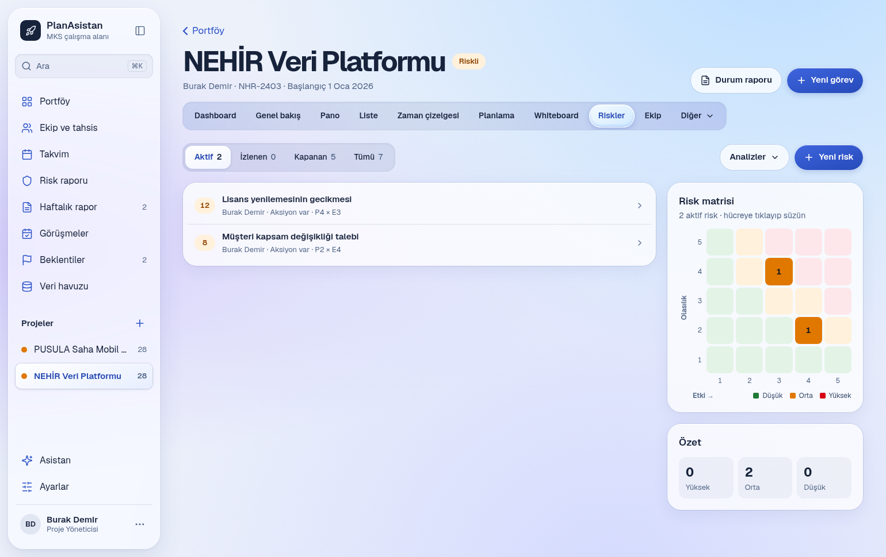
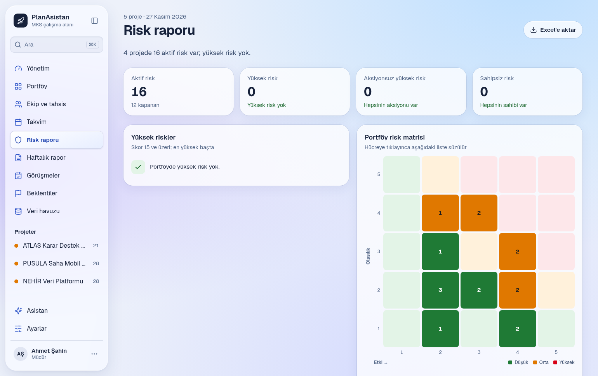
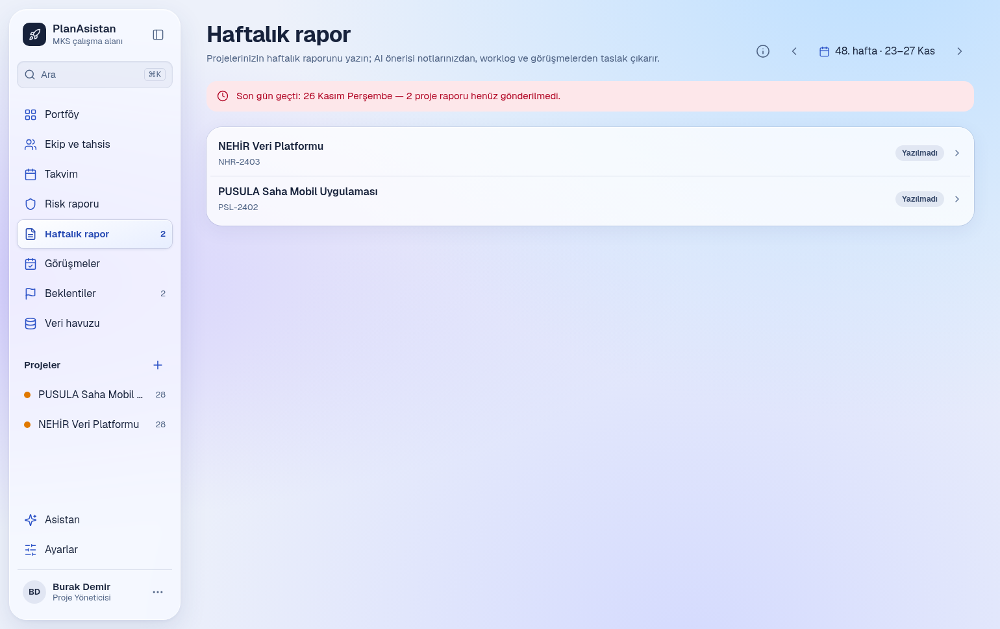
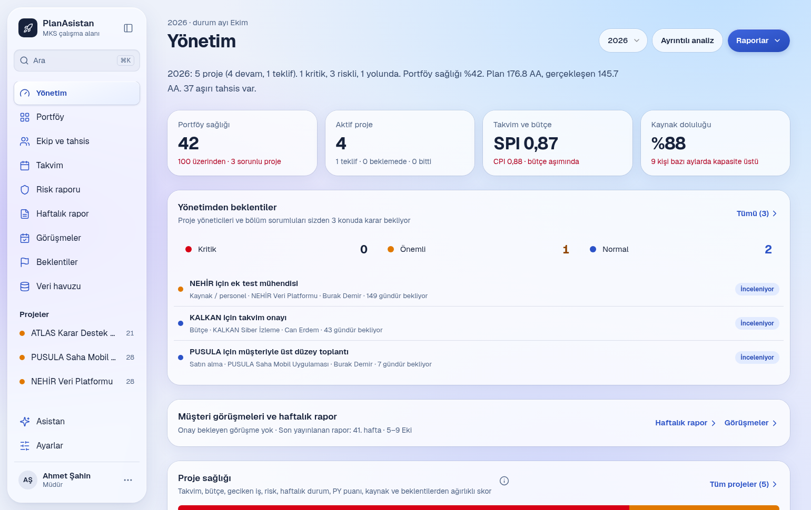

# Risk, rapor ve yönetim

[← Kapasite, tahsis ve maliyet](kapasite.md) · [Whiteboard, asistan ve entegrasyonlar →](isbirligi.md)

## Proje riskini kaydedin ve takip edin

1. Proje içinde **Riskler**’i açın. Riski gerçekleşebilecek olay ve proje üzerindeki etkisiyle tanımlayın.
2. Olasılık ve etkiyi 1–5 aralığında girin. İkisinin çarpımı risk skorunu oluşturur. Hafifletme adımını ve takip durumunu ekleyin.
3. Örneğin “Test ortamı zamanında açılmazsa entegrasyon testleri bir hafta gecikebilir” riski için olasılık 4, etki 5 girildiğinde skor 20 olur. Hafifletme adımı olarak ortamın açılış tarihini teyit etmeyi ve yedek ortam hazırlamayı yazın.
4. Haftalık raporu göndermeden önce açık riskleri ve alınan önlemleri güncelleyin. Birden fazla projeyi inceliyorsanız sol menüde **Risk raporu**’na geçin.

## Haftalık rapor hazırlayın ve yayımlayın

*Haftalık rapor. Dönem seçimi ve inceleme işlemleri etkin role göre görünür.*

| Aşama | Kim | Ne yapar? |
| --- | --- | --- |
| Taslak | Proje yöneticisi | Haftayı ve projeyi seçer. İlerlemeyi, riskleri, sonraki adımları ve karar ihtiyaçlarını yazar. |
| İçerik incelemesi | Bölüm sorumlusu | Durum, gerekçe, tarih ve riskleri inceler. İçeriği onaylar veya gerekçeyle iade eder. |
| Biçim incelemesi ve yayın | PYB Destek | Rapor biçimini ve haftanın durumunu kontrol eder. Düzeltme ister veya haftayı yayımlar. |
| Okuma | Müdür | Yayımlanmış raporu okur ve Yönetim ekranındaki proje durumu ile karşılaştırır. |

1. **Haftalık rapor** ekranında doğru haftayı seçin. Taslakta “ne tamamlandı”, “ne değişti”, “sonraki iş ne” ve “kimden hangi karar bekleniyor” sorularını yanıtlayın.
2. Jira’dan veri çekme veya rapor asistanı açıksa önerilen metindeki görev kodlarını, tarihleri ve sayıları kaynak kayıtlarla karşılaştırın.
3. Taslağı incelemeye gönderin. İade edilirse gerekçeyi okuyun, ilgili bölümü düzeltip yeniden gönderin.
4. Yetkili rol olarak **Onay bekleyen** ve hafta durumunu gözden geçirin. Yayın tamamlanınca ilgili haftayı yönetim görünümünde açarak son içeriği kontrol edin.

[Haftalık rapor asistanı](../RAPOR_AI.md)

## Yönetim ekranından karara geçin

- **Portföy sağlığı** ile inceleme gerektiren projeleri bulun. Projeye inip görev, tahsis ve risk kayıtlarından sinyalin nedenini kontrol edin. Haftalık durum etiketi (RAG) ile hesaplanan sağlık skorunu birlikte değerlendirin.
- **EVM (Kazanılmış Değer Yönetimi)** görünümünde planlanan değer (PV), yapılan işin plan değerini ifade eden kazanılmış değer (EV) ve gerçekleşen maliyet (AC) birlikte okunur. CPI = EV / AC maliyet performansını, SPI = EV / PV takvim performansını özetler. 1’in altındaki oranı değerlendirmeden önce zaman aralığı ve girişlerin eksiksizliğini doğrulayın.
- **Beklentiler** ekranında proje yöneticisi veya bölüm sorumlusu kararı, aciliyeti ve gerekçeyi iletir. Yönetim aynı kayıt üzerinden yanıt verir. Örneğin “Aralık için 0,40 AA test kapasitesi açılması” talebine etkilenen teslimi ve karar tarihini ekleyin.
- **Görüşmeler** ekranında müşteri toplantısının planını, beklenen katılımı ve gerçekleştiğinde sonucunu işleyin. Ortaya çıkan yeni işleri projedeki görevlere taşıyın.
- Yetkiniz varsa **yönetici paketi** ile Excel veya PowerPoint çıktısı alın. Paylaşımdan önce seçili kapsamı, dönemi ve verilerin güncelliğini kontrol edin.
