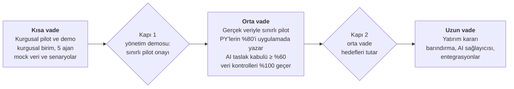

# Danışman raporu — PlanAsistan pilotu

10 Ekim 2026 tarihli değerlendirme; o günden bu yana değişenler hemen altta. Rapor tarihli bir kayıttır: aşağıdaki bölümler 10 Ekim'deki hâliyle durur; yalnız tabloların "12 Ekim" sütunu sonradan eklendi.

## 12 Ekim güncellemesi

Raporun üç kırmızı boyutunun üçü de kodda kapatıldı; takvim ise demonun ajanların kendi ortamında yapılması kararıyla Kasım sonuna uzadı. Geliştirme listesinin on maddesinden yedisi yapıldı, ikisi kısmen (8: RAG kuralı, 10: arife), biri pilot sonrasına kaldı (9); mock veri tablosunun on maddesinden dokuzu kapandı. Kapanışlar canlı koşuda K0'da (15 Ekim) doğrulanacak (BL-18).

| Konu | 10 Ekim | 12 Ekim |
| --- | --- | --- |
| Mock veri | Doluluk %49, kapasite-talep açığı 0, portföy CPI 1,17 | Doluluk %88, 2 rolde açık, CPI ay kapanışında 0,84–1,03; NEHİR üç tohumda da en sorunlu proje |
| Senaryo üretimi | S1, S3, S6, S8 üretilemiyor | `pilot senaryo` ile altı simülasyon senaryosu; 25 Kasım'a kadar denendi |
| Demo hazırlığı | Tarayıcı testi ve dondurma yok | `demo-testi` 28/28, `dondur` / `geri-yukle` var |
| PY iş döngüsü | Rapor, not, risk güncelleme, istek araçları yok | Hepsi MCP'de; geçici rapor yolu kalktı |
| Takvim | Demo 16–20 Kasım haftası, dondurma 13 Kasım | Demo 26 Kasım (varsayım), K0–K4 kapıları, K3 dondurma 19 Kasım |
| Demo ortamı | Dondurulmuş veri kopyası | Ajanların çalıştığı ortamın kendisi; K4'te canlı ya da dondurulmuş kararı |
| 1. rutin modeli | Opus (karar sizin) | Sonnet; tüm ajanlar Sonnet'te |
| Ürün düzeltmeleri | YILDIZ skoru 100; maliyet sapması −6,01 M TL; Ekim CPI'si şişkin | Teklif skorlanmaz (BL-11); sapma aynı dönemin planıyla (BL-09); EVM son kapanan aya kadar (BL-07); rapor biçim denetimi proje adlarını kısaltma saymaz (BL-21) |
| Kurum ağı | Stil, ikon ve Excel kitaplıkları CDN'den (pilot ortamında 403) | Hepsi pakette (BL-08); ikonlar ekran okuyucudan gizli, ikonlu düğmelerin adı var (BL-23) |
| Önerilen RAG kuralı | P1, K3 | Pilot sonrasına alındı (BL-10, 12 Ekim kararı); pilotta RAG'ı PY girer |
| Testler | 864 | 886 (106 dosya) |

Kalan işler ve kanıtlar: [BACKLOG.md](./BACKLOG.md).

## Yönetici özeti

Uygulama demo için yeterince zengin; demoyu taşıyacak mock veri ve test düzeneği henüz değil. Üç açık kapanmadan yönetim karşısına çıkılmamalı:

1. **Veri inandırıcı değil.** Birim doluluğu %49 (PYB birimi %0), kapasite-talep hiçbir rolde açık göstermiyor, dört aktif projenin hiçbiri bütçeyi aşmıyor (CPI 1,00–1,40), müşteri isteklerinin hepsi (en eskisi 1 Haziran'dan beri) "Yeni".
2. **Senaryoların yarısı üretilemiyor.** Kritik hata, izin, fazla mesai ve teklif kazanımı Jira'da iz bırakmalı; simülasyonda bu yetenek yok.
3. **Test ile demo farklı yüzeyde.** Ajanlar uygulamayı MCP üzerinden sınıyor; yönetim tarayıcıdaki ekranları görecek ve bu ekranlar otomatik sınanmıyor.

Önerilen takvim: 12–16 Ekim düzenek haftası (P0 geliştirmeler), 15 Ekim–5 Kasım senaryo koşuları, 10–13 Kasım prova ve veri dondurma, 16–20 Kasım haftası yönetim demosu (tarih teyit bekliyor).

Bu oturumda yapılanlar: pilot kodu ana dalla birleştirildi (864 test geçiyor); rutin talimatları v2'ye geçti (üç aşama, ön puan, ajanda, demo kapısı); rutinler taze oturumlarla Salı ve Perşembe'ye alındı, eskileri devre dışı bırakıldı.

## Durum karnesi

Sekiz boyutun üçü kırmızı: veri gerçekçiliği, senaryo üretimi ve demo hazırlığı. Ürünün kendisi ve rol güvenliği sağlam.

| Boyut | Durum | Kanıt (9 Ekim) | 12 Ekim |
| --- | --- | --- | --- |
| Ürün kapsamı | Yeşil | 27 MCP aracı; portföy, EVM, kapasite, tahsis ve rapor taslağı çalışıyor; birleşik kodda 864 birim testi geçiyor | Yeşil: üç ürün düzeltmesi (BL-07, BL-09, BL-11), 886 test |
| Rol ve gizlilik | Yeşil | 34/34 kontrol; müdür notları veritabanından da okuyamıyor (RLS); hiçbir çıktıda sicil yok | Yeşil: değişiklik yok |
| PY iş döngüsü kapsamı | Sarı | Rapor, not, risk güncelleme ve istek araçları MCP'de yok; geçici yol talimatta | Yeşil: rapor, not, risk ve istek araçları MCP'de (BL-03, BL-05) |
| Test düzeneği | Sarı | v2: üç aşama, ön puan, ajanda, demo kapısı; tarayıcı testi yok | Yeşil: `demo-testi` 28/28, CDN'siz ortamda biçimli ekranla (BL-04, BL-08) |
| Kota ve maliyet | Sarı | Haftalık kota uyarıda, 15 Ekim'de yenilenir; koşular haftada 10'dan 4'e indi | Sarı: tüm ajanlar Sonnet, haftada dört koşu; ilk ölçüm K0'da |
| Mock veri gerçekçiliği | Kırmızı | Doluluk %49, kapasite-talepte açık 0 AA, portföy CPI 1,17, istekler ilerlemiyor (aşağıda) | Yeşil (kodda): doluluk %88, 2 rolde açık, CPI 0,84–1,03 (BL-02) |
| Senaryo üretimi | Kırmızı | 8 senaryonun 4'ü (S1, S3, S6, S8) simülasyon desteği olmadan üretilemez | Yeşil: `pilot senaryo` ile S1, S3, S6, S8 (BL-01) |
| Demo hazırlığı | Kırmızı | Demo yolu, veri dondurma ve prova planı yoktu; bu raporda tanımlandı | Yeşil: demo yolu testi, `dondur` / `geri-yukle`, K0–K4 kapıları (BL-04, BL-06) |

## Mock veri: yönetimin takılacağı noktalar

Yönetim ilk beş dakikada doluluk, bütçe ve kapasite rakamlarına bakar; üçü de bugün yanlış hikâye anlatıyor. Rakamlar 9 Ekim akşamı pilot verisinde (8 Ekim'e kadar) MCP araçlarıyla alındı.

| Konu | Araç çıktısı | Yönetim nasıl okur | Düzeltme | 12 Ekim |
| --- | --- | --- | --- | --- |
| Birim doluluğu | `departman_karnesi`: 24 kişi, kapasite 272,6 AA, plan 134,5 AA, doluluk %49; PYB (U300) %0, Sistem (U330) %44 | "Personelin yarısı boşta mı?" | Proje dışı işler için "Kurumsal işler" tahsisi ya da 2–3 arka plan projesi; PY'lerin proje yönetimi payı tahsise girsin; hedef ortalama %80–90, sıcak noktalar korunur | Yapıldı: %88 (BL-02) |
| Kapasite-talep | `kapasite_talep`: 8 rolün hiçbirinde açık yok (toplam 0 AA); aynı anda `portfoy_ozeti` 30 kişi-ay aşırı tahsis gösteriyor | "İşe alım kararını hangi rakamla vereceğiz?" | S8 rol bazında açık üretsin (ör. U320 test mühendisi); ekranda en az bir rol açığı görünsün | Yapıldı: 2 rolde açık; S8 teklif kazanımıyla büyür (BL-01, BL-02) |
| Bütçe | `evm_analizi`: CPI ATLAS 1,23, KALKAN 1,40, portföy 1,17; Ekim gerçekleşeni 0 | "Bütçeyi hep fazla mı istiyoruz?" | Ay içi tahmini gerçekleşen (Soru 9); planlar gerçekleşene yakın, sapma ±%10 bandında; NEHİR S6 ile aşsın | Yapıldı: CPI 0,84–1,03; Ekim'in 0 gerçekleşeni EVM'e girmez (BL-02, BL-07). Ay içi tahmin pilot sonrası (BL-22) |
| Maliyet sapması | `maliyet_raporu`: plan 17,81 M TL (yıl), gerçekleşen 11,80 M TL (Ocak–Eylül), sapma −6,01 M TL | "6 milyon TL harcanmamış mı?" | Sapma aynı dönemle kıyaslansın (ürün düzeltmesi) | Yapıldı: aynı dönemin planıyla (BL-09) |
| Müşteri istekleri | `musteri_istekleri`: 8 isteğin 8'i "Yeni", en eskisi 1 Haziran; iki başlık iki projede aynı açıklamayla; veri platformunda "mobil karanlık tema" | "Müşteriye yanıt vermiyor muyuz?" | Geçmiş isteklerin çoğu karara bağlanmış olsun (dönüştürüldü ya da reddedildi); şablon tekrarı kalksın; istek proje alanına uysun | Yapıldı: geçmiş istekler karara bağlı, alana özgü metin (BL-02); yinelenen başlık (B-011) K0'da doğrulanacak |
| Riskler | `risk_listesi`: Burak'ın 4 riskinin hepsi 1 Haziran'da açılmış, hiç güncellenmemiş; NEHİR'in en yüksek riski arayüz belgesi (12) | "Risk kaydı tutulmuyor." | Dört aylık risk geçmişi: açılan, güncellenen, kapanan; NEHİR'de kalite riski | Yapıldı: risk geçmişi, kapananlar var (BL-02) |
| Jira içeriği | NHR-41 "eşzamanlı güncellemede veri kaybı" Low öncelikte, 27 Ağustos'tan beri gecikmede, tahmin 1 gün; veri platformunda "çevrimdışıyken uygulama kapanıyor" hatası; hikâyelerde kalıp açıklama | Teknik yönetici hemen fark eder | Bileşen–hata eşlemesi proje türüne göre; veri kaybı Highest; tahminler gerçekçi dağılımda | Yapıldı: alana özgü hata metinleri, ciddi hata Highest/High (BL-01, BL-02) |
| Toplantı notları | 2 Ekim'de dört projenin hepsinde "Sprint değerlendirme toplantısı" (sürüm süresi 3 hafta); bir PUSULA notunda aksiyonun tarihi yok | Dolgu izlenimi | Toplantı türü takvime uysun (Rutin 1 v2'de kural) | Yapıldı: toplantı türü takvime bağlı, aksiyonlar tarihli (BL-02) |
| Haftalık raporlar | Simülasyon PY projeleri dahil raporları kalıp maddelerle yazıyor; NEHİR taslağı "Genel Durum: Yeşil" diyor (18 geciken iş) | Rapor AI'ının değeri görünmez | Geçmiş raporlarda kalite dağılımı (iyi, orta, zayıf); taslak RAG çelişkisini işaretlesin | Kısmen: geçmiş RAG veriden, yoğun PY bir kademe iyimser (algı farkı); kalite dağılımı açık (BL-24), taslağın RAG çelişkisini işaretlemesi BL-10 ile pilot sonrası |
| YILDIZ sağlık skoru | `portfoy_ozeti`: skor 100, güven düşük, veri yok | "Teklifteki proje en sağlıklısı mı?" | Teklif aşamasındaki proje skorlanmasın ("—") | Yapıldı: teklif skorlanmaz, "—" (BL-11) |

Kalibrasyon `baslat --zorla` ile aynı çalışma alanında yapılır: kimlikler ve üyelikler korunur, izleyici yalnız "Buluttan Çek" der.

## Kısa, orta, uzun vade

Kısa vadenin ölçüsü tek: yönetimden gerçek veriyle sınırlı pilot onayı almak. Her aşama, bir sonrakinin onayını ölçülebilir sonuçla kazanır.

Orta vade hedefleri (öneri): PY'lerin en az %80'i raporu uygulamada yazar; rapor hazırlama süresi pilot başında alınan taban çizgisine göre ölçülür; AI taslak kabul oranı en az %60; veri tutarlılığı kontrolleri %100 geçer. Uzun vadedeki yatırım kararı (barındırma, AI sağlayıcısı, entegrasyonlar) orta vadenin ölçümlerine dayanır.

## Demo senaryosu: NEHİR'in toparlanması

On beş dakika, beş rol, tek veri seti. Her adımın rakamı pilot verisinden gelir; demo 13 Kasım'da dondurulan veriyle yapılır.

1. **Müdür, Yönetim ekranı (2 dk).** Portföy sağlığı; sağlık geçmişinde NEHİR'in skoru, PY'nin "Yolunda" RAG'ı ile verinin çelişkisi (algı farkı). Mesaj: uygulama öznel durumu nesnel sinyalle sınar ve erken uyarır.
2. **NEHİR genel bakış (2 dk).** Sağlık skorunun girdi dökümü (SPI, geciken iş, söz tutma, PY puanı); Jira'dan gelen kritik hata ve yeniden açılan kayıtlar. Mesaj: skor açıklanabilir, her kayıp puanın kaynağı görünür.
3. **PY: Jira'dan aktarım, risk ve RAG (3 dk).** Burak aktarımı önizleyip onaylar, riski gerekçesiyle açar, RAG'ı değiştirir. Mesaj: veri Jira'dan gelir, PY karar ekler.
4. **PY: haftalık rapor AI'ı (3 dk).** "Taslak öner", dayanaksız rakam vurgusu, PY'nin düzeltmesi ve gönderim; Selin'in iadesi ve Burak'ın yanıtı. Mesaj: AI yazar, insan doğrular; düzeltmeler AI'yı kurumun diline alıştırır.
5. **Bölüm sorumlusu: kaynak (2 dk).** Selin aşırı tahsisi ve uygun kişiyi bulur, plan kilidine uyar. Mesaj: kaynak kararı rakamla ve izlenebilir verilir.
6. **Müdür: kapasite-talep ve EVM (2 dk).** YILDIZ kazanıldı: rol bazında açık; NEHİR'in bütçe sapması. Karar: işe alım mı, kaydırma mı. Mesaj: yatırım kararı portföy verisine dayanır.
7. **Claude'a soru (1 dk).** Müdür "Bu hafta hangi proje dikkatimi gerektiriyor?" diye sorar; yanıt kaynaklı ve rol kapsamlıdır (notlar görünmez). Mesaj: AI kurum verisinde, yetki sınırı içinde çalışır.

Kapanış: yönetimden istenen karar, gerçek veriyle sınırlı pilotun kapsamı, bölümü ve süresi. Adım 2, 4 ve 6, S1, S4, S6 ve S8 senaryolarının üretilmesine bağlıdır.

## Öncelikli geliştirme listesi

Dört P0 işi demo hikâyesinin ön koşuludur ve 12–16 Ekim düzenek haftasında başlamalıdır. Büyüklükler bir geliştirici ile Claude için tahmindir. Son sütun 12 Ekim'de eklendi.

| # | İş | Neden | Büyüklük (tahmin) | Öncelik | 12 Ekim |
| --- | --- | --- | --- | --- | --- |
| 1 | Senaryo komutu (`pilot senaryo`): kritik hata, tarih aralıklı izin, fazla mesai, teklif kazanımı | S1, S3, S6, S8 üretilemiyor; demo hikâyesi bunlara dayanıyor | 2–3 gün | P0 | Yapıldı (BL-01) |
| 2 | Mock veri kalibrasyonu: doluluk %80–90, kapasite-talep açığı, CPI ±%10, istek ve risk geçmişi, Jira içerik uyumu | Yönetimin ilk bakacağı rakamlar | 2–3 gün | P0 | Yapıldı (BL-02) |
| 3 | MCP rapor araçları: taslak, gönder, onay/iade, yayın; simülasyon persona raporlarını bırakır | PY'nin ana haftalık çıktısı; puanın 20'si | 3–4 gün | P0 | Yapıldı (BL-03) |
| 4 | Demo yolu tarayıcı testi (Playwright): 6 ekran, konsol hatası, ekran görüntüsü, haftada bir | Demo arayüzde; bugün sınanmıyor | 1 gün | P0 | Yapıldı (BL-04) |
| 5 | Ay içi tahmini gerçekleşen; maliyet sapmasında aynı dönem | EVM ve maliyet ay içinde yanıltıyor; S6 görünmüyor | 2 gün | P1 | Yapıldı: EVM son kapanan aya kadar (BL-07), dönem sapması (BL-09); ay içi tahmin pilot sonrası (BL-22) |
| 6 | Not, müşteri görüşmesi, risk güncelle/kapat, istek durumu araçları | PY döngüsünün üç işi eksik | 2 gün | P1 | Yapıldı, P0'a alındı (BL-05) |
| 7 | Veri dondurma ve geri yükleme (`pilot dondur`, `pilot geri-yukle`) | Demo günü güvenliği | 0,5 gün | P1 | Yapıldı (BL-06) |
| 8 | Önerilen RAG kuralı (PY farklı seçerse gerekçe); teklif projeleri skorlanmaz | B-002; YILDIZ skoru 100 | 1 gün | P1 | Teklif skorlanmaz: yapıldı (BL-11). RAG kuralı pilot sonrasına alındı (BL-10) |
| 9 | Yapılandırılmış talep: kaynak talebi ve açıklama talebi | B-007; kararlar iz bırakır | 2–3 gün | P2 | Açık, pilot sonrası (BL-12) |
| 10 | Simülasyonda rapor günü Perşembe, arife yarım gün | Takvim tutarlılığı | 0,5 gün | P2 | Perşembe yapıldı (BL-02); arife açık, 27 Ekim'den önce ya da hiç (BL-14) |

## Kota ve maliyet

Haftalık kullanım sınırı uyarı düzeyinde ve 15 Ekim 00:00'da (İstanbul) yenileniyor; ilk v2 koşusu bu yüzden 15 Ekim. Tüketimin büyüğü rutinlerden değil, uzun geliştirme oturumlarından geliyor.

| Kalem | Gösterge (API eşdeğeri) | Not |
| --- | --- | --- |
| Pilotu kuran geliştirme oturumu | 50,6 $ | Bağlam 582 bin token; uzun oturum her adımda tüm bağlamı yeniden okur |
| 1. rutin oturumu (v1) | 7,9 $ | Opus; bağlam 284 bin token'a büyümüştü |
| 2. rutin oturumu (v1, bir koşu) | 2,7 $ | Sonnet koordinatör ve 5 Sonnet alt ajan |
| Rutin koşu sayısı | haftada 10 → 4 | Salı ve Perşembe; 13 ve 29 Ekim istisna |

Değerler oturum kayıtlarındaki API eşdeğeri maliyettir; abonelik kotası başka birimle ölçülür ama oranlar aynı yönü gösterir. Alınan önlemler: rutinler taze oturumlarda (bağlam sıfırdan), haftada iki koşu, ajan başına 40 araç çağrısı. Öneriler: geliştirme oturumlarını iş bitince kapatıp yenisini açın; rutin oturumlarını iki haftada bir yenileyin; 1. rutini Sonnet'e almak koşu maliyetini belirgin düşürür (bugün Opus; karar sizin).

## Demo riskleri

En büyük iki risk canlı AI adımının aksaması ve yönetimin veride tutarsızlık yakalamasıdır; ikisinin de önlemi prova ve veri dondurmadır.

| Risk | Olasılık | Etki | Önlem |
| --- | --- | --- | --- |
| Canlı AI yanıtı gecikir ya da hata verir (anahtar, kota, ağ) | Orta | Yüksek | Demo günü anahtar ve kota önceden doğrulanır; her AI adımının kaydı yedekte |
| Yönetim veride tutarsızlık yakalar (ör. B-013 türü saat farkı) | Orta | Yüksek | DH3 örneklemi her koşuda; 13 Kasım veri dondurma; demo rakamları provada sınanır |
| "Gerçek veri nerede?" sorusu | Yüksek | Orta | İlk dakikada "kurgusal birim" açıkça söylenir; kapanış gerçek veri pilotunu önerir |
| KVKK ve bilgi güvenliği sorusu (AI'ya veri gidiyor mu?) | Yüksek | Yüksek | Ad maskeleme, RLS, sicilsiz çıktı, sunucu tarafı anahtar; barındırma seçenekleri tek sayfada |
| Demo sırasında veri değişir (rutin koşar) | Düşük | Yüksek | Demo haftası rutinler kapatılır; dondurulmuş kopya |
| Kota demo haftasında biter | Düşük | Orta | Demo haftası rutin yok; provalar 10–12 Kasım |

## Sizden yanıt beklenen sorular

Bu altı yanıt takvimi ve geliştirme sırasını kesinleştirir. Son sütun 12 Ekim'de eklendi.

| # | Soru | 12 Ekim |
| --- | --- | --- |
| 1 | Yönetim demosunun tarihi ve süresi nedir? Varsayımım 16–20 Kasım haftası, 15–20 dakika. | Açık: çalışma varsayımı 26 Kasım Perşembe öğleden sonra; kesin tarih gelince takvim ve rutin istisnaları güncellenir |
| 2 | Dinleyici kim, demodan hangi kararı istiyoruz? Varsayımım: müdür ve üstü; karar gerçek veriyle sınırlı pilot onayı. | Açık |
| 3 | Demo canlı mı olacak, kayıtlı mı? Canlıysa hangi AI sağlayıcısı ve anahtarı kullanılacak? | Yanıtlandı: demo ajanların ortamında, "canlı gibi"; canlı mı dondurulmuş mu K4'te (24 Kasım) seçilir. AI sağlayıcısı açık |
| 4 | P0 geliştirmelerini kim yapacak? | Yapıldı: dört P0 ve iki P1 9 Ekim'de kodlandı |
| 5 | 1. rutin Opus'ta mı kalsın, Sonnet'e mi alınsın? | Yanıtlandı: Sonnet |
| 6 | Gerçek veri pilotu için aday bölüm ve projeler hangileri; KVKK süreci kimde? | Açık |
