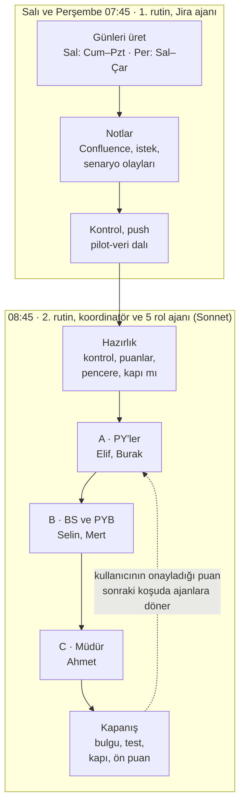
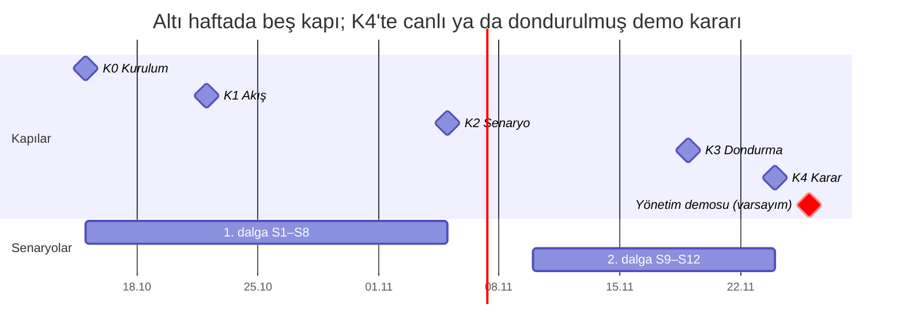

# PlanAsistan Pilotu — Rutin Beklentileri ve Değerlendirme Notu

Son güncelleme: 12 Ekim 2026

Pilotun amacı, yönetim demosundan önce iki şeyi kanıtlamaktır: uygulama gerçekçi kullanımda doğru sonuç veriyor ve mock veri demo senaryosunu tutarlı biçimde taşıyor. Kodun ana dala alınması ikincil bir kapıdır; iki karar ayrı verilir.

Pilot 15 Ekim–26 Kasım arasında Salı ve Perşembe koşularıyla yürür; **yönetim demosu, beş ajanın altı hafta çalıştığı bu ortamın kendisidir.** Ajanın uygulamaya yazmadığı iş demoda görünmez; bu yüzden rapor, risk, istek, not, RAG ve tahsis kararlarının hepsi MCP araçlarıyla uygulamaya yazılır. İlk koşu 15 Ekim 2026 (K0 kurulum kapısı).

12 Ekim itibarıyla danışman raporundaki dört P0 işi ile risk, istek ve not araçları kodda: `claude/nice-cerf-r9wv1r` dalında 106 dosyada 880 test geçiyor, rutinler bu dalı kullanır. Ayrıntı: değerlendirme ve yol haritası [DANISMAN_RAPORU.md](./DANISMAN_RAPORU.md), mimari [SISTEM_TASARIMI.md](./SISTEM_TASARIMI.md), iş listesi [BACKLOG.md](./BACKLOG.md).

## Koşu döngüsü (Salı ve Perşembe)

Jira ajanı Salı ve Perşembe sabahı son koşudan bu yana geçen günleri üretir. Rol ajanları aynı sabah üç aşamada, kendi hesaplarıyla çalışır; her aşama öncekinin bugünkü çıktısını görür. Koordinatör her ajana ölçütlere göre ön puan önerir; kullanıcının onayladığı ya da düzelttiği puan sonraki koşuda ajanlara döner.

## Kurgusal birim ve kullanıcılar

Pilot, 5 bölümlü (U300 PYB, U310 Yazılım, U320 Test, U330 Sistem, U340 Veri ve YZ), 24 kişilik kurgusal bir birimde yürür. Gerçek kişi, kurum ya da proje adı kullanılmaz.

| Proje | Jira | PY | Durum | Bilerek konmuş zorluk |
| --- | --- | --- | --- | --- |
| ATLAS Karar Destek Sistemi | ATL | Elif Yılmaz (ajan) | Devam, 2026 planı kilitli | Kapasite üstü iki kişi (KALKAN ile paylaşılan) |
| PUSULA Saha Mobil Uygulaması | PSL | Burak Demir (ajan) | Devam, plan onayda | Sınırda; PY raporu bazen geç gönderir |
| NEHİR Veri Platformu | NHR | Burak Demir (ajan) | Devam | Yapısal olarak en sorunlu proje: kapasitesinin %30 üstünde iş gelişi, hata yükü, bütçe aşımı eğilimi |
| KALKAN Siber İzleme | KLK | Can Erdem (arka plan) | Devam | Küçük ekip |
| YILDIZ Test Otomasyonu | — | Derya Aksoy (arka plan) | Teklif | Jira akışı yok; Kasım'dan plan |

| Ajan | Kişi | Rol | Uygulamada ne yapar |
| --- | --- | --- | --- |
| elif | Elif Yılmaz | Proje Yöneticisi (ATLAS) | Jira aktarımı, görev, risk, RAG, istek, not, haftalık rapor |
| burak | Burak Demir | Proje Yöneticisi (PUSULA, NEHİR) | İki projenin aynı işleri; kaynak talebi |
| selin | Selin Kaya | Bölüm Sorumlusu (U310) | Doluluk, aşırı tahsis, kaynak talebi yanıtı, rapor onayı ya da iadesi |
| mert | Mert Aydın | PYB Destek | Veri tutarlılığı, maliyet ↔ tahsis, rapor biçim onayı ve haftanın yayını |
| ahmet | Ahmet Şahin | Müdür | Portföy, EVM, kapasite-talep kararı; notları ve müşteri isteklerini göremez |

Ajanlar uygulamayı Claude'un bağlandığı MCP sunucusu üzerinden, her biri kendi pilot hesabıyla kullanır; rolleri Supabase üyeliğinden gelir, yetki kuralları (RLS) gerçekteki gibi uygulanır. Kalibrasyonla (simülasyon v4) Elif ve Burak U310'a alındı: raporlarını bölüm sorumlusu Selin onaylar.

## Rutin 1 — Jira ajanından beklenenler

Jira ajanı Salı ve Perşembe 07:45'te son koşudan bu yana geçen günleri üretir (Salı: Cuma–Pazartesi, Perşembe: Salı–Çarşamba); PY'ler gerçek Jira yerine bu veriyi kullanır. Amaç, PY'lerin üzerinde gerçek bir iş yapabileceği kadar tutarlı ve ayrıntılı ham madde üretmektir; PY'nin işini onun yerine yapmak değil. Talimat: [`pilot/RUTIN_1_VERI.md`](../../pilot/RUTIN_1_VERI.md).

**Ürettikleri**

- **Sahte Jira:** yeni kayıt, işe başlama, worklog, kapanış, yeniden açılma, termin ve sürüm. Biçim gerçek Jira REST API yanıtıyla aynıdır; uygulama gerçek Jira'ya bağlanır gibi bağlanır.
- **Confluence notları:** iki proje için günde 1–2 toplantı tutanağı, teknik karar kaydı ya da müşteri görüşmesi. Her notta katılımcılar, günün kayıt anahtarları (ör. NHR-58), bir karar ve sorumlu-tarihli bir aksiyon bulunur. Toplantı türü takvime uyar (koordinasyon Pazartesi, sprint değerlendirme sürüm bitince).
- **Senaryo olayları:** Jira'da iz bırakan altı senaryo (S1, S3, S6, S8, S9, S10) 15 Ekim'de `pilot senaryo ekle` ile **bir kez** kaydedilir; simülasyon ilgili günü üretirken uygular. Ajanın işi olayın notlardaki karşılığıdır (izin duyurusu, triyaj notu). Anlatı türündeki senaryoları (S2, S11) `pilot istek` ve not ile kendisi üretir.
- **Arka plandaki birim:** KALKAN'ın PY'si, ay başı gerçekleşen adam-ay, diğer çalışanların kayıtları.

**Gerçekçilik kuralları**

- Olay dosyasındaki ve notlardaki her sayı Jira verisinden türetilir; notlarda verilen saat, kayıt ve tarih Jira ile birebir tutar.
- Jira worklog'u ile Jira dışı genel gider (toplantı, proje yönetimi) ayrı tutulur. 9 Ekim'de bu kural ihlal edildi (B-013); simülasyon düzeltildi.
- Hafta sonu ve tatilde not ya da olay üretilmez; izinli kişi worklog girmez.
- Bir senaryo olayı önceki günlerin sinyalleriyle hazırlanır (ör. kritik hatadan önce artan yeniden açılmalar) ve sonuçları sonraki günlere yayılır. Olay dosyasında görünmeyen senaryonun notu yazılmaz.

**Yapmaması gerekenler**

- Persona PY'lerin (Elif, Burak) işini yapmamalı: projelerine Jira aktarımı, RAG, risk ve haftalık rapor girmemeli. Simülasyon v4'ten beri ajanlı dönemde (12 Ekim sonrası) persona projelerinin raporunu yazmıyor, onaylamıyor.
- Jira dışa aktarımlarını elle düzenlememeli; yalnız simülasyon yazar.
- "Çalışmalara devam edildi" türünden boş cümle, adı geçmeyen kişi ya da Jira'da olmayan kayıt üretmemeli; notlara "senaryo" yazmamalı.

**Takvim istisnaları:** 13 Ekim atlanır (15 Ekim koşusu 9–14 Ekim'i birlikte üretir ve simülasyon v4 ile `baslat --zorla` yeniden kurulum yapar); 26 Kasım yalnız K4 kararı "canlı" ise çalışır; 27 Kasım'dan sonra pilot kapanır.

## Rutin 2 — rol ajanlarından ortak beklentiler

Beş ajan Salı ve Perşembe 08:45'te üç aşamada (önce Elif ve Burak, sonra onların bugünkü işini gören Selin ve Mert, en son Ahmet) çalışır ve uygulamayı o gün gerçek bir çalışan nasıl kullanırsa öyle kullanır. Başarı ölçütü tek: yapılan iş gerçek hayatta yapılacak işin aynısı mı? Ajanlar ve alt ajanlar Sonnet'te çalışır. Talimat: [`pilot/RUTIN_2_KULLANICILAR.md`](../../pilot/RUTIN_2_KULLANICILAR.md).

1. **Tetikleyici olmadan iş yok.** Her değişiklik bir nedene dayanır: günün olay dosyası, Jira'daki bir değişiklik, bir toplantı notu, gelen bir mesaj ya da takvim (Perşembe raporu, ay kapanışı). Neden yazılamayan değişiklik yapılmaz.
2. **Çıktı için çıktı yok.** "Bugün değişiklik gerekmedi" geçerli ve tam puan alabilen bir sonuçtur. Dolgu not, tekrar eden risk, genel geçer rapor maddesi eksi puan alır.
3. **Veri eksiksiz ve gerçekçi girilir.** PY bir gerçek projede neyi kayıt altına alırsa onu girer: görev durumu, risk ve önlemi, RAG ve gerekçesi, toplantı notu, müşteri isteğinin kararı, haftalık rapor.
4. **Uygulamaya yazılmayan karar yapılmamış sayılır.** Demo bu veriyle yapılır; koordinatör her "uygulandı" beyanını bir okuma aracıyla doğrular, uygulamada olmayanı puandan düşer.
5. **Sayılar araçtan alınır.** Ajan bir rakamı ancak uygulamanın aracından ya da Jira'dan okuduktan sonra yazar; tahmin edilen rakam "tahmin" diye işaretlenir.
6. **Rol sınırına uyulur.** Ajan rolünün göremeyeceğini istemeyi koşu başına en çok bir kez, bilerek dener ve uygulamanın tepkisini not eder.
7. **Ajanlar birbiriyle konuşur.** Mesajlar somut ve rakamlıdır ("Onur bu ay 1,2 AA görünüyor; ATLAS'ta 0,2 azaltabilir miyiz?"); PY'nin mesajını sonraki aşamadaki rol aynı koşuda yanıtlar. Koşu başına tek tur çalışılır.
8. **Bulgu kanıtlıdır.** Her hata ya da tutarsızlık bildirimi komutu ve çıktıdan alıntıyı içerir; koordinatör bulguyu yeniden üretmeden rapora almaz.

**Sınırlar:** değişiklik sayısında sınır yok, her değişiklik tetikleyici ve gerekçeyle kaydedilir; ajan başına en çok 40 araç çağrısı; yetişmeyen iş ve verilen sözler `pilot-data/ajanda/` altında bir sonraki koşuya kalır.

**Koordinatörün ek işleri (v3):** Perşembe koşularında ve kapı günlerinde `demo-testi` çalıştırır; kapı günlerinde ölçütleri `kapilar.md`'ye yazar ve `dondur` ile geri dönülebilir kopya alır; ajanların bulgularını gömülü bulgularla (G1–G6) karşılaştırır, ajanlara söylemez.

## PY ajanlarının iş döngüsü

Elif ve Burak, gerçek bir PY'nin günlük, haftalık ve aylık işlerinin tamamını uygulamada yapar; 9 Ekim tablosundaki üç eksik araç (not, risk güncelleme/kapatma, istek kararı) ve rapor araçları artık MCP'de olduğundan döngünün her adımı uygulamaya yazılır.

| Ne zaman | İş | Uygulamadaki araç | Gerçekçilik ölçütü |
| --- | --- | --- | --- |
| Her koşu, ilk iş | Jira'dan güncelle: önizlemeyi penceredeki olay dosyalarıyla karşılaştır, onayla | `jira_aktar` | Yeni/güncellenen kayıt sayısı olay dosyasıyla tutar; tutmuyorsa nedeni yazılır |
| Her koşu | Geciken ve yaklaşan işleri incele; Jira dışı işleri (sunum, satın alma, sözleşme/hakediş, kabul testi, kullanıcı eğitimi) görev olarak gir | `gorev_ara`, `oner_gorev_durumu`, `oner_gorev_ekle` | Jira'daki iş elle açılmaz; elle açılan işin sahibi ve terminidir |
| Her koşu | Günün notlarını oku, kendi kaydını gir (karar, aksiyon, sorumlu, tarih) | `notlari_ara`, `oner_not_ekle` | Not Confluence notunu kopyalamaz; PY'nin kararını ekler |
| Sinyal geldiğinde | Riski aç, güncelle ya da kapat; olasılık × etki gerekçeli, önlem ve sorumlu | `risk_listesi`, `oner_risk_ekle`, `oner_risk_guncelle` | Aynı risk iki kez açılmaz; geçen risk kapatılır |
| Kaynak sıkıştığında | Doluluğa bak, uygun kişi ara, bölüm sorumlusundan talep et | `doluluk_analizi`, `uygun_kisi_bul`, `kisi_profili` | Talep rol, adam-ay ve ay içerir |
| Müşteri isteği geldiğinde | Kabul (görev açılır, efor "tahmin") ya da ret; gerekçede kapsam, efor ve takvim etkisi | `musteri_istekleri`, `oner_istek_karari` | İstek en geç 2 iş günü içinde karara bağlanır |
| Salı koşusu | Geçen haftanın plan maddelerini gözden geçir, haftanın hedeflerini ajandaya koy | `proje_detayi`, `gorev_ara` | Hedefler ölçülebilir ve tarihli |
| Perşembe koşusu | Haftalık raporu AI ile yaz, düzelt, gönder; RAG'ı gerekçesiyle güncelle | `haftalik_rapor_taslagi`, `jira_worklog`, `oner_haftalik_rapor`, `oner_rag_guncelle` | Kurum kılavuzuna uygun, biçim uyarısız; RAG geciken oranı, SPI ve yüksek risklerle tutarlı |
| İade geldiğinde | İade notunu karşıla, raporu yeniden gönder | `haftalik_rapor`, `oner_haftalik_rapor` | İade notundaki her madde karşılanır |
| Ay kapanışı | Geçen ayın gerçekleşen adam-ayını worklog ile karşılaştır, sapmayı açıkla | `tahsis_ozeti`, `jira_worklog`, `oner_tahsis_ayarla` | Plan kilitliyse yalnız gerçekleşen girilir |

**Haftalık raporun AI ile yazılması (uygulamanın kendi rapor akışı, MCP'den)**

1. `haftalik_rapor_taslagi` ile uygulamanın "Taslak öner" paketini al (kurum kılavuzu, proje kartı, kısaltma sözlüğü). İlk JSON **AI taslağı** olarak değiştirilmeden saklanır.
2. Kaynakları topla: haftanın olayları ve notları, `jira_worklog`, kapanan işler, müşteri istekleri, geçen haftanın plan maddeleri.
3. Taslağı PY olarak düzelt: her rakamı, tarihi ve adı kaynaklarla doğrula, kaynağı olmayan maddeyi sil, belirsiz ifadeyi somutlaştır.
4. Geçen haftanın plan maddelerini değerlendir: tamamlandı, kısmen, kaydı ya da bırakıldı, gerekçesiyle.
5. `oner_haftalik_rapor` ile haftaya 1–10 puan verip gönder. Biçim hatası gönderimi durdurur; kaynağı bulunamayan rakam, tarih ya da ad "dayanaksız" uyarısıyla döner. AI taslağıyla eşleşen maddeler düzeltme ölçüsüne girer.

Akışın sonrası: Selin aynı Perşembe koşusunda `oner_rapor_karari` ile onaylar ya da madde madde iade eder; Mert Salı koşusunda biçim onayı verir ve `oner_hafta_yayinla` ile haftayı müdürlüğe yayınlar; Ahmet yayınlanan haftayı okur. Puanlamada AI'nın ilk taslağı ile gönderilen hâl birlikte okunur: PY'nin taslakta yaptığı doğru düzeltmeler gerçekçiliğin en güçlü kanıtıdır.

## Diğer rollerin beklentileri

Üç rol, PY'lerin girdiği veriyi gerçek hayattaki görevleriyle tüketir ve denetler; işleri PY'lerin verisi gerçekçi olduğu ölçüde anlamlıdır.

| Rol | Her koşu | Haftalık rapor akışındaki yeri |
| --- | --- | --- |
| Selin Kaya — Bölüm Sorumlusu (U310) | U310 doluluğu ve aşırı tahsisi izler (`doluluk_analizi`, `departman_karnesi`, `kapasite_talep`); gelen kaynak talebine rakamla yanıt verir; plan kilidine uyarak tahsis düzeltmesi önerir | Perşembe: ATLAS, PUSULA, NEHİR raporlarını okur, `oner_rapor_karari` ile onaylar ya da eksikleri madde madde yazarak iade eder |
| Mert Aydın — PYB Destek | Tahsis toplamlarını, eksik PY'yi, maliyet ↔ tahsis ve worklog ↔ gerçekleşen adam-ay tutarlılığını denetler; bulduğunu ilgilisine yazar; geciken raporu izler | Salı: bölüm onaylı raporların (KALKAN dahil) biçimini onaylar ya da iade eder, haftayı `oner_hafta_yayinla` ile yayınlar. Genel veri girişi kapalıdır, rapor denetimi ve yayın açıktır |
| Ahmet Şahin — Müdür | Portföyü, EVM'yi ve maliyet sapmasını izler; kapasite-talebe bakıp işe alım, kaydırma, ek bütçe ya da öncelik kararı verir; kritik projenin PY'sinden açıklama ister. Notları ve müşteri isteklerini göremez | Yayınlanan haftanın raporlarını okur, gerektiğinde PY'ye beklenti iletir |

Bu üç rol de gerçekçilik üzerinden puanlanır. Ek beklenti: PY'nin verisinde gördükleri gerçek dışı bir şeyi (ör. gecikmeye rağmen "Yolunda" RAG) ilgili PY'ye rakamla yazmaları; bu, PY puanına da yansır. Ahmet her koşuda üç demo sorusunu uygulamayla yanıtlar (demo yoklaması, DH6).

## Takvim ve ara kapılar

Koşular Salı ve Perşembe; her kapı zamanında geçilmezse demo kapsamı daralır. 13 Ekim koşusu atlanır, 29 Ekim tatildir (44. hafta raporu 27 Ekim'de), demo tarihi kesinleşince takvim ve iki rutinin istisnaları güncellenir. Koşu koşu ayrıntı: [`pilot/SENARYOLAR.md`](../../pilot/SENARYOLAR.md).

| Kapı | Ne zaman | Geçme ölçütü | Geçmezse |
| --- | --- | --- | --- |
| K0 Kurulum | 15 Ekim, iki rutin sonrası | v4 yeniden kurulum Supabase'de; `senaryo liste` S1, S3, S6, S8, S9, S10'u gösterir; `kontrol` tümü geçti; `demo-testi` GEÇTİ (CDN uyarısı hariç) | 20 Ekim'e kadar kod düzeltmesi; senaryo tarihleri kaydırılır |
| K1 Akış | 22 Ekim, 2. rutin sonrası | 42. hafta raporları uçtan uca (gönderim → bölüm sorumlusu → PYB destek → yayın) MCP araçlarıyla geçti; her persona en az bir yazma aracını gerekçeli kullandı; S2 kararı uygulamada; açık yüksek bulgu yok ya da düzeltmesi planlandı | 27 Ekim'e kadar düzeltme; K2 ölçütleri değişmez |
| K2 Senaryo | 5 Kasım, 2. rutin sonrası | S1–S8'in en az 6'sı başarı ölçütüne ulaştı; PY ortalaması ≥ 75; DH1–DH3 sağlanıyor; gömülü bulguların en az 3/6'sı bulundu | 2. dalga zayıf senaryonun telafisine ayrılır (S12); demo kapsamı daraltılır |
| K3 Dondurma | 19 Kasım, 2. rutin sonrası | Kod dondurulur (sonrası yalnız demo yolunu bozan hata düzeltmesi); `demo-testi` son 3 koşuda GEÇTİ; S9–S11 değerlendirildi; demo akışı yazılı; `dondur --ad K3-2026-11-19` | Demo, K3'te çalışan ekranlarla sınırlanır |
| K4 Karar | 24 Kasım, 2. rutin sonrası | DH1–DH7 sağlanıyor; sunumu yapacak kişi demo akışını uygulamada baştan sona gezdi (canlı prova); `dondur --ad K4-2026-11-24` | Demo dondurulmuş yapılır ya da ertelenir |

## Senaryo takvimi

On iki senaryo iki dalgaya yayılır: 1. dalga (S1–S8) 15 Ekim–5 Kasım, 2. dalga (S9–S12) 10–24 Kasım. Jira'da iz bırakan altı senaryo (S1, S3, S6, S8, S9, S10) artık simülasyonun senaryo komutuyla üretilir ve 15 Ekim'de bir kez kaydedilir. Ajanlar ne olacağını bilmez: ayrıntı `pilot/SENARYOLAR.md`'dedir ve rol ajanlarına verilmez.

| # | Veri günü → koşu | Senaryo | Üretim | PY'den beklenen | Diğer roller | Başarı ölçütü |
| --- | --- | --- | --- | --- | --- | --- |
| S2 | 12–14 Ekim → 15 Ekim | PUSULA kapsam değişikliği (çevrimdışı mod) | Anlatı (`pilot istek` + not) | Burak: isteği "tahmin" eforla `oner_istek_karari` ile kabul ya da ret, plan onayda olduğundan revizyon önerir | Ahmet öncelik kararı | İstek uygulamada karara bağlı; kapsam etkisi 42. hafta raporunda |
| S1 | 15–21 Ekim → 22 Ekim | NEHİR kritik hata zinciri (müşteride veri kaybı, Highest) | Simülasyon | Burak: aktarım, gerekçeli risk ve önlem, RAG ve gerekçesi, test kaynağı talebi, raporda dürüst anlatım | Selin talebi rakamla yanıtlar; Ahmet açıklama ister | Risk, RAG ve rapor aynı olguyu aynı rakamlarla anlatır |
| S4 | 22 Ekim → 27 Ekim | Haftalık rapor iadesi | Rutin 2, kendiliğinden | Burak iade notunu karşılar, yeniden gönderir | Selin iade eder; Mert biçimi denetler | İade notunun her maddesi karşılanır; iade olmazsa zorlanmaz |
| S3 | 19 Ekim duyuru, 26 Ekim–6 Kasım izin | ATLAS kilit kişi izni (Onur Çelik) | Simülasyon | Elif riski açar, işi dağıtır ya da ikame ister; plan kilitli, yalnız gerçekleşen değişir | Selin ikame önerir | Termin kaymaları raporda gerekçeli; plan kilidi korunur |
| S6 | 19–30 Ekim → 27 Ekim ve 3 Kasım | NEHİR bütçe aşımı (fazla mesai ×1,5) | Simülasyon | Burak: 27 Ekim worklog ile erken uyarı; 3 Kasım EVM ile sapma, ek bütçe ya da kapsam önerisi | Mert maliyet ↔ tahsis; Ahmet 5 Kasım'da karar | Erken uyarı worklog rakamıyla, kesin sapma EVM aracından |
| S5 | 28–29 Ekim → 27 Ekim | Bayram haftası | Takvim (arife yarım günü modellenmedi, BL-14) | PY'ler 44. hafta raporunu 27 Ekim'de gönderir | Mert gecikmeyi izler; 29 Ekim ajanlar çalışmaz | Tatile kayıt girilmez; rapor zamanında |
| S7 | 2 Kasım → 3 Kasım | Ay kapanışı | Simülasyon (mevcut) | PY'ler gerçekleşeni worklog ile karşılaştırır, sapmayı açıklar | Mert worklog ↔ gerçekleşen kontrolü | Fark ±0,1 AA içinde ya da açıklamalı |
| S8 | 4 Kasım → 5 Kasım | YILDIZ teklifi kazanıldı (U320 2 × 1,0 AA, U340 1 × 0,5 AA) | Simülasyon | — (YILDIZ'ın PY'si arka planda) | Selin kaydırma ya da işe alım önerir; Ahmet karar verir | Karar kapasite-talep rakamına dayanır |
| S9 | 7–10 Kasım sinyal, 11 Kasım olay → 12 Kasım | PUSULA kritik hata: eşitlemede mükerrer kayıt | Simülasyon | Burak iki projede eşzamanlı krizi yönetir, öncelik sırasını gerekçelendirir, S2 kararını yeniden değerlendirir | Ahmet iki projeyi birlikte dinler | İki raporun tutarlılığı; öncelik kararı rakamlı |
| S10 | 9 Kasım duyuru, 16–27 Kasım izin | NEHİR kilit kişi izni (Ozan Kılıç, S1 kaydı onda) | Simülasyon | Burak S1 kaydını devreder ya da ikame ister | Selin U340 kaynağını S8 ihtiyacıyla çatışma içinde değerlendirir; Ahmet önceliklendirir | Devir/ikame kararı rakamlı; kaynak çatışması açıkça çözülür |
| S11 | 17 Kasım → 19 Kasım | ATLAS müşteri isteği: senaryo karşılaştırma görünümü | Anlatı | Elif `oner_istek_karari` ile karar verir; plan kilidi ve S3 sonrası kapasiteyle ilişkilendirir | — | Karar 2 iş günü içinde, eforu ve takvim etkisi gerekçede |
| S12 | K2'de seçilir | Telafi: 1. dalgada başarısız kalan senaryonun bir çeşidi | — | — | — | Seçilmezse yok |

S6'nın kesin rakamı ay kapanışından sonra gelir: EVM aylık gerçekleşen adam-ayla ve gerçekleşeni girilmiş son aya kadar hesaplanır (BL-07); Ekim, 2 Kasım ay kapanışıyla girer. Bu yüzden S6'nın EVM ölçütü 3 Kasım'dadır; ay içinde erken uyarı worklog'dan gelir.

## Puanlama

Ajanların işini kullanıcı puanlar; tek ölçüt gerçekçiliktir: aynı rolde deneyimli bir çalışan bu işi böyle yapar mıydı? Ajanlar en yüksek puanı almaya çalışır; bu yüzden ölçütler hacmi değil, doğruluğu ve gerekliliği ödüllendirir.

**PY ajanları (100 puan)**

| Ölçüt | Puan | Tam puan için | Puan kırdıran |
| --- | --- | --- | --- |
| Veriyle tutarlılık | 30 | Her rakam, tarih ve kayıt anahtarı Jira ve uygulamayla birebir | Kaynağı olmayan ya da yanlış rakam |
| İş döngüsünün eksiksizliği | 20 | Günün ve haftanın zorunlu işleri zamanında: aktarım, risk ve RAG, Perşembe raporu, ay kapanışı | Atlanan zorunlu iş, geç rapor |
| Haftalık rapor kalitesi | 20 | Ölçülebilir, tarihli, kılavuza uygun; plan değerlendirmesi dürüst; AI taslağının hataları düzeltilmiş | Genel geçer madde, düzeltilmemiş AI hatası, biçim uyarısı |
| Karar ve gerekçe | 15 | Her değişikliğin tetikleyicisi ve gerekçesi yazılı; rol sınırına uygun | Gerekçesiz ya da gereksiz değişiklik |
| İletişim | 10 | Mesaj ve yanıtlar somut, rakamlı, zamanında; verilen söz vadesinde tutulur (ajanda) | Yanıtsız mesaj, belirsiz talep, unutulan söz |
| Bulgu kalitesi | 5 | Kanıtlı, yeniden üretilebilir bulgu; gömülü bulgulardan birini bulmak | Kanıtsız ya da abartılı bulgu |

**Eksi puanlar** (toplamdan düşülür)

- Uydurma kişi, kayıt ya da rakam: her biri −15.
- Çıktı için çıktı (dolgu not, ikinci kez açılan risk, kopya rapor maddesi): her biri −5.
- Olay gerçekleşmeden ona tepki vermek (senaryoyu biliyormuş gibi davranmak): −10.
- Gizli veri ya da sicil sızdırmak, rol dışını bildirmeden zorlamak: −10.
- Uygulamaya yazılmamış kararı "uygulandı" diye bildirmek: gerçek dışı beyan, puandan düşülür.

**Diğer roller ve Jira ajanı**

- Selin, Mert ve Ahmet aynı altı ölçütle puanlanır; "Haftalık rapor kalitesi" yerine rolün asıl işi gelir: Selin için talep ve onay kararları, Mert için denetim isabeti, Ahmet için karar kalitesi.
- Jira ajanı üç ölçütle puanlanır: Jira, olay dosyası ve notların birbiriyle tutarlılığı (50), senaryoların sinyalleriyle hazırlanması (30), tekrar etmeyen ve somut içerik (20).

**Süreç**

1. Koordinatör her koşuda ajan başına ölçütlere göre kanıtlı ön puan önerir; kullanıcı Rutin 2 oturumuna onayını ya da kendi puanını bir cümle gerekçeyle yazar (ör. "elif 82: rapor maddeleri tarihsiz"). Koordinatör bunu `pilot-data/puanlar.json`'a işler.
2. Her ajan bir sonraki koşuda kendi son 5 puanını ve gerekçelerini görerek başlar; aynı hatayı tekrarlamamaya çalışır.
3. Koşu raporunda puan tablosu ve haftalık ortalama yer alır. Hedef (DH4): son 4 koşuda PY ortalaması en az 80, hiçbir koşuda 70'in altı yok.
4. Ajan kendine puan vermez; ajanın memnuniyet değerlendirmesi ürün geri bildirimi olarak ayrı tutulur.

## Demo kapısı: yönetime hazır mıyız?

Koordinatör her koşuda iki karar verir: demo kararı ve kod birleştirme kararı. Demo kararı yedi ölçüte dayanır: hepsi sağlanınca "Hazır"; DH1–DH3 ve DH7 sağlanıp diğerleri sürüyorsa "Koşullu"; DH1, DH2, DH3 ya da DH7 sağlanmıyorsa "Hazır değil".

| Ölçüt | Eşik | Nasıl ölçülür |
| --- | --- | --- |
| DH1 Kontroller | Son 4 koşuda tümü geçti | `pilot kontrol` |
| DH2 Bulgular | Açık yüksek bulgu yok; demo yolunu etkileyen orta bulgu yok | `bulgular.json` |
| DH3 Veri tutarlılığı | Olay dosyası, Jira, not ve uygulama rakamları çelişkisiz | Koordinatörün her koşuda 5 rakamlık örneklemi |
| DH4 Gerçekçilik | Son 4 koşuda PY ortalaması ≥ 80, hiçbir koşuda < 70 | `puanlar.json` (kullanıcı puanı; yoksa ön puan, ayrıca belirtilir) |
| DH5 Senaryolar | Penceredeki senaryolar başarı ölçütüne ulaştı | Senaryo takvimi |
| DH6 Demo yoklaması | Müdürün üç sorusu ≤ 3 araç çağrısında, tutarlı yanıtlanır | Ahmet'in `demo_yoklamasi` alanı |
| DH7 Demo yolu | Son `demo-testi` GEÇTİ; ekrandaki sağlık puanı MCP ile aynı | `pilot demo-testi` (Perşembe ve kapı günleri) |

Müdürün üç sorusu demonun da omurgasıdır: "Bu hafta hangi proje dikkatimi gerektiriyor ve neden?", "Kaynak sıkıntısı işe alımla mı, kaydırmayla mı çözülür?", "En riskli projenin toparlanma planı ve tarihi ne?" Kod birleştirme ayrı karardır: son 3 koşuda kontrollerin tamamı geçti ve açık yüksek bulgu yok.

**Demo günü protokolü**

1. 24 Kasım 2. rutin sonunda K4 kopyası alınır (`pilot-data/donmus/K4-2026-11-24/`).
2. K4 kararı üç seçenektir ve kullanıcı tarafından 2. rutin oturumuna yazılır: *Canlı* (26 Kasım sabahı iki rutin normal çalışır), *Dondurulmuş* (26 Kasım koşuları atlanır, demo K4 kopyasıyla) ya da *Ertele*. Yazılmazsa varsayılan dondurulmuştur.
3. Canlı kararında 26 Kasım koşusu `kontrol` ve `demo-testi` ile biter; biri KALDI ise `geri-yukle --ad K4-2026-11-24` ile geri dönülür ve sunum dondurulmuş yapılır.
4. Sunum: uygulamaya izleyici hesabıyla, müdür görünümüyle girilir ("Buluttan Çek"). Demo akışı `demo-testi`nin gezdiği yoldur: Yönetim → Portföy → Ekip ve tahsis › Kapasite–talep → Risk raporu → Haftalık rapor; ardından NEHİR, PY gözüyle.
5. Canlı an: Ahmet'in demo yoklaması sorularından biri aynı çalışma alanına bağlı Claude'a (MCP) sunumda sorulur; yanıtın rakamları ekrandakilerle aynıdır.
6. Sunum makinesinde CDN erişimi (Tailwind, ikonlar, Excel kitaplığı) önceden denenir; kurum ağı engelliyorsa ekran biçimsiz görünür (BL-08).

## Açıklar ve geliştirmeler

9 Ekim'de karşılanamayan üç beklenti (rapor, not, risk kapatma) 12 Ekim itibarıyla kodda karşılanıyor; açık kalanların üçü demo hikâyesinde görünür (ay içi gerçekleşen, maliyet sapması, teklif skoru). Güncel iş listesi ve kanıtlar: [BACKLOG.md](./BACKLOG.md).

| Beklenti | 9 Ekim | 12 Ekim durumu | BL |
| --- | --- | --- | --- |
| PY haftalık raporu AI ile yazıp gönderir; onay/iade ve yayın | MCP'de rapor aracı yoktu; simülasyon tüm raporları kalıp maddelerle yazıyordu | Yapıldı: taslak, kaydet/gönder, onay/iade, yayın MCP'de; simülasyon persona projelerinin raporunu yazmıyor; geçici yol kalktı | BL-03 |
| Raporu uygulamanın AI asistanıyla yazmak | Rapor AI'ı pilot dalında yoktu | Yapıldı: ana dal pilot koduyla birleştirildi | — |
| PY toplantı notu ve müşteri görüşmesi girer | Not ekleme aracı yoktu | Yapıldı: `oner_not_ekle` (müşteri görüşmesi etiketli not olarak) | BL-05 |
| Senaryolar Jira'da iz bırakır | S1, S3, S6, S8 üretilemiyordu | Yapıldı: `pilot senaryo` (kritik hata, izin, fazla mesai, teklif kazanımı); senaryolar `durum.json`'da | BL-01 |
| Mock veri yönetime inandırıcı görünür | Doluluk %49, kapasite-talep açığı 0, CPI 1,0–1,4, istekler hep "Yeni" | Yapıldı: doluluk %88, 2 rolde açık, CPI ay kapanışında 0,84–1,03, istekler geçmişte karara bağlı | BL-02 |
| Demo arayüzde yapılır | Ekranlar sınanmıyordu | Yapıldı: `pilot demo-testi`, 4 persona, 2 arayüz, 28/28 adım | BL-04 |
| Demo günü güvenliği | — | Yapıldı: `pilot dondur` / `geri-yukle` | BL-06 |
| Ajan işi puanlanır, ajan puandan öğrenir | Puan kaydı yoktu | Yapıldı (v2): `puanlar.json` | — |
| Eksiksiz veri girişi | Günde en çok 3 değişiklik | Yapıldı (v2): sınır kalktı, 40 araç çağrısı | — |
| Ajan verdiği sözü hatırlar | Her koşu sıfırdan | Yapıldı (v2): `pilot-data/ajanda/` | — |
| Risk güncellenir ve kapanır; müşteri isteği ilerler | Yalnız risk ekleme vardı | Yapıldı: `oner_risk_guncelle`, `oner_istek_karari` | BL-05 |
| Raporun son günü tek | Rehber Perşembe, simülasyon Cuma | Yapıldı: Perşembe teslim, Cuma bölüm onayı, Pazartesi yayın | BL-02 |
| Gerçekleşen adam-ay worklog ile tutar | Ay içinde 0 (B-010); Ekim CPI'si ay ortasında şişkin | Yapıldı: EVM gerçekleşeni girilmiş son aya kadar hesaplanır, CPI şişmez. Ay içi tahmini gerçekleşen pilot sonrasına kaldı | BL-07, BL-22 |
| Maliyet sapması aynı dönemle kıyaslanır | Yıllık plan Ocak–Eylül gerçekleşeniyle | Açık | BL-09 |
| Ajanlar uygulama üzerinden yazışır | Mesaj ve kaynak talebi aracı yok (B-007) | Açık: yazışma pilot dosyasında yürüyor | BL-12 |

## Danışmana sorular

Bu on bir soru, notun düzeltmeye açık kararlarıydı; yanıtlar 10 Ekim'de verildi ve rutin talimatlarına (v2, ardından v3) işlendi. Kod gerektiren geliştirmeler Backlog'dadır.

| # | Soru | Önerimiz | Danışman görüşü |
| --- | --- | --- | --- |
| 1 | PY iş döngüsü tablosu gerçek PY pratiğini yansıtıyor mu; eksik ya da fazla iş var mı? | Tablodaki 11 iş | Büyük ölçüde evet. Eksik: verilen sözün takibi (ajanda), paydaş ve müşteri iletişimi, kabul testi, teslimat ve hakediş gibi kilometre taşları. Fazla: RAG'ın Cuma ayrı iş olması; raporla birlikte Perşembe yapılsın. `son_degisiklikler` MCP'de yok; tabloda düzeltildi. |
| 2 | Haftalık raporun son günü Perşembe mi, Cuma mı? Onay ve yayın hangi günler? | Perşembe teslim, Cuma bölüm sorumlusu onayı, Pazartesi yayın | Perşembe 17:00 PY teslimi, Cuma 12:00 bölüm sorumlusu onayı ya da iadesi, Pazartesi PYB destek yayını. Pilotta Perşembe koşusu teslim ve onay/iadeyi, Salı koşusu biçim denetimi ve yayını kapsar. Simülasyonun Cuma raporu Perşembe'ye çekilmeli. |
| 3 | Sekiz senaryo gerçekçi mi; sıklığı (haftada 2–3) uygun mu? | Senaryo takvimi | Gerçekçi ve iyi seçilmiş. Haftada iki olay yeterli; fazlası ajanları sürekli kriz kipinde tutar. İki düzeltme: S6'nın kesin rakamı ay kapanışından (S7) sonra gelir; S1, S3, S6 ve S8 simülasyon desteği olmadan üretilmemeli. Takvim 15 Ekim–5 Kasım'a kaydırıldı. |
| 4 | Puan ağırlıkları uygun mu? | Tutarlılık 30, döngü 20, rapor 20, gerekçe 15, iletişim 10, bulgu 5 | Uygun; iki hafta sabit kalsın ki puanlar kıyaslanabilsin. İletişim ölçütü söz takibini de kapsasın. Kullanıcının yükü için koordinatör kanıtlı ön puan önersin, kullanıcı onaylasın ya da düzeltsin; ikisi arasındaki fark izlensin. |
| 5 | Burak'ın karakteri "yoğun, bazen geç günceller". Bu gerçekçi gecikme puanda nasıl ele alınsın? | Gecikme gerekçeliyse ve haftada bir günü geçmiyorsa puan kırmaz | Öneriye katılıyorum: gerekçeli, önceden bildirilmiş ve en çok bir günlük gecikme puan kırmaz. Üç haftada bir kezi geçmesin ki Mert'in geciken rapor takibi sınansın ama örüntüye dönüşmesin. Bildirimsiz gecikme döngü puanından düşer. |
| 6 | PY hangi Jira dışı işleri görev olarak açmalı? | Müşteri sunumu, satın alma, sözleşme ve hakediş işleri | Önerilen dördüne ek: kabul testi ve teslimat koordinasyonu, kullanıcı eğitimi, yönlendirme kurulu hazırlığı, dönem raporu, sözleşme değişikliği ve satın alma şartnamesi. Ölçüt: sahibi ve termini olan, Jira ekibinin değil PY'nin yaptığı iş. |
| 7 | RAG kuralı için eşikler ne olmalı? | Geciken açık iş %20'yi geçerse ya da 1 yüksek risk varsa Sarı; %45'i geçerse ya da 3 yüksek risk varsa Kırmızı (yüksek risk: olasılık × etki ≥ 15) | Öneri iyi ama geciken oranı tek başına oynak (NEHİR'de 25 açık işin 18'i, %72). Ekleyin: SPI < 0,95 Sarı, < 0,85 Kırmızı; CPI için aynı eşikler; müşteride veri kaybı gibi engelleyici hata Kırmızı. Uygulama önerilen RAG'ı göstersin; PY farklı seçerse gerekçe zorunlu olsun. |
| 8 | Bölüm sorumlusu başka bölümlerin kişi ve maliyet verisini görmeli mi? | Yalnız kendi bölümünü | Kişi ve maliyet ayrıntısında yalnız kendi bölümü. Kaynak eşleştirmesi için diğer bölümlerin rol bazında boş kapasitesini adsız ve maliyetsiz görmeli (ör. "U320'de Kasım'da 1,2 AA test mühendisi"); isim, karşı bölüm sorumlusu onaylayınca açılır. |
| 9 | Gerçekleşen adam-ay ay içinde worklog'dan anında mı hesaplanmalı (B-010)? | Ay içinde tahmini, ay kapanışında kesin | Ay içinde worklog'dan "tahmini gerçekleşen" (ayrı görünümle), ay kapanışında PYB onayıyla kesin. EVM ve maliyet ay içinde tahmini değeri kullanmalı: bugün Ekim 0 göründüğü için CPI yukarı kayıyor (portföy 1,17, KALKAN 1,40) ve S6 ay sonuna kadar görünmüyor. Önceliği Orta'ya çıkardım. |
| 10 | Ajanlar arası yazışma uygulama içinde mi olmalı (B-007)? | Evet; "Yönetimden beklentiler" modülüne bağlansın | Genel sohbet değil, yapılandırılmış talep: kaynak talebi (rol, AA, ay, gerekçe → onay, kısmi, ret) ve açıklama talebi (soru, termin → yanıt). Müdürün talepleri "Yönetimden beklentiler"e bağlansın. Değeri iz bırakmasıdır: kararlar denetlenebilir olur. |
| 11 | Ana dala alma ölçütü ne olsun? | Son 3 iş günü kontrollerin tamamı geçti, açık yüksek bulgu yok ve 3 hafta üst üste PY puan ortalaması en az 80 | İki kapıyı ayırın. Kod: son 3 koşuda kontrollerin tamamı geçti ve açık yüksek bulgu yok; ajan puanı beklenmez, yoksa dallar uzar (main, pilot dalının 19 commit önüne geçmişti). Demo: DH1–DH7 (Demo kapısı bölümü). |

## Ek: 9 Ekim pilot bulguları

İlk gün 14 bulgu açıldı; hepsi koordinatör ajan tarafından yeniden üretilerek doğrulandı. Dokuzu kodda düzeltildi; `bulgular.json`'da hepsi hâlâ "açık" görünüyor, çünkü kapanışları ilk Rutin 2 koşusunda (15 Ekim, K0) yeniden üretilerek doğrulanacak (BL-18). Açık kalan beşi tasarım kararı ya da geliştirme bekliyor.

| ID | Önem | Konu | Durum (12 Ekim) |
| --- | --- | --- | --- |
| B-001 | Yüksek | Kapasite-talep tüm satırlarda "Rol atanmamış", kapasite 0; işe alım kararına kullanılamıyor | Kodda düzeltildi, K0'da doğrulanacak |
| B-002 | Orta | Portföy RAG'ı PY elle girmedikçe gecikmeyi yansıtmıyor | Açık: önerilen RAG kuralı (BL-10) |
| B-003 | Orta | Görev aramasında bilinmeyen filtre sessizce yok sayılıyor | Kodda düzeltildi, K0'da doğrulanacak |
| B-004 | Orta | Tahsis özeti "gerçekleşen" istenince plan döndürüyor | Kodda düzeltildi, K0'da doğrulanacak |
| B-005 | Orta | Araç listesi parametre şeması vermiyor; yanlış parametre sessizce yok sayılıyor | Kodda düzeltildi, K0'da doğrulanacak |
| B-006 | Orta | Öneriyi ayrı çağrıda uygulamak öneriyi bulamıyor | Kodda düzeltildi, K0'da doğrulanacak |
| B-007 | Orta | Uygulama içi mesaj ve kaynak talebi yok | Açık: yapılandırılmış talep (BL-12) |
| B-008 | Orta | Bölüm sorumlusu kendisini "uygun kişi" olarak buluyor | Kodda düzeltildi, K0'da doğrulanacak |
| B-013 | Orta | Olay dosyasındaki worklog toplamları Jira'dan yüksek (veri) | Simülasyonda düzeltildi, K0'da doğrulanacak |
| B-009 | Düşük | RAG yalnız İngilizce değer kabul ediyor | Açık (BL-19) |
| B-010 | Düşük | Ay içinde gerçekleşen adam-ay 0, worklog'a bağlı değil | EVM son kapanan aya kadar (BL-07); ay içi tahmin pilot sonrası (BL-22) |
| B-011 | Düşük | Müşteri isteklerinde yinelenen başlıklar | Kodda düzeltildi, K0'da doğrulanacak |
| B-012 | Düşük | Görev araması Jira anahtarıyla sonuç vermiyor | Kodda düzeltildi, K0'da doğrulanacak |
| B-014 | Düşük | Plan kilidi ancak öneri denenince öğreniliyor | Açık (BL-20) |
