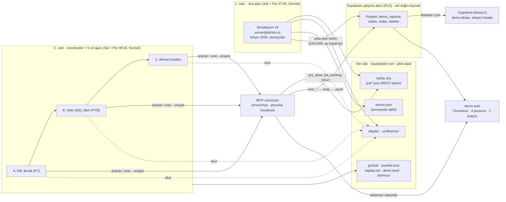
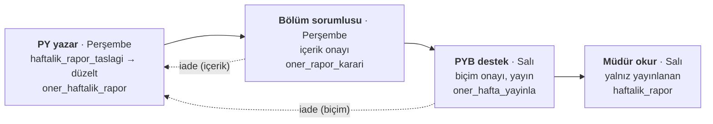

# Sistem tasarımı

Son güncelleme: 12 Ekim 2026

Pilot iki rutin, bir MCP sunucusu ve uygulamanın Supabase çalışma alanından oluşur; ajanlar uygulamaya yalnız MCP'den, kendi hesaplarıyla ve öneri → onay akışıyla yazar.

## Mimari

Jira ajanı veriyi üretir; rol ajanları uygulamaya yalnız MCP üzerinden, kendi hesaplarıyla yazar; demo ekranı ve `demo-testi` aynı Supabase çalışma alanını okur.

## Veri ve yetki

Tek doğru kaynak uygulamanın Supabase çalışma alanıdır; sahte Jira, simülasyon durumu (senaryolar dahil), olay ve Confluence dosyaları, koşu raporları, puanlar ve bulgular `claude/pilot-veri` dalında `pilot-data/` altında durur. Kod `claude/nice-cerf-r9wv1r` dalındadır (main + PR #49 + pilot v3); iki rutin de her koşuda bu dalı veri dalına birleştirip derler.

| Hesap | Rol | Kim kullanır |
| --- | --- | --- |
| `pilot-jira` | Çalışma alanı sahibi (PYB Destek) | 1. rutin, sunucu anahtarıyla yazar |
| `pilot-elif`, `pilot-burak` | Proje Yöneticisi | 2. rutin |
| `pilot-selin` | Bölüm Sorumlusu | 2. rutin |
| `pilot-mert` | PYB Destek | 2. rutin |
| `pilot-ahmet` | Müdür (notlar RLS ile kapalı) | 2. rutin |
| İzleyici hesabı | PYB Destek ya da müdür görünümü | Tarayıcıdan izleme ve demo |

- Personalar MCP sunucusuna kendi Supabase hesaplarıyla bağlanır; rolleri üyelikten gelir, yetki kuralları (RLS) gerçekteki gibi uygulanır. `pilot kontrol` bunu da sınar: müdür notları veritabanından okuyamaz ve yazamaz, PY okuyabilir.
- Gizli bilgiler yalnız ortam değişkenlerindedir (`PILOT_SUPABASE_URL`, `PILOT_SUPABASE_ANON_KEY`, `PILOT_SUPABASE_SERVICE_ROLE_KEY`, isteğe bağlı `PILOT_PASSWORD`); `pilot-data/bulut.json` yalnız çalışma alanı kimliğini ve alan adını tutar.
- `baslat --zorla` aynı çalışma alanını yerinde yeniler: kimlik ve üyelikler değişmez, izleyici yalnız "Buluttan Çek" der.

## Haftalık rapor akışı

Rapor iki onaydan sonra yayınlanır; iade her adımda PY'ye döner ve PY iade notunun her maddesini karşılayıp yeniden gönderir. AI taslağı ve gönderilen hâl birlikte saklanır; kaynağı bulunamayan rakam, tarih ya da ad uyarıyla döner.

Akış uygulamanın kendi rapor akışıdır (`utils/weeklyReport`); MCP onu açar, yeni kural eklemez. Gerçek takvimde PY Perşembe 17:00'de teslim eder, bölüm sorumlusu Cuma 12:00'ye kadar karar verir, PYB destek Pazartesi yayınlar; pilotta Perşembe koşusu teslim ve bölüm kararını, Salı koşusu biçim onayını ve yayını kapsar.

## Demo güvencesi

Demo ajanların ortamında yapıldığı için üç komut, ekranın doğru göründüğünü sınar ve bozulan ortamı geri alır.

| Komut | Ne yapar | Ne zaman |
| --- | --- | --- |
| `pilot demo-testi` | Çalışma alanını uygulamanın IndexedDB deposuna yazar; müdür, PY, bölüm sorumlusu ve PYB destek gözüyle demo ekranlarını klasik ve modern arayüzde Chromium'da gezer; çökme, sayfa hatası ve portföy sağlığının MCP'deki değerle aynılığını denetler (28 adım) | Perşembe koşuları ve kapı günleri (DH7) |
| `pilot dondur --ad K<n>-<tarih>` | Çalışma alanını (bulutta notlar dahil), simülasyon durumunu ve sahte Jira'yı `pilot-data/donmus/` altına yazar (yaklaşık 3 MB) | Her kapı gününün sonunda |
| `pilot geri-yukle --ad …` | Bulutta çalışma alanını yerinde yeniler, durum ve Jira'yı geri koyar, sonraki günlerin olay ve Confluence dosyalarını arşive taşır; aynı günün yeniden üretimi birebir aynıdır | Demo günü `kontrol` ya da `demo-testi` KALDI ise |

Geliştirme ortamında ağ politikası CDN'leri engellediği için ekranlar biçimsiz görünür; işlevsel denetimler yine çalışır ve CDN uyarısı bulgu sayılmaz. Sunum makinesinde CDN erişimi ayrıca denenir (BL-08).

## Tasarım kararları

| Karar | Neden | Bedeli |
| --- | --- | --- |
| Demo, ajanların çalıştığı ortamın kendisidir | Yönetim altı haftalık gerçek işi görür; ayrı bir demo verisi hazırlanmaz | Her karar uygulamaya yazılmalı; bozulan ortam için kapı kopyaları ve geri-yükle gerekir |
| Ajanlar uygulamaya yalnız MCP'den, öneri → onay akışıyla yazar | Gerçek kullanıcının onay adımı ve yetki kuralları aynı kalır | Her değişiklik iki çağrı (önizleme, `--onayla`) |
| Rapor işlemleri genel veri girişinden ayrı kapıdan | PYB destek veri girmez ama raporu denetler ve yayınlar; müdür yalnız yayınlanmış haftayı okur | Yetki modelinde ikinci bir yol |
| İstek ve not araçları yönetici rollerine hiç sunulmaz | Müdür notları ve müşteri isteklerini göremez (RLS ile tutarlı) | — |
| 1 iş günü = 8 saat | Uygulamanın Billed Hours kuralı; 7 saatlik günlükler CPI'yı 1'in üstüne itiyordu | Simülasyon yeniden kuruldu (v4, `baslat --zorla`) |
| Ajanlı dönem 12 Ekim'de başlar | Öncesini simülasyon yazar; sonrasında persona projelerinin RAG, risk, istek ve raporunu ajanlar yönetir | Geçmiş veride ajan kararı yok |
| Senaryolar `durum.json`'da; geçmişe etki eden senaryo reddedilir | Tohum 2026 ile üretim belirlenimci; senaryo geçmişi değiştiremez | Tarihi kaçan senaryo yeniden kaydedilemez |
| Haftada iki koşu, taze oturum, tüm ajanlar Sonnet | Kota ve maliyet; bağlam her koşuda sıfırdan | Ajan hafızası ajanda dosyasına bağlı |
| Araç kataloğu sınırı 18 000 karakter | Yeni PY yazma araçları kısaltılmış tanımlarla bile 16 000'i aştı | PY bağlamı biraz büyüdü (BL-15) |
