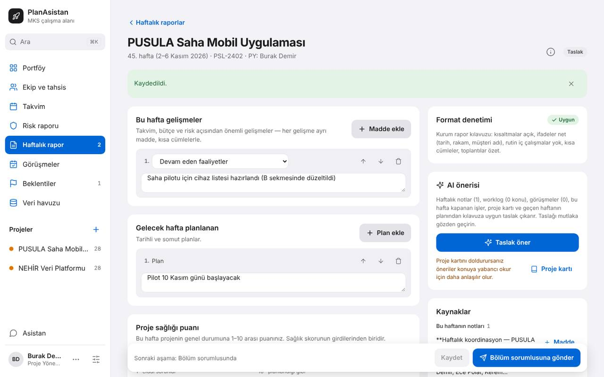
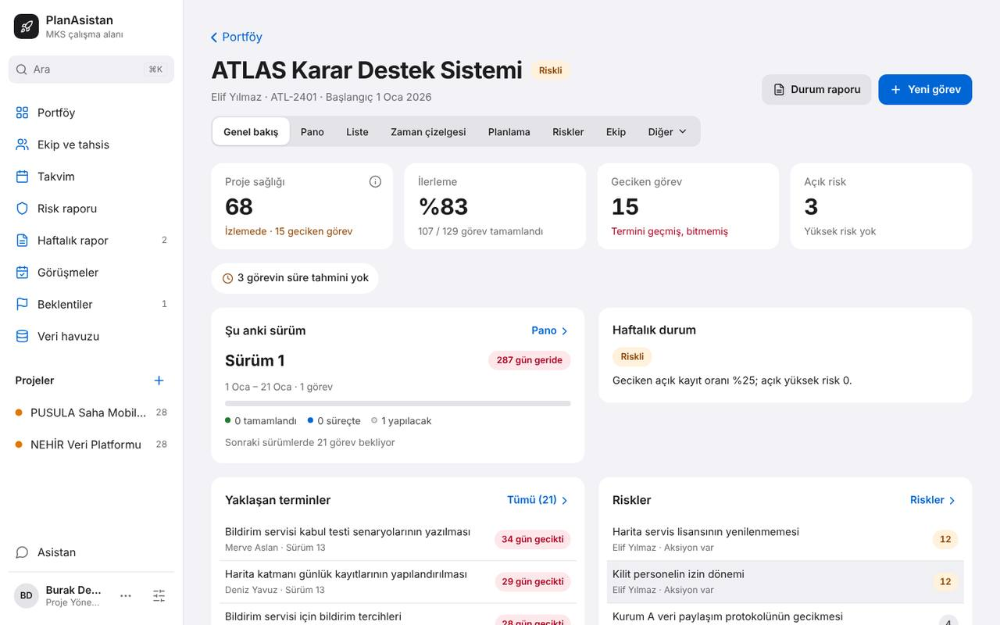
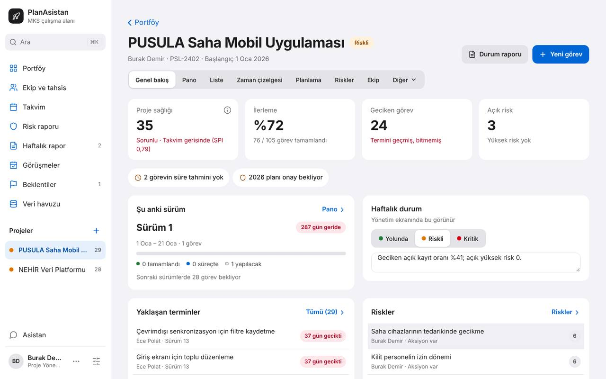
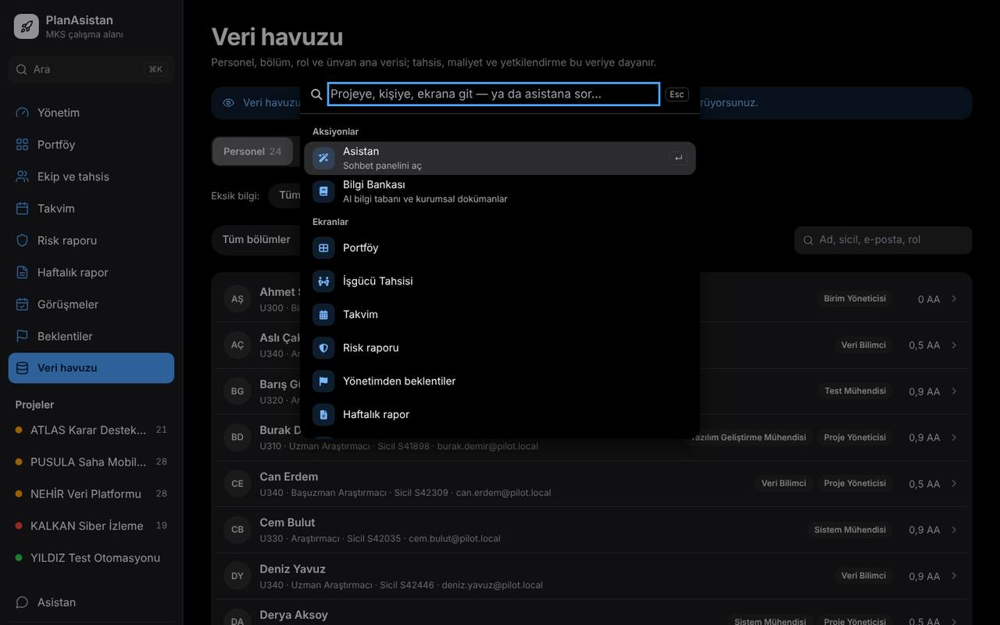
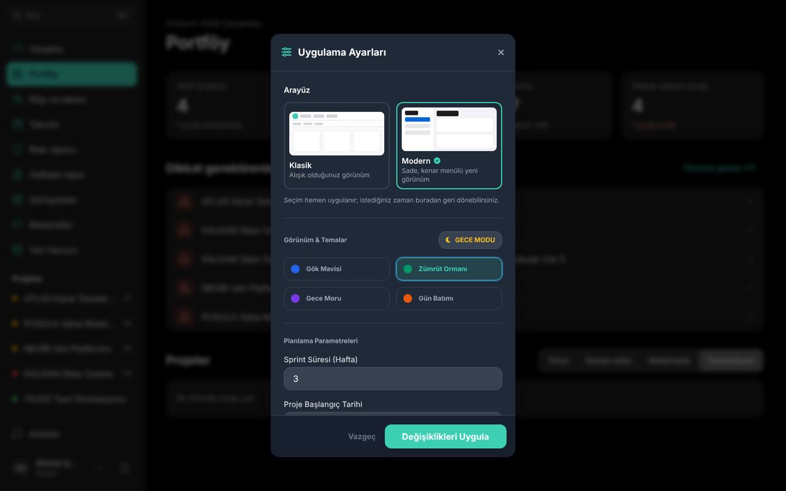
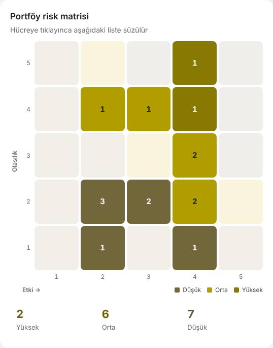
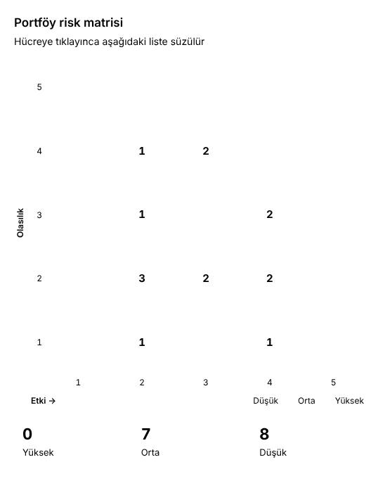

# UI/UX çarpışma testi raporu · 2026-11-04

**Sonuç:** Modern arayüz görsel olarak sağlam. Ama veri güvenliği ve yetkide demoyu riske atan dört sorun var:

- Bozuk depo kaydı açılışta çalışma alanını uyarısız siliyor.
- İki sekmede son kaydeden kazanıyor.
- Gönderilen rapor ikinci sekmeden kaydedilince taslağa dönüyor.
- PY başka PY'nin projesinde görev ekleyip silebiliyor.

Açılışta verdiğin iki örnek doğrulandı: "modernde beyaz mod çalışmıyor" ve "siyah modda bölge ayrımı net değil".

### Düzeltme durumu (6 Kasım)

| Bulgu | Durum | Commit |
|---|---|---|
| UI-KRC-01 bozuk depo kaydı (UI-KRC-08'in bozuk alan ve engelli depo durumları dahil) | Düzeltildi: okunamayan depoya yazılmıyor, kurtarma ekranı açılıyor | `6ea3630` |
| UI-KRC-02, UI-KRC-13 iki sekme | Düzeltildi: tek etkin sekme; öteki sekme "Burada kullan" ile taze veriyle devralıyor | `0da1439` |
| UI-AKS-02 yetki (UI-AKS-03 dahil) | Düzeltildi: açık proje kapsamla sınırlı, proje yazımları merkezde korunuyor | `8c947fb` |

| **K2** (19 satırın 19'u) | | |
| 3.1 varsayılan Sürüm 1 · 3.3 ondalık süre · 3.2 aşırı tahsis sayısı | Düzeltildi | `7c98907` |
| 1.3 kaydedilmemiş iş · 1.4 çift tık silme · 2.2 sahiplik devri onayı · 1.5 hata sınırı ve bozuk yedek · 1.6 çevrimdışı | Düzeltildi | `81204cd` |
| 4.1 Gece/Gündüz (Sistem/Gündüz/Gece) · 4.2 koyu modda eski ekranlar · 4.3 Uygula düğmesi · 4.4 Ayrıntılı analiz · 4.5 segment sayacı · 4.6 klasik kontrast | Düzeltildi | `1268d3e` |
| 5.1 Ayarlar penceresi · 5.2 pencere odağı · 5.3 anahtarlar · 6.1 çekmece · 7.1 yüksek karşıtlık | Düzeltildi | `eeb79ae` |

K2'lerle birlikte kapanan K3'ler: UI-KRC-08, UI-KRC-09, UI-ERS-06, UI-ERS-07 (K4), UI-ERS-08, UI-ERS-12, UI-GRS-05, UI-GRS-18.

Doğrulama koordinatörün yeniden ürettiği senaryolarla yapıldı; demo yolu testi her iki turdan sonra 28/28 geçti. Ölçülen K2 sonuçlarından: eşik altı metin Ayrıntılı analiz koyu 78 → 1, açık 42 → 0; Kapasite–talep koyu 207 → 2; Portföy klasik açık 24 → 0. Bağımsız doğrulama bir sonraki çarpışma koşusunun işi.

K2'den sonra açık kalan dört konu (klasik koyu Portföy'de 4 küçük metin, klasikte müdürün "Yeni Görev"i görmesi, UI-ERS-10, UI-AKS-13) K3 turunda kapandı.

| **K3** (39 bulgunun 38'i; 8'i K2'lerle birlikte kapanmıştı) | Durum | Commit |
|---|---|---|
| 8.1 kayıt bildirimi ve canlı bölge (UI-AKS-05, UI-ERS-09) · 1.3 yenilemede konum (UI-AKS-13) · 8.2 ilk tıklama (UI-AKS-15) · 2.3 denetim izi (UI-KRC-16) · 3.4 hafta başlığı (UI-AKS-07) · klasikte müdüre "Yeni Görev" | Düzeltildi | `8c90f9b` |
| 5.4 "Diğer araçlar" menüsü (UI-ERS-10), komut paleti (UI-ERS-14), "Aç" düğmeleri (UI-ERS-16), ısı haritası 288 durak → 1 (UI-ERS-11) · 7.2 risk matrisinde D/O/Y harfleri (UI-ERS-05, UI-GRS-08) · 6.2 yazı büyütme (UI-ERS-13) | Düzeltildi | `955cb06` |
| 8.3 taşmalar (UI-KRC-10, -11, -12, -17, UI-GRS-13, -16) · 6.3 telefonda tablo ve rapor maddesi (UI-AKS-16, -17) · 5.5 pencere düzeni (UI-GRS-10, -15) · 4.7 koyu menüler (UI-GRS-06) · klasik koyu Portföy 4 → 0 | Düzeltildi | `a7add43` |
| 8.4 adlar ve dil (UI-AKS-06, -08, -09, -10, -11, -12, -18) | Düzeltildi | `9a87299`; AI asistanın ekran adları ve klasik tahsis başlığı bu rapor güncellemesiyle aynı commit'te |

Yeni adlar (UI-AKS-08): resmî akış **Haftalık rapor**; Teams/e-posta için üretilen metin **Durum özeti** (eski "Durum raporu"); Yolunda/Riskli/Kritik alanı **Gidişat** (eski "Haftalık durum"). Klasik ve modern gezinme aynı adları kullanıyor (**Ekip ve tahsis**, **Risk raporu**, **Yönetim**).

Doğrulama: her grup sonrası tarayıcıda bulgunun senaryosu yeniden üretildi, birim testleri 930/930, demo yolu 28/28. Ölçülenlerden: süzgeç taşması Liste 1526, Pano 1687, Tahsis 1835 px → üçü de 1440/1440; "Tahsisi düzenle"ye 311 → 22 Tab; Durum özeti metin kutusu 45 → 340 px.

Açık kalanlar:

- **UI-GRS-09** (K3): Gün Batımı temasında vurgu turuncusu uyarı turuncusuyla aynı. Vurgu rengini değiştirmek marka kararı olduğu için bekliyor.
- K4'ler: UI-AKS-14 açıklanmamış kısaltmalar, UI-AKS-19 telefonda Portföy sırası, UI-GRS-12 klasikte modern "ada" ekranlar, UI-GRS-17 kenar çubuğu alt menüsü. UI-GRS-18 hata ekranı K2'de kapandı.
- Bağımsız doğrulama: bu düzeltmeleri ajanlar değil koordinatör doğruladı; bir sonraki çarpışma koşusu bunu yapmalı.

| | |
|---|---|
| Kod | `claude/zealous-tesla-hidbc9` (uygulama kodu `main` 964cfab ile aynı) |
| Ortam | Bulut kapsayıcısı, Chromium (başsız), `vite preview`, pilot simülasyon verisi (5 proje, 24 kişi), boş ve aşırı veri (67 proje, 620 görevlik proje, 200 kişi) |
| Ajanlar | 🎨 Deniz (görsel), 🧭 Cem (akış), 💥 Tolga (kırıcı), ⌨️ Ece (erişilebilirlik); tanımlar: [`docs/UI_AJANLARI.md`](../../UI_AJANLARI.md) |
| Koşu | Tur 1 bağımsız keşif → Tur 2 çapraz saldırı (halka: Tolga → Deniz → Ece → Cem → Tolga) → Tur 3 uzlaşma |
| Hacim | ~175 betik çalıştırması, ~750 ekran görüntüsü; tam set kapsayıcıda `ui-testi/2026-11-04/` (105 MB, git dışında). Burada seçilmiş 16 kanıt görüntüsü var. |

## Özet

| | K1 | K2 | K3 | K4 | Toplam |
|---|---:|---:|---:|---:|---:|
| Doğrulandı (iki ajan üretti) | 2 | 19 | 29 | 0 | **50** |
| Aday (tek ajan; çoğu Tur 2'de bulundu) | 1 | 4 | 10 | 5 | **20** |
| Reddedildi | | | | | **0** |

Önem dağılımı ajanların yazdığı hâliyledir. K4'ler çapraz doğrulamada bilerek atlandı. Uzlaşmadan sonra K1 sayısı 4'tür (UI-AKS-02 K2'den yükseldi); diğer önem değişiklikleri aşağıda.

| Ajan | Tur 1 | Tur 2 yeni | Çapraz denetlediği | Sonuç |
|---|---:|---:|---|---|
| 🎨 Deniz | 12 | 6 | Tolga'nın 12'si | 12 doğrulandı |
| 🧭 Cem | 14 | 5 | Ece'nin 14'ü | 14 üretildi; 3'ünde önem düşürme önerisi |
| 💥 Tolga | 12 | 5 | Cem'in 13'ü | 13 doğrulandı; birinde kapsam genişledi |
| ⌨️ Ece | 14 | 2 | Deniz'in 11'i | 11 üretildi; ikisinde önem değişikliği önerisi |

70 bulgu, aynı sorunu anlatanlar birleştirilerek kök nedene göre 8 bölümde **36 satırda** toplandı.

## Önem kararları

Ajanların uzlaşamadığı üç konuda kullanıcı 2026-11-06'da koordinatörün önerisini onayladı.

| Konu | Seçenekler | Karar (kullanıcı onayladı) |
|---|---|---|
| **UI-AKS-02**: PY başka PY'nin projesine girip görev ekleyebiliyor. Tolga Tur 2'de kapsamı genişletti: tamamlama, silme ve öteki PY'nin 32 Günlük notunu okuma da açık; müdür de aynısını yapabiliyor. | K2 kalsın / K1 | **K1.** Yetkisiz silme veri kaybıdır. Müdürden gizlenen notlar başka PY'ye açık. |
| **UI-AKS-04**: Aşırı tahsis sayısı ekrandan ekrana değişiyor (34 → 9 kişi → 37). Cem K1 adayı dedi. | K1 / K2 | **K2.** Tolga farkın iki şeyden geldiğini gösterdi: izin kayıtları (sabit 3 kişi-ay) ve "kişi" ile "kişi-ay" birim karışıklığı. Rakam yanlış değil, tutarsız. |
| **UI-ERS-02**: 1024 px altında kapalı çekmecedeki 19 düğme Tab sırasında, odak görünmez. Cem K3 dedi (iş yapılabiliyor). Ece K2'de ısrar ediyor (%200 yakınlaştıran her kullanıcı bu kipe düşüyor, görünmeyen öğede Enter beklenmedik ekrana götürüyor). | K2 / K3 | **K2.** Her sayfada, her dar ekran ve yakınlaştırma kullanıcısında. Kural gereği iş etkisinde Cem'in görüşü ağır basar, ama bu bir sistem davranışı. |

Uzlaşmada kural gereği çözülenler:
- **UI-ERS-05** K2 → K3: Cem önerdi, Ece katıldı.
- **UI-ERS-07** K3 → K4: Cem önerdi, Ece katıldı.
- **UI-GRS-11** K3 → K2: ölçüm 2,71:1, ölçek < 3:1 metne K2 diyor.
- **UI-GRS-08** ikiye ayrıldı: ısı haritası K4, risk matrisi kısmı UI-ERS-05 ile birleşti.

## 1. Veri güvenliği

Tolga'nın şeridi; Deniz her birini iki temada doğruladı.

| # | Önem | Durum | Sorun | Kök neden (öneri) |
|---|---|---|---|---|
| 1.1 | **K1** | doğrulandı | **Bozuk ya da tanınmayan depo kaydı açılışta çalışma alanını uyarısız siliyor.** `meta.format` 1 değilse ya da `meta` bozuksa uygulama örnek çalışma alanıyla açılıyor ve hemen depoya yazıyor: 24 kişi, 55 rapor, 33 tahsis, 5 proje → 0, 0, 0, 1. Modern arayüz seçimi de gidiyor. (UI-KRC-01; ekranda hata durumu yok: UI-GRS-18) | `utils/workspaceStore.ts:39`, `App.tsx:191-224`: okunamayan depo "boş" sayılıyor ve üzerine yazılıyor |
| 1.2 | **K1** | doğrulandı + aday | **İki sekmede son kaydeden kazanıyor.** Öteki sekmenin görevi ve raporu sessizce kayboluyor (UI-KRC-02). Ağır biçimi: bir sekmede bölüm sorumlusuna gönderilen rapor, eski hâli açık ikinci sekmede "Kaydet"e basılınca **taslağa dönüyor**. Uygulama "Kaydedildi." diyor; gönderim tarihçeden siliniyor (UI-KRC-13, aday). | `utils/workspaceStore.ts:68` (sekmeler arası eşitleme yok), `utils/weeklyReport.ts:298-318` (aşama denetimi bellekteki eski kopyaya bakıyor) |
| 1.3 | K2 | doğrulandı | **Kaydedilmemiş iş uyarısız kayboluyor.** Haftalık rapor taslağı kenar çubuğuyla gezinince, yenileyince, geri tuşuna basınca ya da "Klasik arayüze dön"e basınca gidiyor (UI-KRC-04). Görev formu Esc'e ve arka plana tıklamaya kapanıyor (UI-KRC-09, K3). Yenileme ayrıca konumu da götürüyor (UI-AKS-13, K3). | `ReportEditor.tsx:507-509`, `beforeunload` yok; `components/modern/ui.tsx:39-45` |
| 1.4 | K2 | doğrulandı + aday | **Klasik arayüzde çift tık iki kez siliyor.** Görev çöp kutusu iki görevi siliyor (UI-KRC-03). "Projeyi sil" iki projeyi tüm verileriyle siliyor (UI-KRC-15, aday). Onay metni görev adını bile söylemiyor. | `App.tsx:1543, 1735, 1777`; `PortfolioView.tsx:132`: çift tık koruması ve geri alma yok |
| 1.5 | K2 | doğrulandı | **Açılış hatası yakalanmıyor.** Site verisi engelliyse ya da depoda bir alan bozuksa sonsuz yükleme oluyor, mesaj yok (UI-KRC-08). Bozuk bir yedek dosyası beyaz (koyu modda lacivert) boş ekran veriyor (UI-KRC-06). | Hata sınırı (ErrorBoundary) yok; `App.tsx:198-200`; `utils/workspace.ts:167-168` |
| 1.6 | K2 | doğrulandı | **Uygulama çevrimdışı açılmıyor.** README "PWA + service worker, çevrimdışı çalışır" diyor; derlemede servis çalışanı yok (UI-KRC-07). | `sw.js` depo kökünde ama `dist/`'e girmiyor, kaydı da yok |

*1.2: Rapor A sekmesinde gönderildi. B sekmesinde "Kaydet" → "Kaydedildi.", sağ üstte "Taslak".*

## 2. Yetki ve rol

| # | Önem | Durum | Sorun | Kök neden (öneri) |
|---|---|---|---|---|
| 2.1 | **K1** | doğrulandı | **PY başka PY'nin projesinde görev ekleyip tamamlayıp silebiliyor ve onun Günlük notlarını okuyabiliyor.** Yol: Portföy › "Dikkat gerektirenler". Müdür de aynısını yapabiliyor; aynı sayfadaki durum kartı ise salt okunur (UI-AKS-02). Aynı kökten: Burak'ın "Dikkat gerektirenler" listesinin ilk maddeleri başkasının projeleri. "Kritik proje yok" kartının yanında "KALKAN kritik durumda" yazıyor (UI-AKS-03, K2). | `utils/todoItems.ts:23-168` liste `visibleProjectIds` ile sınırlanmıyor; "Yeni görev" yolunda `canEditProjectContent` denetimi yok |
| 2.2 | K2 | aday | **Klasik Portföy'de PY, kendi projesinin sahipliğini onaysız devrediyor.** Tek ok tuşu ya da tek seçim yetiyor ve proje kendi listesinden kayboluyor; "Sahip atanmadı" da seçilebiliyor (UI-KRC-14). | `PortfolioView.tsx:141-144` |
| 2.3 | K3 | aday | **Bölüm sorumlusu dokunmadan onaylayınca tarihçeye "düzenledi" kaydı düşüyor** (UI-KRC-16). | `utils/weeklyReport.ts:236, 318` |

## 3. Yanlış ya da yanıltıcı rakam

| # | Önem | Durum | Sorun | Kök neden (öneri) |
|---|---|---|---|---|
| 3.1 | K2 | doğrulandı | **Yeni görev varsayılan olarak geçmiş "Sürüm 1"e düşüyor.** Tek görev eklenince "Şu anki sürüm" kartı "Sürüm 13 · 17 Kas başlıyor"dan "Sürüm 1 · 287 gün geride"ye dönüyor. İki arayüzde de böyle (UI-AKS-01). | `TaskFormSheet.tsx:38`, `TaskFormModal.tsx:22, 79`, `utils/projectOverview.ts:63-68` |
| 3.2 | K2 | doğrulandı | **Aşırı tahsis sayısı ekrandan ekrana değişiyor:** Portföy 34 kişi-ay, tıklanan ekran "9 kişi", Bölüm özeti ve Kapasite–talep 37 (UI-AKS-04). | `utils/todoItems.ts:128` izinleri saymıyor, `AllocationView.tsx:152` sayıyor; birimler karışık |
| 3.3 | K2 | doğrulandı | **Süre tahmininde ondalık kayboluyor:** "1,5" gün → 15 (Türkçe tarayıcıda 1), "0.5" → 0 (UI-KRC-05). | `TaskFormSheet.tsx:131-132` `parseInt` |
| 3.4 | K3 | doğrulandı | **Müdür "Haftalık rapor"da 4 hafta önceki raporu "bu haftanın gelişmeleri" başlığıyla görüyor** (UI-AKS-07). | `ModernWeeklyReport.tsx:119-122` |

## 4. Tema ve koyu mod

Verdiğin örneklerin karşılığı bu bölümde.

| # | Önem | Durum | Sorun | Kök neden (öneri) |
|---|---|---|---|---|
| 4.1 | K2 | doğrulandı | **Gece/Gündüz ayarı hiçbir arayüzde uygulanmıyor; tema yalnız işletim sistemini izliyor.** Ayar kaydediliyor, `<html>`'e `dark` sınıfı ekleniyor, ekran değişmiyor. Sistem koyuyken düğme "GÜNDÜZ MODU" diyor, ekran siyah (UI-GRS-01). Üç ajan bunu birbirinden habersiz buldu (bkz. Ajanların değerlendirmesi). | `tailwind.config.js` içinde `darkMode: 'class'` yok; `styles/modern.css:61-63` yalnız `prefers-color-scheme` |
| 4.2 | K2 | doğrulandı | **Koyu modda eski bileşenler modern arayüze sızıyor ve okunmuyor.** Kapasite–talep, Senaryo, Ayarlar, Ayrıntılı analiz lacivert-gri klasik paletle açılıyor. "0" değerleri, tarihler ve seçili segment 1,94–1,99:1. Seçili "Plan", seçili olmayanlardan sönük (UI-GRS-04, UI-GRS-07). | `styles/modern.css:205-209` `.m-legacy` eşlemeleri yalnız açık temada |
| 4.3 | K2 | doğrulandı | **Ayarlar'daki "Değişiklikleri Uygula" koyu modda okunmuyor:** açık vurgu üstünde beyaz yazı, dört renk temasında 1,95–2,72:1 (UI-GRS-02). | `SettingsModal.tsx:236-240` sabit `text-white` |
| 4.4 | K2 | doğrulandı | **Yönetim › Ayrıntılı analiz:** durum rozetleri ve uyarı yazıları iki temada da 2,15–2,54:1; ekrandaki 396 metnin 78'i eşiğin altında (UI-GRS-03). | `ExecutiveView.tsx:29, 44` sabit renkler |
| 4.5 | K2 | doğrulandı | **Koyu modda seçili segmentteki sayaç sönük (2,71:1).** Kaç kişi/bölüm olduğu yalnız orada yazıyor (UI-GRS-11, K3 → K2). | `styles/modern.css:166-168` |
| 4.6 | K2 | aday | **Klasik arayüzde kart tarihi, "Riskli" rozeti ve "Dışa Aktar" okunmuyor** (1,47–2,15:1) (UI-GRS-14). | `PortfolioView.tsx:221` |
| 4.7 | K3 | doğrulandı | **Koyu modda katmanlar birbirinden ayrılmıyor.** Açılır pencereler (rehber, Ctrl+K paleti, Durum raporu) sayfa zemini ile aynı siyah, kenarları görünmüyor (1,0–1,1:1). Açılır menüler (Raporlar, Araçlar) altlarındaki kartla aynı renkte, menünün nerede bittiği anlaşılmıyor (UI-GRS-05, UI-GRS-06). %200'de daha kötü (Ece). | Pencereler zemin olarak `m-bg` kullanıyor: `GuideTour.tsx:82`, `CommandPalette.tsx:106`, `modern/ui.tsx:47`; menüler `m-surface` (kartla aynı) |
| 4.8 | K3 | doğrulandı | **Turuncu temada vurgu rengi uyarı turuncusuyla aynı;** nötr öğeler "riskli" gibi görünüyor (UI-GRS-09). | `styles/modern.css:59, 94` ↔ `:27` |
| 4.9 | K4 | aday | **Klasik arayüzde Risk raporu ve Haftalık rapor modern "siyah ada" olarak açılıyor** (UI-GRS-12). | |

<table><tr>
<td></td>
<td></td>
</tr><tr>
<td><em>4.7: Ctrl+K paleti, sayfa ile aynı siyah; alt kenarı yok.</em></td>
<td><em>4.2 ve 4.3: Ayarlar koyu modda klasik lacivert; "Değişiklikleri Uygula" 1,95:1.</em></td>
</tr></table>

## 5. Pencereler, odak ve klavye

| # | Önem | Durum | Sorun | Kök neden (öneri) |
|---|---|---|---|---|
| 5.1 | K2 | doğrulandı | **Ayarlar penceresi pencere değil.** `role="dialog"` yok, açılınca odak arkada kalıyor; "Kapat"a 16. Tab'da ulaşılıyor; Esc kapatmıyor (UI-ERS-01). Cem bunu gerçek işle denedi: temayı değiştirmek 21 Tab sürdü, bunların 15'i bulanık arka planda. | `SettingsModal.tsx:101-110` |
| 5.2 | K2 | kısmen doğrulandı | **Ortak pencere bileşeni (`Sheet`) odağı yönetmiyor.** Bilgi pencerelerinde odak karartmanın arkasında kalıyor: içeri girmek için 3–52 Tab; `aria-modal` olduğu için ekran okuyucu bu sürede hiçbir şey duymuyor (UI-ERS-15, aday). Kapanınca odak sayfa başına düşüyor: ikinci "Yeni görev"e 20 Tab (UI-ERS-06, K3). Odak tuzağı yok (UI-ERS-07, K3 → K4). | `components/modern/ui.tsx:39-47` |
| 5.3 | K2 | doğrulandı | **Ayarlar'daki iki anahtar adsız ve durumsuz** ("Yapay Zeka Asistanı", "Yerel Kayıt"). Yüksek karşıtlıkta hiç görünmüyor (UI-ERS-03). | `SettingsModal.tsx:201-221` |
| 5.4 | K3 | doğrulandı | **Klavye menüleri menü gibi davranmıyor.** "Diğer araçlar"da ok tuşu yok, Esc kapatmıyor (UI-ERS-10). Komut paletinde seçim ekran okuyucuya söylenmiyor (UI-ERS-14). Ayrıntılı analizde 20 düğmenin adı yalnız "Aç" (UI-ERS-16, aday). Doluluk ısı haritası 312 Tab durağı (UI-ERS-11). | `ModernSidebar.tsx:113, 254-256`; `CommandPalette.tsx:115`; `ExecutiveView.tsx:252`; `ModernAllocation.tsx:290-300` |
| 5.5 | K3 | doğrulandı + aday | **Pencere içi düzen:** Durum raporunda 34 satırlık rapor 2 satırlık kutuya sıkışıyor (UI-GRS-10). Klasik "Yeni Görev" penceresinin başlığı ve kapat düğmesi üst çubuğun altında kalıyor (UI-GRS-15; Cem de gördü). | `StatusReportSheet.tsx:57`; `TaskFormModal.tsx:150` `z-40` < üst çubuk |

## 6. Dar ekran, telefon ve yakınlaştırma

| # | Önem | Durum | Sorun | Kök neden (öneri) |
|---|---|---|---|---|
| 6.1 | K2 | doğrulandı | **Kapalı çekmece Tab sırasında.** 1024 px altında kapalı çekmecedeki 19 düğmeye Tab ile gidiliyor ama odak görünmüyor (UI-ERS-02). Açık çekmeceye klavyeyle girilemiyor, Esc kapatmıyor (UI-ERS-08, K3). Telefonda çekmece Ayarlar penceresinin üstünü örtüyor (UI-ERS-12, K3). | `styles/modern.css:192` çekmece yalnız `transform` ile gizleniyor (`inert`/`visibility` yok) |
| 6.2 | K3 | doğrulandı | **Yalnız yazıyı büyütünce (%200) içerik büyümüyor;** menü "Ekip v…", "Risk ra…" diye kesiliyor (UI-ERS-13). | Sabit px yazı boyutları (`text-[15px]` vb.) |
| 6.3 | K3 | aday | **Telefonda işler:** doluluk tablosu bu aya kaydırınca kişi adları kayboluyor (UI-AKS-16). Rapor maddesi sığmıyor, "Maddeyi sil" kesik (UI-AKS-17). PY'nin projeleri 1,6 ekran aşağıda (UI-AKS-19, K4). | `ModernAllocation.tsx:266-268`; `ReportEditor.tsx:115-123` |

## 7. Renkten bağımsızlık ve yüksek karşıtlık

| # | Önem | Durum | Sorun | Kök neden (öneri) |
|---|---|---|---|---|
| 7.1 | K2 | doğrulandı | **Yüksek karşıtlık (forced-colors) modunda seçili durumlar, ilerleme çubukları, risk matrisi ve pencere sınırları kayboluyor** (UI-ERS-04). Cem: öncelik seçerken seçili düğme yalnız biraz kalın yazıyla ayrılıyor. | Bilgi yalnız `background-color` ile; `forced-colors` kuralı yok |
| 7.2 | K3 | doğrulandı | **Risk matrisinde düzey yalnız renkle anlatılıyor.** Döteranopide "Yüksek" ile "Düşük" aynı zeytin tonu; gri tonlamada Orta ile Düşük aynı (UI-ERS-05 K2 → K3, UI-GRS-08). Aynı ekrandaki "Yüksek riskler" listesi bilgiyi renksiz veriyor. Isı haritası süzgeçlerde ayrılıyor ve yüzdeler yazılı (K4). | `RiskParts.tsx:53-61` |

<table><tr>
<td></td>
<td></td>
</tr><tr>
<td><em>7.2: Döteranopi süzgeci.</em></td>
<td><em>7.1: Yüksek karşıtlık: matris hücreleri kayboluyor.</em></td>
</tr></table>

## 8. Geri bildirim, dil ve düzen

| # | Önem | Durum | Sorun |
|---|---|---|---|
| 8.1 | K3 | doğrulandı | **Görev eklenince "kaydedildi" izi yok.** Ne görsel ne ekran okuyucu bildirimi var; yeni görev görünür yerde değil. Haftalık raporda bildirim var, örnek olarak kullanılabilir (UI-AKS-05, UI-ERS-09). |
| 8.2 | K3 | aday | **Yeni görev formunda adı yazmadan Öncelik ya da Durum'a tıklayınca ilk tıklama kayboluyor.** "Görev adı gerekli." satırı formu 26 px itiyor; seçim "Orta"da kalıyor ve görev yanlış öncelikle kaydedilebiliyor (UI-AKS-15; `TaskFormSheet.tsx:149-151`). |
| 8.3 | K3 | doğrulandı + aday | **Taşma:** Uzun ad filtre listesini 1222 px'e şişiriyor (UI-KRC-10). Klasik üst çubuk 1440 px'e sığmıyor (UI-KRC-11). Pano kartında uzun kelime kartın dışına taşıyor (UI-KRC-12). Kapasite–talep'te "Toplam" sütunu kesik (UI-KRC-17; Cem ve Deniz de gördü). Taşmada kenar çubuğu kayıyor, koyu modda lacivert şerit açılıyor (UI-GRS-13). Klasik proje çubuğunda "Zekâ" sekmesi kesik (UI-GRS-16; Cem de gördü). Kenar çubuğu alt menüsü kayıyor (UI-GRS-17, K4). |
| 8.4 | K3 | doğrulandı | **Adlar ve dil:** "Haftalık rapor", "Haftalık durum", "Durum raporu" karışıyor (UI-AKS-08). Klasik ve modern gezinme adları farklı (UI-AKS-12). Klasikte "MEDİUM/HİGH", "Tüm Kaynak Adıler" görünüyor (UI-AKS-10). Bölüm süzgecinde yalnız kodlar var (UI-AKS-09). Müşteri istekleri "Diğer" menüsüne gömülü, aramada çıkmıyor (UI-AKS-11). Klasik görev formunda Termin alanı yok (UI-AKS-06). Kısaltmalar açıklanmamış (UI-AKS-14, K4). AI düğmesi kullanıcıya "AI_API_KEY tanımlı değil." diyor (UI-AKS-18, aday). |

## Doğru çalışanlar

Ajanlar bunları denedi ve sağlam buldu:
- Görev ekleme ve rapor gönderme, onay ve iadede çift ve üçlü tık tek kayıt üretiyor.
- HTML, `` ve `javascript:` bağlantıları hiçbir ekranda çalışmadı.
- Ekranlar arasında 20 hızlı geçiş ve yıl sınırı (ISO 53. hafta) sorunsuz.
- Aşırı veride ısı haritası 200 kişiyi 410 ms'de çiziyor.
- Müdür iki arayüzde de notları ve müşteri isteklerini görmüyor.
- Arayüz değiştirince açık proje ve ekran korunuyor.
- Haftalık rapor akışında geri bildirim açık.
- Modern arayüzde "hareketi azalt" roket ve hiper sürüş animasyonlarını durduruyor.
- Modern Portföy ekranında ve boş durum ekranlarında metin kontrastı iki temada da eşiği geçiyor.

## Ajanların değerlendirmesi

**Kör noktalar işe yaradı.** Bulguların ağır kısmı, bir ajanın kendi şeridi dışında görüp devrettiği ya da çapraz turda genişlettiği yerlerden çıktı:

- **Gece/Gündüz ayarı** (4.1) ajanların okuduğu hiçbir belgede yazmıyordu; kalibrasyon için bilerek saklandı. Deniz kendi şeridinde buldu. Cem ve Ece ise şeridi olmadığı hâlde fark edip Deniz'e devretti.
- **Yetki açığı** (2.1) Cem'in akışında çıktı. Tolga'nın kötü yol denemesinde silme, not okuma ve müdür yetkisine genişledi.
- **Gönderilen raporun taslağa dönmesi** (1.2), Tolga'nın Cem'in akışını iki sekmede tekrar etmesinden çıktı. Ne akış ne kırıcı şeridi bunu tek başına bulurdu.
- **Varsayılan "Sürüm 1"** (3.1) Cem'in akışında çıktı. Ece bunu klavye turunda ayrıca gördü.

**"Önce bak, sonra ölç" kuralı işledi.** Koşudan önce koordinatör, koyu modda kart ile zemin arasındaki 1,23:1 kontrastın ve görünmeyen gölgenin bölge ayrımını bozduğunu düşünüyordu. Deniz bunu ölçtü ama göz kısma testinde ana ekranlardaki kartlar ayrı bloklar olarak seçildi: "ölçüm şüphesi, göz geçti". Asıl sorunu daha dar yerde buldu: pencereler ve menüler 1,0–1,1:1 (4.7).

**Çapraz doğrulama sert davrandı ama hiç reddetmedi.** 50 doğrulamanın 0'ı reddedildi. Ajanlar her bulguyu 2/2 üretmeden yazmadı; bu iyi bir işaret. Ama bir sonraki koşuda reddetme gücünü ayrıca sınamak gerekir: bilerek yanlış bir bulgu eklenip yakalanıp yakalanmadığına bakılmalı.

## Altyapı notları

Koşu sırasında ortak betikte beş hata çıktı ve düzeltildi; dördünü ajanlar, birini koordinatör fark etti:

| Hata | Bulan | Düzeltme |
|---|---|---|
| Veri yükleme yarışı: uygulamanın ilk açılışta yazdığı örnek proje, küçük veri setlerini eziyordu (boş veri seti klasik arayüzde açılıyordu) | Deniz | `caed25d`: veri, uygulama açılmadan yükleniyor |
| `oturum({ proje })` modern arayüzde projeyi açmıyordu | Ece | `caed25d` |
| Dokunma hedefi ölçümü ekran dışındaki kapalı çekmeceyi sayıyordu | Ece | `caed25d` |
| Gece yarısında koşu dizini değişiyordu | Deniz | `f6dc477`: son hazırlanan koşu kullanılıyor |
| Birleştirme betiği "UI-KRC-01 (K1)" biçimini ve "önem değişmeli" kararını okumuyordu | koordinatör | `39d4e05` |

Deniz'in Tur 1'deki boş veri görüntüleri ve buna dayanan devir notu geri çekildi. Bundan etkilenen başka bulgu yok: Tolga UI-KRC-01'i düzeltilmiş betikle yeniden üretti.

Koşu iki kez API kullanım sınırına takıldı. Ajanlar kaldıkları yerden sürdürüldü, iş kaybolmadı.

## Bir sonraki koşu için

1. **Adayları doğrula:** 20 aday, özellikle UI-KRC-13 (K1), UI-KRC-14, UI-KRC-15, UI-ERS-15 ve UI-GRS-14 (K2'ler).
2. **Türkçe tarayıcı:** Başsız Chromium sayı ve tarih alanlarında en-US davranıyor ("1,5" → 15, "mm/dd/yyyy"). `--lang=tr-TR` bayrağı denendi, sayı alanını değiştirmedi. UI-KRC-05 gibi yerel ayara bağlı bulgular gerçek, Türkçe bir Chrome'da elle doğrulanmalı.
3. **Klasik arayüz** bu koşuda ikincil kaldı. Klasik koyu tema ve klasik ekranlarda "hareketi azalt" ayrıca taranmalı.
4. **Gerçek ekran okuyucu yok.** Erişilebilirlik ağacıyla yaklaşıldı. Kritik akışlar (Ayarlar, Yeni görev, Haftalık rapor) NVDA ya da VoiceOver ile elle denenmeli.
5. **Reddetme gücünü sına:** Tur 2'ye bilerek yanlış bir bulgu konmalı.
6. **Düzeltmelerden sonra** aynı koşu tekrarlanmalı ve bulguların kapandığı doğrulanmalı. Öncelik sırası önerisi: 1.1, 1.2, 2.1, 1.3, 4.1, 3.1, 5.1–5.2, 4.2–4.3.

---

Tur 1 ve Tur 2'nin tam metinleri: [`tur1/`](./tur1/), [`tur2/`](./tur2/). Koordinatör talimatı: [`docs/UI_KOORDINATOR.md`](../../UI_KOORDINATOR.md).
