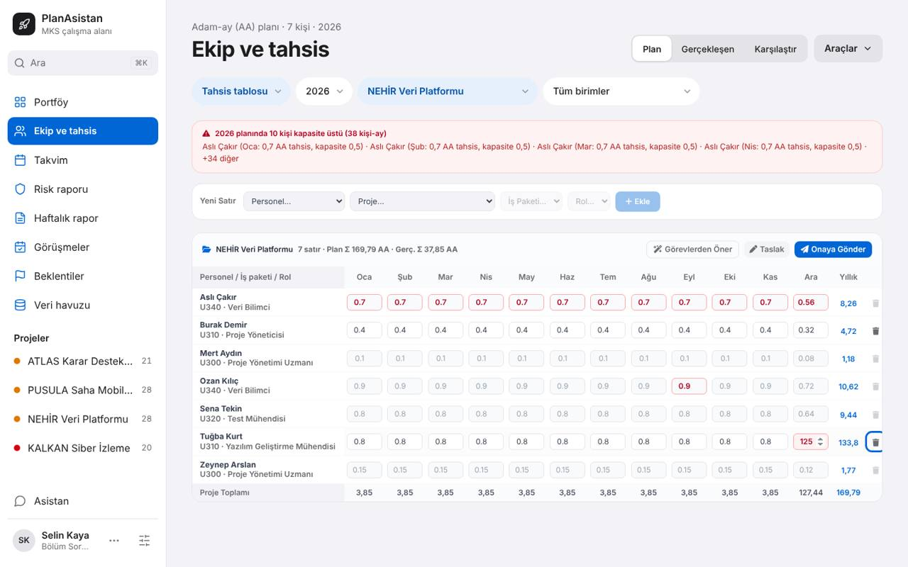
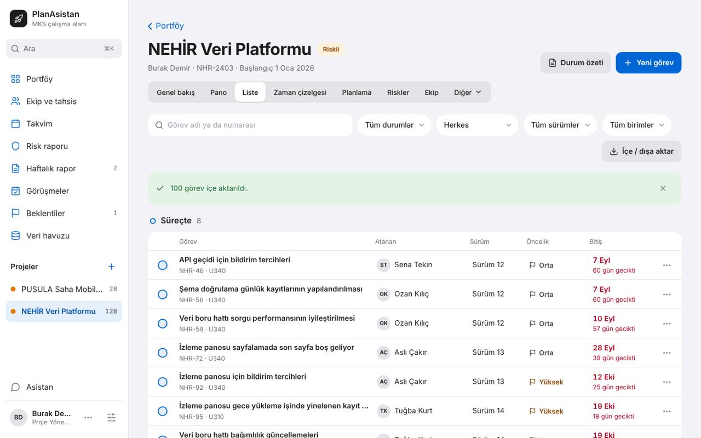
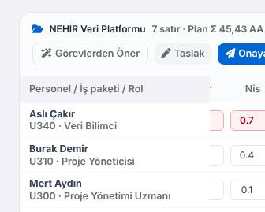
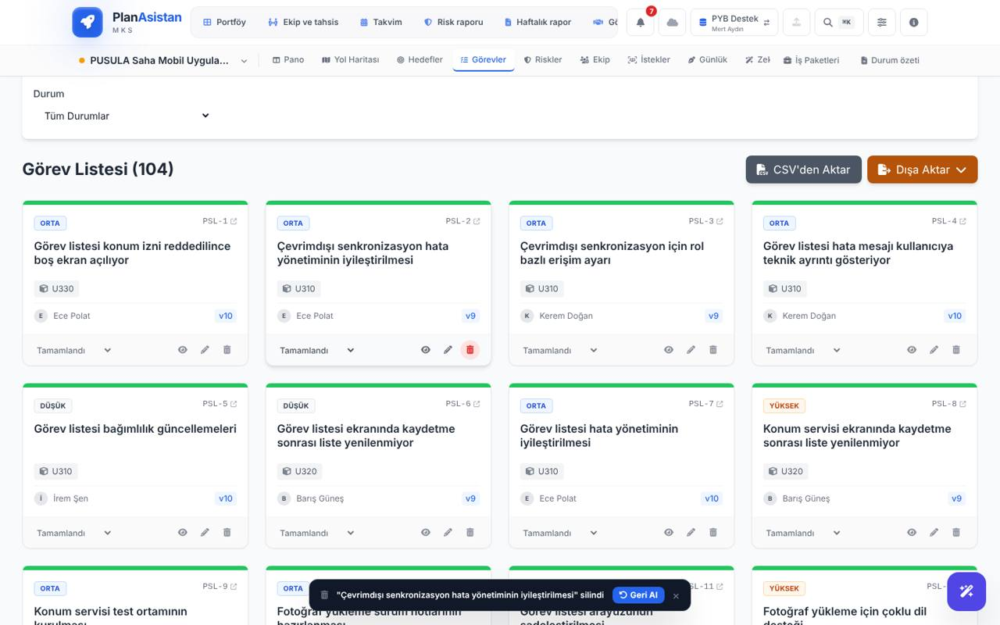
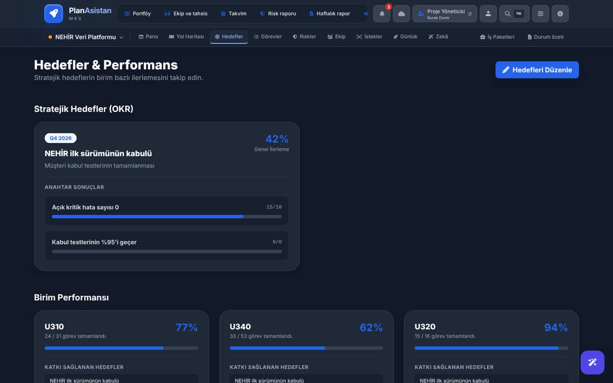
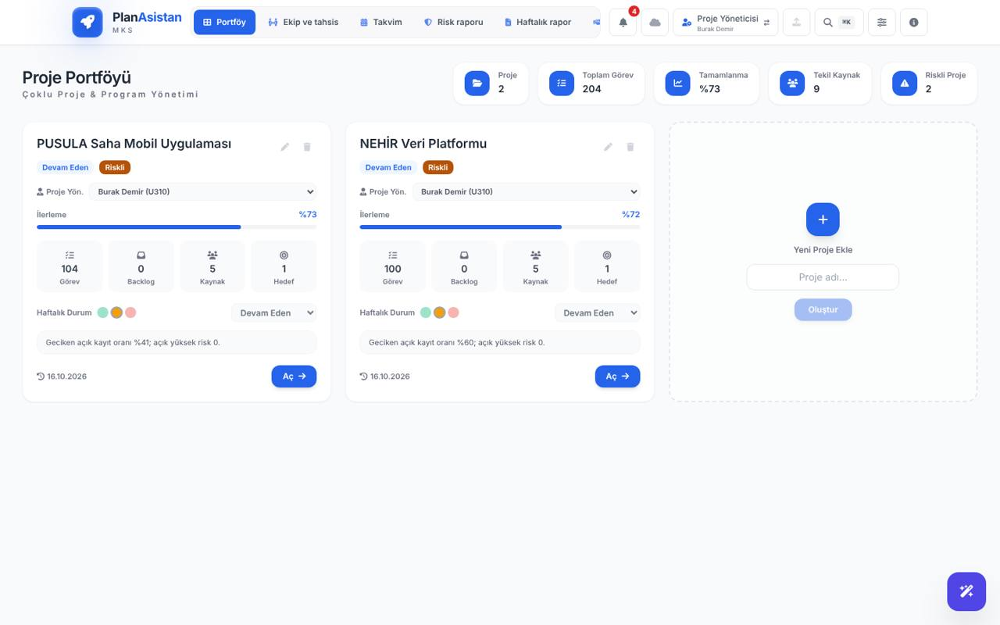

# UI/UX çarpışma testi raporu · ikinci koşu · 2026-11-06

**Sonuç:** İlk koşunun düzeltmeleri büyük ölçüde tuttu: 70 bulgunun 45'i düzelmiş, 21'i kısmen düzelmiş, 1'i düzelmemiş. Bağımsız denetimde 20 "düzeldi" kararının 20'si teyit edildi. Ama bu koşu, ilk koşunun bakmadığı yollarda **altı engelleyici (K1)** buldu. Altısı da veri kaybı ya da sessiz veri bozulması:

- Tahsis tablosunda "0,5" yazınca 5 AA, "1,25" yazınca 125 AA kaydediliyor.
- Uygulamanın kendi Excel dışa aktarımı geri yüklenince bütün görevler bir kez daha ekleniyor (100 → 200 → 300).
- Ayarlar'da "Yerel Kayıt" kapatılınca kayıtlı bütün projeler hemen siliniyor.
- Bozuk bir proje kaydı açılışta uyarısız gizleniyor, ilk kayıtta kalıcı olarak siliniyor.
- "Geri al", silmeden sonraki 7 saniyede yapılan başka değişiklikleri de geri alıyor.
- Veri havuzu Excel içe aktarması, eksik sütunlu satırla var olan kişinin ünvanını, rollerini ve kapasitesini siliyor.

En çok bulgu tahsis tablosunda ve içe aktarma yollarında toplanıyor. Klasik arayüz, düzeltmelerin çoğu modern arayüze yapıldığı için geride kalmış.

| | |
|---|---|
| Kod | `claude/zealous-tesla-hidbc9` @ `8fb563d` |
| Ortam | Bulut kapsayıcısı, Chromium (başsız), `vite preview`; pilot (5 proje, 24 kişi), boş ve aşırı veri (67 proje, 620 görevlik proje, 200 kişi) |
| Ajanlar | 🎨 Deniz (görsel), 🧭 Cem (akış), 💥 Tolga (kırıcı), ⌨️ Ece (erişilebilirlik); tanımlar: [`docs/UI_AJANLARI.md`](../../UI_AJANLARI.md) |
| Koşu | Tur 1: eski bulguların yeniden sınaması + bağımsız keşif → Tur 2: çapraz saldırı (halka Tolga → Deniz → Ece → Cem → Tolga) + öncekinin "düzeldi" kararlarının denetimi → Tur 3: uzlaşma |
| Hacim | ~150 betik çalıştırması, ~1170 ekran görüntüsü; tam set kapsayıcıda `ui-testi/2026-11-06/` (git dışında). Burada seçilmiş 14 kanıt görüntüsü var. |
| Kesinti | Koşu iki kez kullanım sınırına takıldı ve kapsayıcı bir kez yeniden başladı; ajanlar kaldıkları yerden sürdü, diskteki iş kaybolmadı. Kapsayıcının saati koşu ortasında 9 Kasım'a geçti; haftalık rapor görüntüleri "46. hafta" gösteriyor, kararların hiçbiri tarihe bağlı değil. |

## 1. İlk koşunun düzeltmeleri

| Ajan | Eski bulgu | Düzeldi | Kısmen | Düzelmedi | Yeni sorun |
|---|---|---|---|---|---|
| Deniz | 18 | 10 | 6 | 1 | 1 |
| Cem | 19 | 11 | 7 | 0 | 1 |
| Tolga | 17 | 13 | 3 | 0 | 1 |
| Ece | 16 | 11 | 5 | 0 | 0 |
| **Toplam** | **70** | **45** | **21** | **1** | **3** |

**Bağımsız denetim:** Tur 2'de her ajan halkadaki öncekinin "düzeldi" kararlarından beşini kendi yöntemiyle yeniden denedi (önce K1/K2). 20 kararın 20'si teyit edildi. Teyit edilenler arasında bozuk depo kaydı (UI-KRC-01), iki sekme (UI-KRC-13), yetki (UI-AKS-02), Sürüm 1 (UI-AKS-01), Gece/Gündüz kontrastı (UI-GRS-03) ve pencere odağı (UI-ERS-01) var.

**Düzelmeyen:** UI-GRS-16. Klasik proje çubuğunda "Zekâ" sekmesi hâlâ "İş Paketleri"nin altına giriyor; çakışma 28 px'ten 14 px'e indi.

**Düzeltmenin açtığı yeni sorunlar:**
- UI-GRS-01 → UI-GRS-27: Gece/Gündüz artık 8/8 koşulda çalışıyor. Ama tarayıcı deposu engelliyken açılış betiği hata verip sistem temasını hiç denetlemiyor; kurtarma ekranı koyu sistemde beyaz açılıyor (`index.html:19-24`).
- UI-AKS-12 → UI-AKS-24: Klasik menü adları moderne eşitlenince menü uzadı; 1440 px'te Görüşmeler, Beklentiler ve Veri Havuzu görünmüyor.
- UI-KRC-02 → UI-KRC-19: Tek etkin sekme çalışıyor, kilit kırılamadı. Ama "Burada kullan" ile devirde eski sekmedeki kaydedilmemiş iş uyarısız siliniyor, eski sekme "Çalışmanız kaydedildi" diyor.

**Kısmen düzelenler (21):** Düzeltme bulgunun anlattığı yerde tuttu, komşu ekranlara taşınmadı.

| Bulgu | Kalan |
|---|---|
| UI-GRS-02 | Ayarlar'da koyu modda "Vazgeç" 3,2:1, "VERİLERİ SIFIRLA" 3,52:1 |
| UI-GRS-04 | Klasik koyuda seçili segmentler 1,99:1 |
| UI-GRS-05 | Ekran rehberi ve Ctrl+K paleti koyu modda hâlâ kenarsız siyah |
| UI-GRS-08 | Risk matrisi düzeldi; tahsis ısı haritası hâlâ yalnız tona dayanıyor |
| UI-GRS-09 | Gün Batımı vurgusu kehribara döndü ama uyarı ailesinde kaldı |
| UI-GRS-18 | Kurtarma ekranı var; seçili arayüzü ve renk temasını izlemiyor |
| UI-AKS-03 | PY'nin "Dikkat gerektirenler"i düzeldi; müdürünki düzelmedi |
| UI-AKS-05 | Görev bildirimi var; proje, plan ve tahsis işlemleri sessiz (UI-AKS-29) |
| UI-AKS-08 | Modern adlar ayrıldı; klasikte ve metinlerde eski adlar kalmış |
| UI-AKS-09 | Süzgeçte bölüm adı var; ekran yine "Tüm birimler · 24 kişi" ile açılıyor |
| UI-AKS-10 | Görevler Türkçe; projenin ilk ekranında İngilizce kalıntı |
| UI-AKS-14 | Bazı kısaltmalar açıldı; "Sağlık skoru" ve "PMO puanı" gibi terimler açıklanmıyor |
| UI-AKS-17 | "Maddeyi sil" ekranda; madde kutusu telefonda hâlâ dar, alt şerit örtüyor |
| UI-KRC-04 | Bildirilen yollar soruyor; sekme devri soruyor değil (UI-KRC-19) |
| UI-KRC-08 | Açılış her bozulmada ekran gösteriyor; `people:null` içeren yedek mesajsız reddediliyor |
| UI-KRC-09 | Görev formu soruyor; Yeni risk, görüşme ve beklenti formları sorusuz kapanıyor (UI-KRC-24) |
| UI-ERS-04 | Yüksek karşıtlıkta etkin proje yalnız kalın yazıyla ayrılıyor; "Yeni görev" ve "Durum özeti" sınırsız |
| UI-ERS-06 | Palet Esc, görev kaydetme, Pano taşıma, rapor kaydet/gönder ve Profil Esc'ten sonra odak `body`'ye düşüyor |
| UI-ERS-09 | Ayarlar "Uygula", Pano taşıma ve tahsis değişikliği duyurulmuyor |
| UI-ERS-10 | "Diğer araçlar" menü gibi; kart işlemleri, proje "Diğer", "Madde ekle" değil (UI-ERS-30) |
| UI-ERS-13 | Yazı %200'de içerik büyüyor; ısı haritası hücre yazısı 13 px'te sabit |

## 2. Yeni bulgular: özet

64 bulgu (Tur 1'de 39, Tur 2'de 25). Aynı kusuru anlatan beş çift birleştirilince **59 ayrı bulgu**.

| | K1 | K2 | K3 | K4 | Toplam |
|---|---|---|---|---|---|
| Uzlaşma sonrası | 6 | 24 | 32 | 2 | 64 |
| Doğrulandı (iki ajan) | 3 | 17 | 18 | 0 | 38 |
| Aday (tek ajan; Tur 2'de bulundu, çapraz sınanmadı) | 3 | 7 | 14 | 2 | 26 |

Üç K1 adayını (UI-AKS-31, UI-KRC-26, UI-KRC-27) koordinatör kodla teyit etti. UI-KRC-21 Deniz'in önerisiyle doğrulanmış bir K2'den K1'e çıktı; Ece'nin K1 önerdiği UI-ERS-27 ise K2 oldu. Reddedilen ya da üretilemeyen bulgu yok.

| Ajan | Tur 1 | Tur 2 | Doğruladığı (öncekinin) | Önem değişikliği önerisi |
|---|---|---|---|---|
| Deniz | 10 | 5 | Tolga 8/8 | 1 (UI-KRC-21 K2 → K1) |
| Cem | 11 | 8 | Ece 10/10 | 1 (UI-ERS-22 K3 → K2) |
| Tolga | 8 | 6 | Cem 11/11 | 0 |
| Ece | 10 | 6 | Deniz 9/9 | 0 |

## Önem kararları

| Bulgu | Öneriler | Karar |
|---|---|---|
| UI-KRC-21 bozuk proje kaydı sessizce gizlenip siliniyor | Tolga K2, Deniz K1 | **K1.** Kullanıcı hiçbir temada uyarı görmüyor; ekranda yalnız "…görevi eklendi" yazarken proje depodan siliniyor. Aynı sınıfın meta karşılığı UI-KRC-01 de K1'di. |
| UI-ERS-22 ok tuşu tahsis değerini değiştiriyor | Ece K3, Cem K2 | **K2.** Değer sessizce kaydediliyor, yenilemeden sonra kalıyor, geri alma yok; UI-KRC-30 ile aynı kusur. |
| UI-AKS-24 / UI-GRS-22 klasik menü 1440 px'te kırpılıyor | Cem K2, Deniz K3 | **K2.** Mert'in ana ekranı Veri Havuzu menüde görünmüyor; iş etkisinde Cem'in görüşü ağır basar. |
| UI-ERS-27 klasik arayüzde 768 px altında ana gezinme yok | Ece K1 (uzlaşmada sorulsun) | **K2.** Koordinatör denedi: telefonda Ayarlar düğmesi görünüyor ve oradan Modern'e geçilebiliyor. İş yapılabiliyor ama yol bilinmiyor. |
| UI-GRS-28 Görünüm ve renk teması seçilince ekran değişmiyor | Deniz K4, Cem K3 | **K3.** Aynı pencerede "Arayüz" hemen değişiyor; kullanıcı öteki iki ayarın çalışmadığını sanıyor. |

Birleştirilen çiftler: UI-AKS-22 = UI-KRC-23 (klasikte salt okunur rollerde sahte silme), UI-AKS-24 = UI-GRS-22 (klasik menü), UI-ERS-22 = UI-KRC-30 (ok tuşu ve tekerlek), UI-AKS-27 ⊂ UI-ERS-30 (menülerde Esc), UI-GRS-30 ⊂ UI-GRS-19 (klasik tema kontrastı).

## 3. Engelleyiciler (K1)

| # | Bulgu | Durum | Ne oluyor | Olası kök neden |
|---|---|---|---|---|
| 1 | UI-AKS-20 | doğrulandı (Cem, Tolga) | Tahsis tablosunda "0,5" → 5 AA, "1,25" → 125 AA. Uyarı yok, bozuk plan onaya gönderilebiliyor. Nokta ile doğru. Ece'nin görünmeyen hücre bulgusuyla (UI-ERS-18) birleşince "0,3" görünmeyen Haziran hücresine 3 AA yazılıyor. | `components/AllocationView.tsx:201-210` hücre girişi `DecimalInput` kullanmıyor |
| 2 | UI-KRC-18 | doğrulandı (Tolga, Deniz) | Uygulamanın kendi Excel dışa aktarımı geri yüklenince her seferinde 100 görev yeniden ekleniyor (aynı Jira anahtarıyla). Önizleme, onay, geri alma yok. Jira CSV'de de aynı sınıf (UI-KRC-25, K3). | İçe aktarma mevcut görevi anahtarla eşlemiyor |
| 3 | UI-AKS-31 | aday; koordinatör kodla teyit etti | Ayarlar'da "Yerel Kayıt" kapatılıp "Uygula"ya basılınca kayıtlı bütün projeler depodan siliniyor; uyarı yok, sayfa yenilenince Portföy boş. | `App.tsx:439-441`: kapalıyken `projects: []` yazılıyor, depo projeleri siliyor |
| 4 | UI-KRC-21 | doğrulandı (Tolga, Deniz); K2 → K1 | Tek bir bozuk proje kaydı açılışta uyarısız gizleniyor, ilk kayıtta depodan kalıcı olarak siliniyor. | Proje kaydı okunamayınca atlanıyor, kalıcılık "yok" sayıp siliyor |
| 5 | UI-KRC-26 | aday; koordinatör kodla teyit etti | Bir görev silindikten sonraki 7 sn içinde başka bir görevde ya da başka ekranda yapılan değişiklik, "Geri al"a basınca sessizce siliniyor. | `App.tsx:518-527`: geri alma bütün çalışma alanının anlık görüntüsünü geri yazıyor (kod 5 Ekim'den beri var) |
| 6 | UI-KRC-27 | aday; koordinatör kodla teyit etti | Veri havuzu Excel içe aktarması eksik sütunlu satırla var olan kişinin ünvanını, EMY'sini ve rollerini siliyor, kapasitesini 1 AA yapıyor. Aynı adlı, farklı sicilli satır var olan kişinin sicilini ve bölümünü değiştiriyor. | `utils/poolImporter.ts:318-320`: `Object.assign(existing, { ...np })` boş alanları da yazıyor; kişi adla da eşleniyor |

## 4. K2 bulguları, kök nedene göre

### 4.1 Veri güvenliği ve kurtarma
| Bulgu | Durum | Ne oluyor |
|---|---|---|
| UI-KRC-19 | doğrulandı | "Burada kullan" devrinde eski sekmedeki kaydedilmemiş rapor taslağı ya da açık form uyarısız siliniyor; eski sekme "Çalışmanız kaydedildi" diyor. |
| UI-KRC-20 | doğrulandı | Kurtarma ekranının "Ham veriyi indir" dosyası "Yedekten yükle" ile reddediliyor; talimata uyup "Veriyi sil"e basan kullanıcı verisini geri alamıyor (24 kişi, 411 görev). |
| UI-KRC-22 | doğrulandı | Tek projedeki tek bozuk alan (`risks:"metin"`) iki arayüzü de çıkışsız hata ekranına kilitliyor; "Sayfayı yeniden yükle" aynı ekrana dönüyor. |
| UI-AKS-25 | doğrulandı | Excel içe aktarma biçimi söylemiyor; tanınmayan dosyada yeşil "Excel içe aktarıldı." diyor. |

### 4.2 Tahsis tablosu ve plan akışı
| Bulgu | Durum | Ne oluyor |
|---|---|---|
| UI-ERS-18 | doğrulandı | Sabit "Personel" sütunu geri Tab'la gelinen hücreyi örtüyor; %200'de 13 adımın 5'inde, telefonda 11'in 11'inde hücre görünmüyor. |
| UI-ERS-19 | doğrulandı | 84 açık hücrenin 71'i adsız; ekran okuyucu yalnız "0,4, döndürme kutusu" diyor. |
| UI-ERS-22 = UI-KRC-30 | doğrulandı; K3 → K2 | Odaktaki hücrede ok tuşu ve fare tekerleği değeri değiştirip sessizce kaydediyor; geri alma yok. |
| UI-KRC-28 | aday | Kilitli ve onaydaki plan iki yoldan değişiyor: "Yeni Satır › Ekle" ve Excel "Veri Girişi" (0,8 → 50 AA); rozet "Kilitli" kalıyor. |
| UI-KRC-29 | aday | Silinen projenin tahsis satırları "Bilinmeyen Proje" olarak kalıyor, aşım sayısına giriyor, hiçbir rolde silinemiyor. |
| UI-KRC-31 | aday | "Görevlerden Öner › Uygula" mevcut satırı güncellemek yerine rolsüz ikinci satır ekliyor; kişinin yükü ikiye katlanıyor. |
| UI-AKS-21 | doğrulandı | Müdür planı gerekçe sorulmadan, onaysız ve bildirimsiz reddediyor; PY'nin ekranında plan "henüz onaya gönderilmedi" görünüyor. |

### 4.3 Klasik arayüzde rol ve yazma
| Bulgu | Durum | Ne oluyor |
|---|---|---|
| UI-AKS-22 = UI-KRC-23 | doğrulandı | Klasikte müdür ve PYB destek "Sil" ve "Düzenle" görüyor; onay ve "silindi · Geri Al" çıkıyor ama hiçbir şey silinmiyor, düzenleme sessizce atılıyor (depo korunuyor, arayüz yanlış bilgi veriyor). |
| UI-AKS-23 | doğrulandı | PYB destek proje Ekip sekmesinde "Kişi ekle" görüyor; ekleme sessizce yapılmıyor. |

### 4.4 Klasik arayüz görünüm ve gezinme
| Bulgu | Durum | Ne oluyor |
|---|---|---|
| UI-GRS-19 (+ UI-GRS-30) | doğrulandı | Klasik koyu temada birincil renk yazılar 2,84:1 (Gece Moru 2,58, Gün Batımı 2,65); Zümrüt açıkta 3,58–3,77:1. Kaynak `index.html:62`, koyu karşılık yok. |
| UI-GRS-20 | doğrulandı | Klasik risk ekranı ve tahsis onayı beyaz yazıyı sarı/yeşil/kırmızı zeminde kullanıyor (2,15–2,77:1). |
| UI-AKS-24 = UI-GRS-22 | doğrulandı | Klasik üst menü 1440 px'te "Haftalık ra|" diye kesiliyor; Görüşmeler, Beklentiler, Veri Havuzu görünmüyor. |
| UI-ERS-27 | aday; K1 → K2 | Klasikte 768 px altında ana gezinme ve ⌘K yok; çıkış yolu Ayarlar → Modern. |
| UI-GRS-29 | aday | Klasik Portföy'de "Sahip atanmadı" açıkta 1,47:1, koyuda 1,94:1; satır boş sanılıyor. |
| UI-ERS-28 | aday | Klasik "Yeni Görev Ekle" ve "İş Paketi Yönetimi" pencerelerine odak girmiyor (forma 528 Tab), Esc kapatmıyor. |

### 4.5 Pencereler ve dar ekran
| Bulgu | Durum | Ne oluyor |
|---|---|---|
| UI-ERS-20 | doğrulandı | "Bulut eşitleme" ve "Hakkında" pencere değil: odak girmiyor, Tab arka sayfada, Esc kapatmıyor, iki pencere üst üste açılabiliyor. |
| UI-ERS-17 | doğrulandı | Haftalık rapordaki yapışkan alt şerit telefonda ve %200'de odaklanan düğmeyi ve yeni madde kutusunu tamamen örtüyor. |

## 5. K3 ve K4 bulguları (kısa)

- **Tahsis ve plan:** UI-AKS-26 müdürün onay uyarısı genel doluluğa götürüyor · UI-AKS-28 neden düzenlenemediği belli değil · UI-AKS-35 müdüre "Tahsisi düzenle" gösteriliyor, tablo kapalı · UI-ERS-23 "Tahsisi düzenle"den sonra odak kayboluyor · UI-ERS-31 plan onayı klavyede sessiz · UI-GRS-31 Kapasite–talep'te Aralık "Toplam"ın altında kalıyor (UI-KRC-17 düzeltmesinin yan etkisi).
- **Geri bildirim ve metin:** UI-AKS-29 proje, plan ve tahsis işlemleri sessiz · UI-AKS-30 yeni terim karmaşası ("PMO puanı", "PYB sorumlusu") · UI-AKS-32 boş raporda açıklanmayan "1 format hatası" · UI-AKS-33 Planlama Parametreleri açık projenin ayarı ama belli değil · UI-AKS-34 "VERİLERİ SIFIRLA" her rolde görünüyor, sonrası sessiz · UI-AKS-36 "Hakkında" uygulamayı yanlış anlatıyor ("Local Storage", "sunucuya gönderilmez") · UI-AKS-37 "Yedek al / yükle" Profil penceresini açıyor · UI-AKS-38 (K4) aynı şeye iki ad, İngilizce kalıntılar.
- **Klavye ve menüler:** UI-ERS-21 komut paletinden Tab ile arka sayfaya çıkılıyor · UI-ERS-25 Ayarlar'daki radyo grupları ok tuşuyla çalışmıyor · UI-ERS-26 rapor Kaydet/Gönder sonrası odak kayboluyor · UI-ERS-30 (+ UI-AKS-27) dört menüde ok tuşu ve Esc yok · UI-ERS-24 yatay telefonda çekmecenin alt bölümü menüyü örtüyor · UI-ERS-32 klasik Görevler'de 104 durum seçicisi adsız.
- **Klasik görünüm:** UI-GRS-21 risk matrisi ızgarası kırık, düzey harfi yok · UI-ERS-29 klasik risk matrisinde düzey yalnız renkle · UI-GRS-23 klasik Pano'da metinlerin çoğu 7–10 px.
- **Tema:** UI-GRS-24 Zümrüt'te vurgu ile "tamamlandı" yeşili birleşiyor · UI-GRS-25 açık modda Zaman çizelgesi sütunları zeminden ayrılmıyor (1,03:1) · UI-GRS-26 sürüm çipleri "Sürü…" diye kesik · UI-GRS-27 kurtarma ekranı depo engelliyken koyu sistemde beyaz · UI-GRS-28 Görünüm ve renk teması seçilince ekran değişmiyor (K4 → K3) · UI-GRS-32 devre dışı alanlar etkin gibi çiziliyor · UI-GRS-33 (K4) hata ekranı renk temasını izlemiyor.
- **Veri:** UI-KRC-24 kaydedilmemiş iş uyarısı Yeni risk, görüşme ve beklenti formlarında yok · UI-KRC-25 kendi Jira CSV dışa aktarımı geri yüklenince kopya.

Tam liste ve çapraz kararlar: [`tablo.md`](tablo.md). Ajanların bulgu dosyaları `tur1/<ajan>/bulgular.md`, yeniden sınamaları `tur1/<ajan>/regresyon.md`, Tur 2 kararları `tur2/<ajan>.md`.

## Doğru çalışanlar

- Tek etkin sekme: dondurma, aynı anda açılış, ping-pong ve üç sekme kilidi kırmadı.
- Bozuk depo kaydı (meta) artık ezilmiyor; dört bozulma türünde kurtarma ekranı açılıyor.
- PY yalnız kendi projesine yazabiliyor; başka PY'nin projesini "etkin proje" olarak hatırlatmak da işe yaramadı.
- Mert'in haftalık rapor zinciri (denetle, iade et, format onayı, yayınla) sorunsuz.
- Boş veriyle ilk gün: ilk proje, ilk görevler, ilk rapor 14 tıklamada tamamlandı.
- Gece/Gündüz ayarı 8/8 koşulda uygulanıyor; modern arayüzde koyu mod katmanları ayrılıyor.
- Yazı boyutu %200'de modern ekranların içeriği tam ölçekleniyor, yatay kaydırma yok.

## Ajanların değerlendirmesi

- **Tolga** en ağır bulguları getirdi: altı K1'in dördü onun. İlk koşuda yeni savunmalar yoktu; bu koşuda savunmaların komşu yollarını (devir, kurtarma dosyası, geri alma, içe aktarma) denedi.
- **Cem**'in Mert ve Selin akışları tahsis ve plan onayındaki boşlukları ortaya çıkardı; ondalık hatası (UI-AKS-20) gerçek tuş vuruşlarıyla bulundu, birim testlerinin göremeyeceği bir yol.
- **Deniz** klasik arayüze odaklandı ve modern düzeltmelerin oraya taşınmadığını ölçtü; Tolga'nın bulgularında kullanıcının gördüğü yanıltıcı güvenceyi her temada belgeledi.
- **Ece**'nin tahsis tablosu bulguları (gizli hücre, adsız hücre, ok tuşu) Cem'in ondalık hatasıyla birleşince "görmediğin hücreye on kat değer" senaryosunu verdi.
- **Kör nokta:** Hiçbir ajan bulut eşitleme açıkken denemedi; Cem, UI-AKS-31 ve UI-AKS-34'ün bulutla da denenmesini önerdi.

## Bir sonraki koşu için

- K1 düzeltmelerinden sonra yalnız veri yollarına (içe aktarma, geri alma, kurtarma, ayarlar) odaklanan kısa bir koşu.
- Bulut eşitleme açıkken veri yolları.
- Klasik arayüz için ayrı bir tur: düzeltmeler artık iki arayüze de taşınmalı ve iki arayüzde de sınanmalı.
